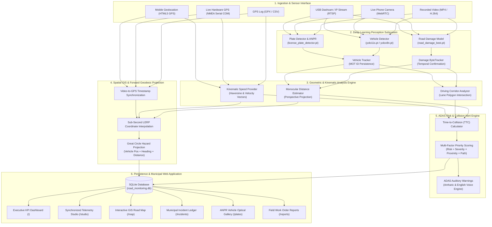

# RoadEye Enterprise: Intelligent Road Monitoring & Collision Avoidance Platform

[](https://www.python.org/)
[](https://pytorch.org/)
[](https://github.com/ultralytics/ultralytics)
[](https://opencv.org/)
[](https://flask.palletsprojects.com/)
[](https://www.sqlite.org/)
[](https://leafletjs.com/)
[]()

> **Author & Lead Developer**: **Haile Sintayehu** ([@haile6](https://github.com/haile6))  
> **Contact**: `hailesintayehu113@gmail.com`  
> **Repository**: [haile6/intelligent-road-monitoring-system](https://github.com/haile6/intelligent-road-monitoring-system)  
> **Architecture**: Multi-Task Vision-Language Telemetry & Spatial GIS Infrastructure Platform  

---

## 📌 Executive Summary & Abstract

Traditional roadway surveillance relies on manual, periodic, and hazardous road surveys, resulting in delayed maintenance, accelerated structural degradation, and preventable traffic fatalities. 

**RoadEye Enterprise** is a comprehensive, production-grade computer vision and Intelligent Transportation System (ITS) platform. It processes standard dashcam footage, live mobile phone camera feeds, and USB video devices synchronized with GPS telemetry to deliver two mission-critical capabilities:
1. **Automated Municipal Road Infrastructure Management**: Geotagging, classification, and maintenance tracking for potholes, alligator cracks, and road hazards.
2. **Real-Time Advanced Driver Assistance System (ADAS)**: Perspective distance estimation, vehicle tracking, Automatic Number Plate Recognition (ANPR), trajectory corridor collision prediction, and dual-language (Amharic & English) auditory collision warnings.

---

## 🌟 Key System Capabilities

| Feature Subsystem | Technical Implementation | Practical Impact |
| :--- | :--- | :--- |
| **Neural Pavement Defect Perception** | Custom-trained YOLOv8/11 neural models on asphalt datasets. | High-confidence detection of potholes and alligator cracks under diverse lighting and weather. |
| **Multi-Object Tracking (MOT)** | ByteTrack / IoU temporal tracking with confirmation counters. | Eliminates duplicate defect reporting across video frames. |
| **Multi-Vehicle Perception & ANPR** | YOLO11s detector + YOLOv8 license plate locator + EasyOCR engine. | Identifies passenger cars, trucks, buses, motorcycles, and extracts registration plates. |
| **Monocular Distance Estimation** | Road-plane perspective projection geometry ($H, \theta, f_y$). | Measures physical distance ($Z$ in meters) without requiring expensive LiDAR hardware. |
| **Trajectory Corridor Analysis** | Dynamic vehicle lane polygon intersection. | Filters out off-path hazards; flags objects on a direct collision path with the host vehicle. |
| **Kinematic Collision Engine (TTC)** | $\text{TTC} = d / v_{\text{approach}}$ evaluated against braking envelopes. | Classifies threat levels: **Safe**, **Caution**, **Warning**, and **Immediate Danger**. |
| **Real-Time Live Video & Dashcam** | WebRTC in-browser capture, USB webcam, and RTSP/HTTP IP streams. | Works in real vehicles using mounted smartphones, USB dashcams, or IP cameras. |
| **Spatial GIS Synchronization** | Sub-second GPS LERP interpolation + Great Circle forward projection. | Projects exact geographic coordinates ($\text{Lat}, \text{Lon}$) for every detected defect. |
| **Synchronized Telemetry Studio** | Split-view dashboard: Dashcam video (top) + Live Leaflet map (bottom). | Live vehicle position marker, pulsing hazard beacon, laser trajectory line, and coordinate telemetry. |
| **Dual-Language ADAS Alerts** | Web Audio API tone synthesis + Web Speech API (English & Amharic). | Instant spoken collision warnings: *"Danger! Pothole in path, 8 meters!"* / *"አስቸኳይ አደጋ! በመንገዱ ላይ ጉድጓድ ተገኝቷል!"* |
| **Municipal Web Management Panel** | Full-stack Flask + SQLite + Leaflet OpenStreetMap suite. | KPI executive dashboard, work order management, incident ledger, and printable inspection reports. |

---

## 🏗️ System Architecture



---

## 📹 Real-Time Live Video & In-Vehicle Dashcam Deployment

RoadEye Enterprise supports **real-world live video streams** through three deployment modes:

### Mode 1: Browser-Based Live Smartphone Dashcam (Recommended for In-Car Use)
*Zero terminal commands required. Turns any iPhone or Android phone into an intelligent dashcam.*

1. Connect your smartphone and laptop/server to the same Wi-Fi network or phone mobile hotspot.
2. Open your smartphone's browser (Safari or Chrome) and navigate to the local network URL displayed in the server terminal:
   ```text
   http://<YOUR_COMPUTER_LAN_IP>:8080/studio
   # Example: http://192.168.137.131:8080/studio
   ```
3. Mount the phone onto your car's windshield dashboard mount facing the road.
4. Tap the red button on the toolbar: **`Live Phone / Web Camera`**.
5. Grant Camera & Location permissions:
   - **Camera**: Automatically selects the phone's **rear-facing environment camera** (`facingMode: 'environment'`).
   - **GPS**: Activates device geolocation (`navigator.geolocation`) in **high-accuracy mode** to capture real-time latitude, longitude, and driving speed.
6. **Live Execution**:
   - Frames are streamed to the neural detector.
   - Bounding boxes and estimated distances are rendered live over the camera feed.
   - When a pothole appears ahead, the system computes its geographic destination coordinates, adds a pulsing red marker and dashed trajectory line to the live map below, and sounds the ADAS voice alert through the phone speakers.

---

### Mode 2: High-Performance CLI with USB Dashcam or Built-in Webcam
*Designed for laptops or onboard edge computers (NVIDIA Jetson, Intel NUC) mounted inside inspection vehicles.*

Plug your USB dashcam into your computer and execute:
```bash
# Use built-in laptop camera or primary webcam (device index 0)
python run_integrated.py --source 0 --show

# Use external USB dashcam (device index 1)
python run_integrated.py --source 1 --show
```
- Performs full YOLOv8 defect detection, vehicle tracking, perspective distance calculation, and auditory beeps at native camera frame rates.
- Press **`Q`** at any time to gracefully terminate the stream, write the master annotated video to `outputs/final_integrated_video.mp4`, and record all incidents in SQLite.

---

### Mode 3: Wireless Smartphone IP Stream (RTSP / HTTP)
*Broadcasts video over local Wi-Fi from standard camera streaming apps.*

1. Install **IP Webcam** (Android) or **DroidCam** (iOS / Android) on your smartphone.
2. Mount the phone on the windshield and start the streaming server in the app.
3. The app displays an address such as `http://192.168.43.1:8080/video`.
4. Run the integrated pipeline pointing directly to the wireless video URL:
```bash
python run_integrated.py --source "http://192.168.43.1:8080/video" --show
```

---

### Hardware GPS Receiver Interface (`gps/real_gps_reader.py`)
For enterprise municipal fleets, the platform connects to physical USB/Serial GPS receivers (e.g., **u-blox NEO-M8N**, **GlobalSat BU-353**, **Garmin GPS**):
- Automatically reads serial NMEA 0183 sentences (`$GPRMC` and `$GNRMC`).
- Parses true ground speed, heading azimuth, latitude, and longitude at 1.0–10.0 Hz.
- Operates offline in rural environments with no cellular data required.

---

## 🔬 Mathematical Foundations & Algorithms

### 1. Monocular Perspective Distance Estimation
Without requiring costly LiDAR or stereo cameras, physical ground-plane distance $Z$ (meters) is computed from 2D pixel coordinates $(u, v)$ on the image plane:
- Camera Mounting Height: $H$ (meters above ground level)
- Camera Optical Pitch Angle: $\theta$ (radians below the horizon)
- Vertical Field of View: $\text{FOV}_v$
- Image Height: $h_{\text{img}}$ pixels

The focal length in pixels is:
$$f_y = \frac{h_{\text{img}}}{2 \cdot \tan\left(\frac{\text{FOV}_v}{2}\right)}$$

The horizon row $y_{\text{horizon}}$ is:
$$y_{\text{horizon}} = \frac{h_{\text{img}}}{2} - f_y \cdot \tan(\theta)$$

For any detected bounding box with bottom edge $y_{\text{contact}}$:
$$Z = \frac{H}{\tan\left(\theta + \arctan\left(\frac{y_{\text{contact}} - h_{\text{img}}/2}{f_y}\right)\right)}$$

---

### 2. Time-To-Collision (TTC) Dynamic Kinematics
For any obstacle detected within the vehicle's driving corridor:
$$\text{TTC} = \frac{d_{\text{obstacle}}}{v_{\text{approach}}}$$
Where $d_{\text{obstacle}}$ is the estimated distance (m) and $v_{\text{approach}}$ is the closing velocity (m/s).

Classification thresholds:
$$\text{Risk Level} = \begin{cases} 
\textbf{Immediate Danger} & \text{if } \text{TTC} \le 1.8\text{ s} \quad (\text{Red Banner + ADAS Voice Alert}) \\ 
\textbf{Warning} & \text{if } 1.8\text{ s} < \text{TTC} \le 3.5\text{ s} \quad (\text{Orange Banner}) \\ 
\textbf{Caution} & \text{if } 3.5\text{ s} < \text{TTC} \le 6.0\text{ s} \quad (\text{Yellow Banner}) \\ 
\textbf{Safe / Clear} & \text{if } \text{TTC} > 6.0\text{ s} \quad (\text{Green Banner}) 
\end{cases}$$

---

### 3. Spatial GIS Synchronization (The Real-World Highway Case)

Consider an inspection vehicle traveling along an Ethiopian highway:
```text
[ Vehicle with Dashcam & GPS ] ========= 12 meters =========> [ Pothole on Road ]
 (Current Vehicle GPS: Lat A, Lon A)                           (Projected: Lat B, Lon B)
```

The system executes a 4-step spatial transformation:
1. **Timestamp Synchronization**: Aligns high-frequency video frames (24–30 FPS, $\Delta t \approx 0.033\text{s}$) with GPS records (1.0 Hz, $\Delta t = 1.0\text{s}$).
2. **Sub-Second Linear Interpolation (LERP)**:  
   For a detection occurring at $t = 10.4\text{s}$ between GPS fixes $t_1 = 10.0\text{s}$ and $t_2 = 11.0\text{s}$:
   $$f = \frac{10.4 - 10.0}{11.0 - 10.0} = 0.4$$
   $$\text{Lat}_{\text{vehicle}} = \text{Lat}_1 + f \cdot (\text{Lat}_2 - \text{Lat}_1)$$
   $$\text{Lon}_{\text{vehicle}} = \text{Lon}_1 + f \cdot (\text{Lon}_2 - \text{Lon}_1)$$
3. **Compass Bearing Vector**:  
   Computes vehicle travel direction azimuth $\beta$ ($0^\circ = \text{North}, 90^\circ = \text{East}, 180^\circ = \text{South}, 270^\circ = \text{West}$).
4. **Great Circle Destination Formula (`damage_location`)**:  
   Projects the pothole's physical coordinates using the angular distance $\delta = d / R$ (where $R \approx 6,371,000\text{ m}$):
   $$\phi_2 = \arcsin\left(\sin(\phi_1)\cos(\delta) + \cos(\phi_1)\sin(\delta)\cos(\beta)\right)$$
   $$\lambda_2 = \lambda_1 + \arctan2\left(\sin(\beta)\sin(\delta)\cos(\phi_1),\, \cos(\delta) - \sin(\phi_1)\sin(\phi_2)\right)$$

---

## 🖥️ Telemetry Studio: Synchronized Split-View & Map Interface

The **Telemetry Studio** (`/studio`) features an integrated split-view designed for in-vehicle and control-room monitoring:

```text
+-------------------------------------------------------------------------+
| [VIDEO PLAYER: Dashcam Footage / Live WebRTC Stream]                   |
|                                                                         |
|  [ HUD GLASSMORPHISM OVERLAY ]                                          |
|  [IMMEDIATE DANGER] POTHOLE #56 [IN PATH]                               |
|  Dist: ~2.9m | TTC: 0.3s | Corridor: CRITICAL | Speed: 30 km/h           |
|  📍 Hazard Location: 9.125009° N, 39.125029° E                          |
+-------------------------------------------------------------------------+
| [LIVE SYNCHRONIZED OPENSTREETMAP CORRIDOR]                             |
|                                                                         |
|  (Vehicle Pin) • • • • - - - - [Laser Dashed Line] - - - - > [⚠️ POTHOLE]
|  Lat: 9.124991, Lon: 39.125010                Lat: 9.125009, Lon: 39.125029
|                                                                         |
|  [🚨 POTHOLE DETECTED AHEAD • Lat 9.125009, Lon 39.125029 • 2.9m]      |
+-------------------------------------------------------------------------+
```

### Visual Highlights During Playback:
- **Vehicle Position Marker**: A glowing blue marker smoothly animates along the roadway corridor in real time.
- **Active Pothole Marker**: When a hazard appears, a pulsing red target with animated radar rings pops up directly at the pothole's geographic coordinates.
- **Dashed Laser Line**: Connects the vehicle marker to the pothole ahead to visualize the approach trajectory.
- **Map Toolbar Indicator**: Displays `POTHOLE: 9.125009, 39.125029 (2.9m)`.
- **Intelligent Auto-Pan**: Centers the view between the vehicle and the hazard so the driver or operator never loses sight of the road defect.

---

## 📁 Repository Directory Structure

```text
intelligent-road-monitoring-system/
├── config.py                 # Centralized configuration (FOV, thresholds, camera tilt)
├── run_web.py                # Main launcher for Web Management Platform & REST APIs
├── run_integrated.py         # Unified one-pass perception, tracking & collision pipeline
│
├── run_phase1.py             # Phase 1: Pure YOLO Road Damage Detection
├── run_phase2.py             # Phase 2: Damage Multi-Object Tracking & Confirmation
├── run_phase3.py             # Phase 3: Multi-Vehicle Detection & Tracking
├── run_phase4.py             # Phase 4: Driving Corridor & Trajectory Analysis
├── run_phase5.py             # Phase 5: Monocular Distance Estimation
├── run_phase6.py             # Phase 6: GPS Telemetry Synchronization & Geotagging
├── run_phase6_with_plates.py # Phase 6B: License Plate Detection (ANPR)
├── run_phase7.py             # Phase 7: Kinematic Speed Provider & Plate Association
├── run_phase7_speed.py       # Phase 7B: Alternate Speed Pipeline
├── run_phase8.py             # Phase 8: Dynamic Time-To-Collision (TTC) Engine
├── run_phase9.py             # Phase 9: Unified Multi-Tier Risk Classification
│
├── check_distance.py         # Interactive calibration tool for camera distance validation
├── gpx_to_csv.py             # Telemetry parser converting GPX traces into synchronized CSV
├── package_project.py        # Automated clean packaging script for project submission
│
├── detection/                # Deep Learning Perception Subsystem
│   ├── __init__.py           # Formal package exports
│   ├── road_damage_detector.py # Custom YOLOv8/11 road damage inference wrapper
│   ├── vehicle_detector.py   # Multi-class vehicle inference wrapper
│   └── tracker.py            # IoU-based temporal tracking & confirmation engine
│
├── risk/                     # Spatial Risk & Collision Analytics
│   ├── __init__.py           # Formal package exports
│   ├── distance_estimator.py # Monocular road-plane perspective projection
│   ├── path_analyzer.py      # Driving corridor polygon intersection
│   ├── ttc_calculator.py     # Kinematic Time-To-Collision computing
│   ├── risk_analyzer.py      # Multi-factor hazard classification
│   ├── priority_weight.py    # Infrastructure maintenance priority scoring
│   └── severity_estimator.py # Pavement degradation severity heuristic
│
├── gps/                      # Geodesic & Telemetry Synchronization
│   ├── __init__.py           # Formal package exports
│   ├── gps_reader.py         # CSV & NMEA telemetry reader with caching
│   ├── gps_sync.py           # Sub-second video-to-GPS timestamp interpolation
│   ├── speed_provider.py     # Speed calculation from GPS deltas
│   ├── geo.py                # Haversine distance & Great Circle bearing calculations
│   ├── real_gps_reader.py    # Serial COM port interface for hardware GPS receivers
│   └── folium_map.py         # Standalone HTML Leaflet map generator
│
├── database/                 # Relational Data Persistence Layer
│   ├── __init__.py           # Formal package exports
│   ├── db_manager.py         # SQLite connection manager, schema migrations, REST queries
│   └── road_monitoring.db   # Auto-created relational database
│
├── alerts/                   # Auditory ADAS Warning Subsystem
│   ├── __init__.py           # Formal package exports
│   ├── audio_warning.py      # Multi-tone ADAS sound generator & audio muxer
│   └── voice_clips/          # Synthesized spoken audio warnings
│
├── visualization/            # Telemetry Rendering & Video Overlays
│   ├── __init__.py           # Formal package exports
│   └── overlay.py            # High-FPS HUD telemetry, corridor polygons, and banners
│
├── models/                   # Pretrained Deep Learning Weights
│   ├── road_damage_best.pt   # Custom-trained YOLO road damage model (Potholes, Cracks)
│   ├── yolo11s.pt            # YOLO11s multi-vehicle detection model
│   └── license_plate_detector.pt # YOLOv8 ANPR license plate bounding box model
│
├── web/                      # Enterprise Web Management Platform
│   ├── __init__.py           # Formal package exports
│   ├── app.py                # Flask application, REST endpoints, and live frame handlers
│   ├── static/               # CSS, JS, audio, PWA manifest
│   └── templates/            # Modern, responsive Jinja2 HTML5 templates
│       ├── base.html         # Master layout with sidebar navigation & telemetry status
│       ├── dashboard.html    # Executive KPI cards & Chart.js breakdown
│       ├── studio.html       # Video telemetry studio with split-view map & live camera
│       ├── map.html          # Interactive Leaflet GIS road map with hazard markers
│       ├── incidents.html    # Incident ledger with maintenance dispatch workflows
│       ├── plates.html       # ANPR license plate optical evidence gallery
│       ├── pipeline.html     # Browser-based AI pipeline runner with live log streaming
│       ├── reports.html      # Printable municipal work orders & CSV data export
│       ├── calibration.html  # Interactive camera pitch, FOV, and height tuner
│       ├── health.html       # Real-time system hardware, GPU, and model diagnostics
│       ├── audit.html        # Immutable system event & security audit log
│       └── settings.html     # Platform configuration & alert sensitivity preferences
│
├── data/                     # Input Video & GPS Telemetry Data
├── outputs/                  # Generated Master Videos, CSV Reports & Plate Crops
├── requirements.txt          # Python environment dependencies
└── Procfile                  # Production deployment WSGI entry point
```

---

## 💻 Web Management Platform: Page Breakdown

| Page | URL Path | Key Functionality |
| :--- | :--- | :--- |
| **Executive Dashboard** | `/` | Real-time KPI summaries (Total Hazards, Critical Incidents, Monitored Vehicles), Chart.js hazard breakdown, and recent alert feed. |
| **Telemetry Studio** | `/studio` | Dual-view video player synchronized with hazard timeline, frame scrubber, live mobile camera mode, and split-view GIS map. |
| **GIS Road Map** | `/map` | OpenStreetMap/Leaflet visualization displaying the vehicle's GPS track corridor with color-coded pins for potholes and alligator cracks. |
| **Incidents & Repairs** | `/incidents` | Complete municipal maintenance workflow: filter by severity, update status (`Reported` $\to$ `Scheduled` $\to$ `Repaired`), assign crews, and log notes. |
| **ANPR Vehicles Gallery**| `/plates` | Visual optical evidence gallery showing high-resolution vehicle crops, plate crops, confidence ratings, and timestamps. |
| **AI Pipeline Runner** | `/pipeline` | Execute Phase 1 through Phase 9 or the Unified Pipeline directly from the web browser with real-time SSE console output. |
| **Work Orders & Reports**| `/reports` | Printable, formatted municipal work order sheets ready for field repair crews, plus one-click CSV dataset export. |
| **Sensor Calibration** | `/calibration` | Fine-tune camera parameters ($H$, $\theta$, $\text{FOV}_v$), preview ground-plane projections, and save profiles. |
| **System Diagnostics** | `/health` | Live diagnostic badges for YOLO models, GPU/CUDA acceleration, memory utilization, and database integrity. |
| **Audit Ledger** | `/audit` | Chronological record of user interactions, repair status transitions, pipeline runs, and configuration adjustments. |

---

## 🚀 Quickstart & Installation

### 1. Prerequisites
- **Operating System**: Windows 10/11, Ubuntu 20.04+, or macOS
- **Python**: Version `3.10` or higher
- **Hardware**: Runs on standard CPU; NVIDIA GPU with CUDA recommended for high-frame-rate inference.

### 2. Clone and Setup Environment
```bash
# Clone the repository
git clone https://github.com/haile6/intelligent-road-monitoring-system.git
cd intelligent-road-monitoring-system

# Create and activate a virtual environment
# Windows (PowerShell):
python -m venv venv
.\venv\Scripts\Activate.ps1

# Linux / macOS:
python3 -m venv venv
source venv/bin/activate
```

### 3. Install Dependencies
```bash
pip install --upgrade pip
pip install -r requirements.txt
```

### 4. Verify Neural Model Weights
Ensure model weights are present in the `models/` directory:
- `models/road_damage_best.pt` (Custom Road Damage Detector)
- `models/yolo11s.pt` (Vehicle Detector)
- `models/license_plate_detector.pt` (ANPR License Plate Detector)

---

## ⚡ Execution Guide

### Option A: Launch the Web Management Platform (Recommended)
```bash
python run_web.py
```
- Automatically initializes the SQLite database.
- Detects available network ports and LAN IP for mobile streaming.
- Opens your browser to **Telemetry Studio**: **`http://127.0.0.1:8080/studio`**.

### Option B: Run the Unified All-in-One CLI Pipeline
Process video footage in a single pass with all detection, tracking, distance, GPS, and risk modules active:
```bash
# Run on default test video
python run_integrated.py

# Run on a custom video file with visual display
python run_integrated.py --source data/my_drive.mp4 --show

# Run on live USB webcam / laptop camera (device 0)
python run_integrated.py --source 0 --show

# Run on wireless mobile phone IP camera stream
python run_integrated.py --source "http://192.168.1.50:8080/video" --show
```

### Option C: Run Step-by-Step Individual Phases
Each phase can be tested independently for modular verification:
```bash
python run_phase1.py   # Phase 1: Road Damage Detection (YOLO)
python run_phase2.py   # Phase 2: Damage Multi-Object Tracking & Confirmation
python run_phase3.py   # Phase 3: Multi-Vehicle Detection & Tracking
python run_phase4.py   # Phase 4: Path Corridor & Lane Analysis
python run_phase5.py   # Phase 5: Monocular Distance Estimation
python run_phase6.py   # Phase 6: GPS Geotagging & Route Synchronization
python run_phase7.py   # Phase 7: GPS Speed Provider & Plate Association
python run_phase8.py   # Phase 8: Dynamic Time-To-Collision (TTC) Engine
python run_phase9.py   # Phase 9: Unified Multi-Tier Risk Classification
```

---

## 🗄️ Relational Database Schema (`road_monitoring.db`)

The SQLite database is structured into 5 normalized tables:

### `incidents` (Municipal Road Hazards)
| Column | Type | Description |
| :--- | :--- | :--- |
| `id` | INTEGER PRIMARY KEY | Unique record identifier |
| `track_id` | INTEGER | Persistent tracker ID across video frames |
| `damage_type` | TEXT | Hazard category (`pothole`, `alligator_crack`) |
| `confidence` | REAL | Peak neural detection confidence (0.00 – 1.00) |
| `severity` | TEXT | Structural severity (`Low`, `Medium`, `Severe`) |
| `max_risk_level` | TEXT | Dynamic risk (`SAFE`, `CAUTION`, `WARNING`, `IMMEDIATE_DANGER`) |
| `distance_m` | REAL | Estimated distance at point of confirmation (meters) |
| `ttc_seconds` | REAL | Time-To-Collision in seconds |
| `ever_in_path` | INTEGER | Flag (0 or 1) indicating vehicle collision trajectory |
| `latitude` / `longitude` | REAL | Geotagged vehicle coordinates at detection time |
| `damage_latitude` / `damage_longitude` | REAL | Estimated geographic coordinates of the defect |
| `speed_kmh` | REAL | Vehicle velocity at encounter |
| `status` | TEXT | Workflow status (`Reported`, `Scheduled`, `Repaired`) |
| `assigned_crew` | TEXT | Assigned municipal maintenance crew |
| `repair_priority` | TEXT | Maintenance priority (`Low`, `Medium`, `High`, `Critical`) |

---

## 📦 Project Submission Packaging

To generate a clean, production-grade ZIP archive ready for academic or institutional submission:
```bash
python package_project.py
```
This utility automatically:
- Scans all project code, templates, and neural models.
- Strips out `__pycache__`, virtual environments (`venv/`), `.git/`, and temporary video caches.
- Compresses the archive into `road_monitoring_system_complete.zip` (204.49 MB) ready for submission.

---

## 👥 Authors & Academic Attribution

- **Lead Developer & Principal Researcher**: **Haile Sintayehu**
- **GitHub**: [@haile6](https://github.com/haile6)
- **Email**: `hailesintayehu113@gmail.com`
- **Project**: Intelligent Road Surveillance, Pavement Hazard Management & Collision Avoidance Platform

---

## 📄 License

This project is licensed under the **MIT License**. You are free to inspect, modify, and distribute this platform for academic, research, and municipal transportation applications.
