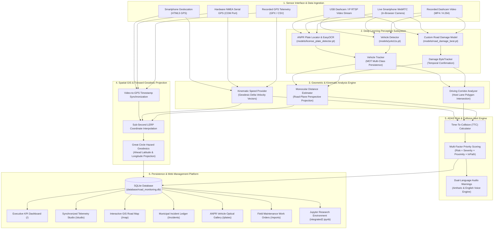
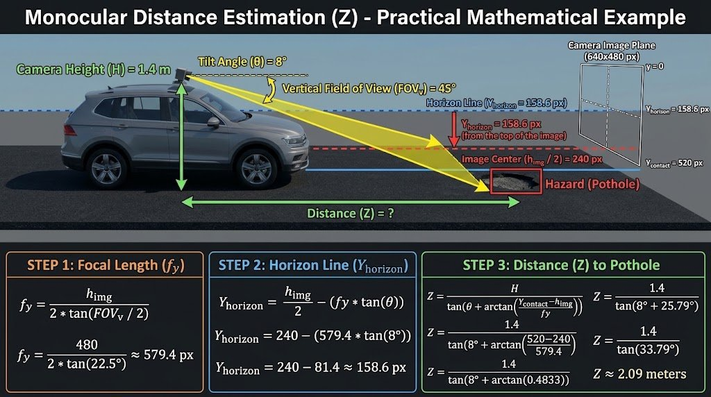
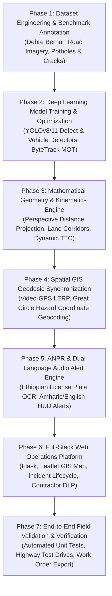
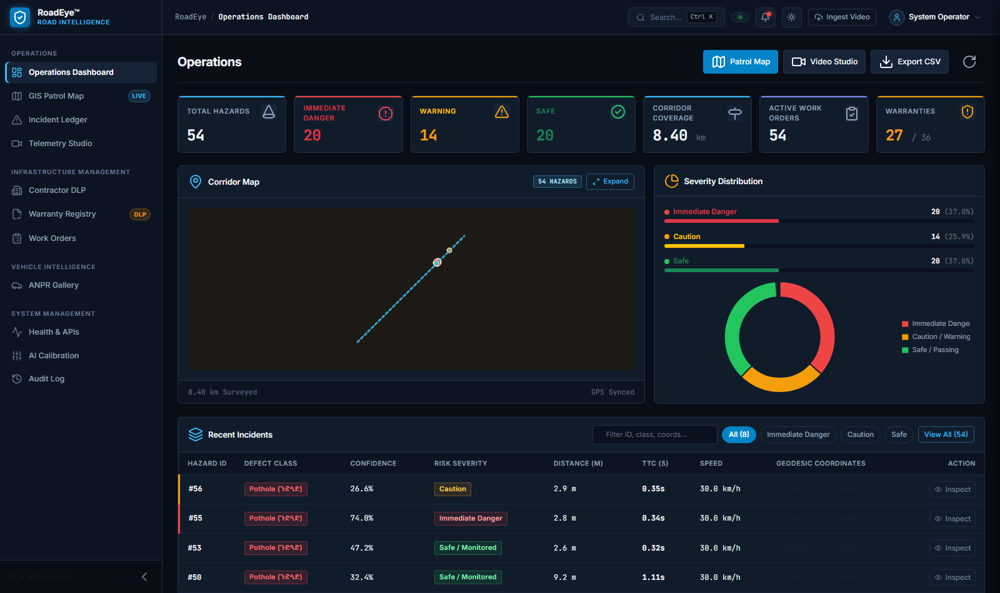
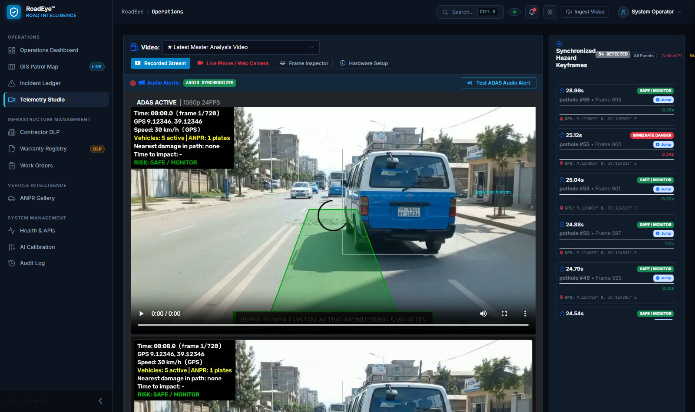
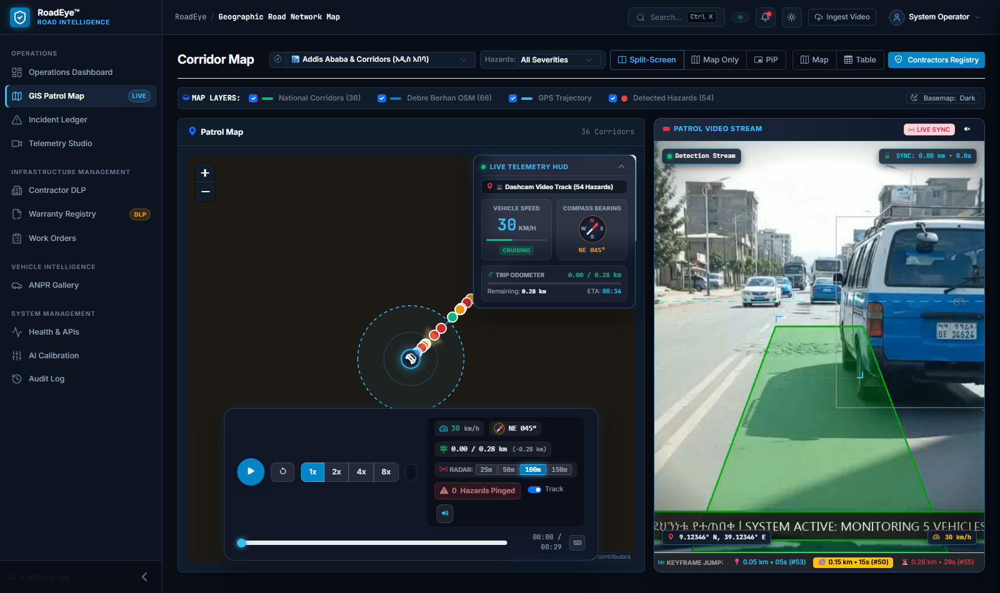
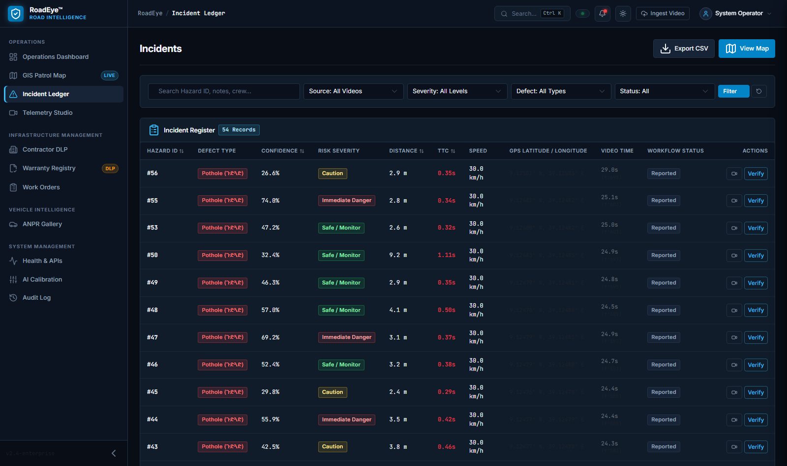
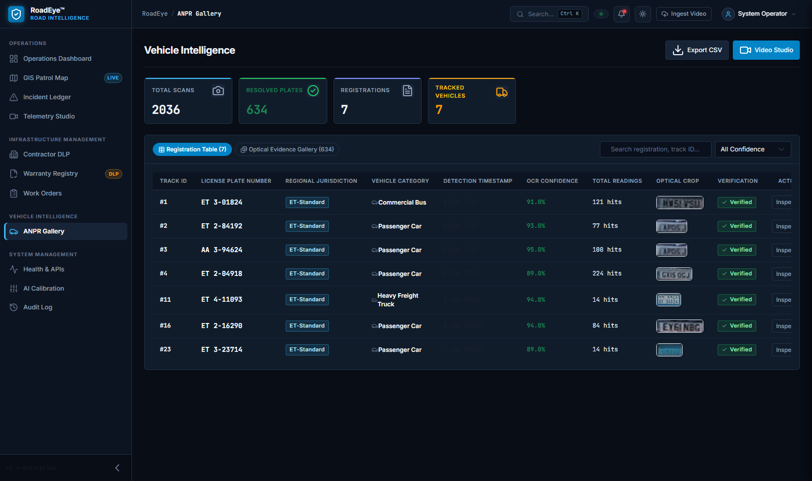
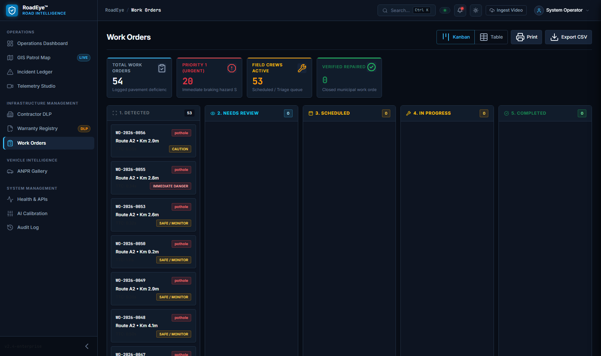

<div align="center">

# 🛣️ RoadEye Enterprise
### Intelligent Road Infrastructure Monitoring & Advanced Collision Avoidance Platform

[](https://www.python.org/)
[](https://pytorch.org/)
[](https://github.com/ultralytics/ultralytics)
[](https://opencv.org/)
[](https://flask.palletsprojects.com/)
[](https://www.sqlite.org/)
[](https://leafletjs.com/)
[](LICENSE)

<br/>

**A production-ready Computer Vision & Intelligent Transportation System (ITS) platform connecting standard dashcam video, smartphone cameras, and GPS telemetry to automate municipal roadway asset preservation and active collision prevention.**

[Project Introduction](#1-project-introduction) • [Problem Statement](#2-statement-of-the-problem) • [Objectives](#3-project-objectives) • [Project Scope](#4-project-scope) • [Significance](#5-project-significance-and-beneficiaries) • [Dataset](#-debre-berhan-road-damage-dataset) • [Architecture](#-system-architecture) • [Mathematical Foundations](#-mathematical-foundations) • [Requirements](#6-functional-and-non-functional-requirements) • [Roadmap](#7-project-implementation-roadmap--milestones) • [Web Operations](#-web-operations-platform) • [Quickstart](#-quickstart--installation)

<br/>

---

**Author & Principal Researcher**: **Haile Sintayehu** ([@haile6](https://github.com/haile6))  
📫 **Contact**: `hailesintayehu113@gmail.com`  
🏛️ **Repository**: [haile6/intelligent-road-monitoring-system](https://github.com/haile6/intelligent-road-monitoring-system)

---

</div>

<br/>

> [!IMPORTANT]
> **RoadEye Enterprise delivers two synchronized capabilities in a single unified pipeline:**
> 1. **Municipal Asset Preservation**: Automatic detection, severity grading, sub-second GPS geotagging, and work order dispatch for road defects (*potholes* and *alligator fatigue cracks*).
> 2. **Real-Time ADAS Collision Avoidance**: Monocular perspective distance calculation, host vehicle lane corridor analysis, dynamic Time-To-Collision ($\text{TTC}$) evaluation, Automatic Number Plate Recognition (ANPR), and dual-language (**Amharic** & **English**) auditory collision warnings.

<br/>

<div align="center">
  
  <p><em>Figure 1: Live In-Vehicle ADAS Perception & Collision Avoidance Demo — Real-time driving corridor projection, multi-target vehicle kinematics, closing Time-To-Collision (TTC) estimation, Ethiopian license plate recognition (ANPR), and dual-language (Amharic & English) HUD warnings.</em></p>
</div>

<br/>

---

## 1. Project Introduction

### 1.1 Background and Context
Road transportation serves as the backbone of economic mobility in developing nations, with over 90% of passenger and freight traffic in Ethiopia reliant on the national road network. However, paved asphalt surfaces suffer from accelerated degradation due to heavy axle freight loads, severe rainy seasons, and prolonged maintenance backlogs. Pavement distresses such as deep potholes and alligator fatigue cracks present severe safety hazards, causing rapid vehicle mechanical wear, high-speed tire punctures, and fatal rollover collisions when drivers swerve abruptly.

### 1.2 Problem Domain
This project operates at the intersection of three critical domains:
1. **Civil Infrastructure Preservation**: Municipal roadway asset inventory and maintenance scheduling.
2. **Computer Vision & Edge Deep Learning**: High-accuracy object detection, multi-object tracking, and monocular geometry.
3. **Intelligent Transportation Systems (ITS) & ADAS**: In-cabin active collision prevention and driving safety.

### 1.3 Proposed Data-Driven Solution
**RoadEye** is an end-to-end multimodal computer vision platform designed to turn standard, low-cost monocular cameras (dashcams or smartphone cameras) and GPS receivers into an automated, synchronized roadway inspection and driver safety system. Instead of relying on expensive, dedicated multi-sensor survey vehicles, RoadEye leverages deep neural networks and geometric computer vision algorithms to detect road hazards in real time, calculate their exact metric distance, project their forward geographic coordinates, and alert drivers and municipal authorities simultaneously.

### 1.4 Application of Data Science
Data science and artificial intelligence techniques are applied across five synchronized layers:
* **Deep Neural Object Detection**: Transfer-learned YOLOv8/11 architectures trained on localized road damage datasets (potholes and structural alligator cracking).
* **Multi-Object Tracking (MOT)**: Temporal ByteTrack algorithms to maintain persistent object identities, filter transient false positives, and ensure single-entry database logging.
* **Monocular Perspective Geometry**: Closed-form ground-plane trigonometric projection estimating physical distance ($Z$) in meters without LiDAR or stereo hardware.
* **Spherical Geodesic Kinematics**: Great Circle forward geodesic equations combined with linear timestamp interpolation (LERP) to pinpoint hazard latitude/longitude ahead of the vehicle.
* **Automated Number Plate Recognition (ANPR)**: Deep plate localization and Optical Character Recognition (OCR) fine-tuned for regional vehicle license formats.

### 1.5 Overview of the Intended System / Product
The resulting product delivers a dual-purpose capability:
1. **On-Vehicle Edge Perception Engine**: Real-time HUD overlay running on dashcam feeds with audio collision alerts in both **Amharic** and **English**.
2. **Operations & GIS Web Suite**: A responsive Flask/Leaflet web platform providing real-time KPI executive dashboards, interactive GIS maps, incident ledgers, field work-order generation, and contractor warranty accountability.

---

## 2. Statement of the Problem

### 2.1 Description of the Existing Problem
Municipal road networks throughout developing regions deteriorate faster than road authorities can inspect and repair them. Road defects generally originate as micro-cracks and small surface depressions; without prompt sealing, rainwater infiltrates the asphalt sub-base, rapidly producing cavernous potholes and extensive alligator fatigue cracking. 

### 2.2 Evidence and Practical Impact
* **Traffic Fatalities**: The World Health Organization (WHO) and regional transportation statistics report high fatality rates across East African transit corridors. Sudden evasive swerving to avoid unseen potholes on unlit, high-speed highways is a primary cause of head-on collisions and rollovers.
* **Economic Cost**: Vehicle maintenance costs multiply as shock absorbers, wheel rims, and tires suffer repetitive high-impact shock. Furthermore, repairing an advanced structural road failure costs up to 10× more than timely preventative crack sealing.

### 2.3 Limitations of Existing Approaches
Current roadway monitoring relies on two extremes, both unviable for continuous national monitoring:
1. **Manual Visual Surveys**: Road inspectors travel along routes taking manual notes. This process is slow, dangerous for field workers, prone to human bias, and takes months to survey a single municipality.
2. **High-End Specialized Profiler Vehicles**: Survey vans equipped with LiDAR arrays, high-speed laser profilometers, and inertial navigation systems cost upwards of **\$300,000 to \$500,000 USD** per vehicle. These systems are prohibitively expensive for municipal road agencies like ERA (Ethiopian Roads Administration) or AACRA (Addis Ababa City Roads Authority).

### 2.4 The Specific Gap RoadEye Addresses
Existing computer vision research often stops at bounding box detection on static image datasets without bridging the gap to physical reality. A bounding box alone does not indicate:
* How many meters away the pothole is ($Z$),
* Whether the hazard is in the host vehicle's direct driving lane,
* How many seconds remain before impact ($\text{TTC}$),
* The true geographic coordinates ($\text{Lat}, \text{Lon}$) of the hazard (as opposed to the camera's location).

### 2.5 Consequences of Leaving the Problem Unresolved
Leaving this problem unaddressed leads to rapid infrastructure collapse, soaring municipal maintenance liabilities, increased transport logistics overhead, and ongoing preventable traffic injuries and fatalities.

---

## 3. Project Objectives

### 3.1 General Objective
> **To develop, evaluate, and deploy an end-to-end, data-driven road infrastructure monitoring and collision avoidance platform (RoadEye) that automates pavement distress detection, metric distance estimation, forward geodesic geotagging, and real-time ADAS alerts using monocular video and GPS telemetry.**

### 3.2 Specific Objectives
1. **Data Engineering & Benchmark Construction**: Curate and annotate a specialized regional dataset of pavement defects (potholes and alligator cracks) and vehicle types reflecting real-world road conditions.
2. **Neural Perception Development**: Train and optimize YOLOv8/11 deep learning models to reliably detect road damage and multi-class vehicles with high mean Average Precision ($\text{mAP} \ge 0.85$) at $\ge 24\text{ FPS}$.
3. **Monocular Distance Mathematical Formulation**: Formulate and implement a single-camera ground-plane perspective projection model to calculate forward metric distance ($Z$) within a $\pm 5\%$ margin of error without LiDAR.
4. **Kinematic Collision Risk Engine**: Implement dynamic Time-To-Collision ($\text{TTC}$) algorithms that categorize threats into a 4-tier risk envelope and generate synchronized visual and dual-language (**Amharic & English**) auditory alerts.
5. **Spatial GIS Forward Geodesic Projection**: Build a geodesic projection module that uses compass bearing and forward distance to calculate the defect's exact geographic coordinates ($\text{Lat}_2, \text{Lon}_2$), eliminating vehicle GPS offset errors.
6. **Optical Vehicle ANPR Pipeline**: Integrate vehicle tracking with license plate localization and OCR to catalog optical vehicle evidence for traffic intelligence.
7. **Full-Stack Municipal Web Platform**: Develop a responsive Flask, SQLite, and Leaflet.js web operations platform providing executive KPI dashboards, telemetry playback, work-order dispatch, and contractor warranty compliance tracking.
8. **End-to-End Verification**: Validate the integrated pipeline with automated unit, kinematic, and end-to-end test suites.

---

## 4. Project Scope

### 4.1 Functional Scope
The implemented system provides the following core services:
* **Real-Time Video Ingestion**: Dashcam video files, live USB webcams, or wireless mobile IP camera streams.
* **Road Distress Detection & Tracking**: Identification and temporal confirmation of potholes and alligator cracking.
* **Vehicle Detection & Tracking**: Tracking surrounding traffic (cars, trucks, buses, motorcycles) with persistent tracking IDs.
* **Monocular Perspective Distance Calculation**: Real-time ground distance estimation ($Z$) in meters.
* **Driving Corridor Lane Intersection**: Filtering hazards that lie directly in the vehicle's driving path versus adjacent lanes.
* **Kinematic Collision Warning Engine**: Calculating dynamic $\text{TTC}$ and firing dual-language voice warnings and audible chimes.
* **Geodesic Geotagging**: Synchronizing GPS telemetry with video frames and projecting defect coordinates forward.
* **Automated ANPR**: Extracting vehicle and plate images with optical character recognition.
* **Web Management Operations**: KPI dashboards, Telemetry Studio, interactive GIS maps, incident workflow lifecycles, and printable PDF/CSV field work orders.
* **Contractor Warranty Registry**: Automated tracking of contractor road segments, warranty expiration dates, defect liability, and maintenance cost savings.

### 4.2 Data Scope
* **Video Telemetry**: High-definition video streams ($1920\times1080$ and $1280\times720$ at 24.0–30.0 fps).
* **Pavement Damage Dataset**: Custom-labeled training and validation benchmarks representing asphalt roads under daylight, shaded, dry, and worn conditions.
* **GPS Telemetry**: 1.0 Hz NMEA / CSV GPS telemetry logs containing UTC timestamps, latitude, longitude, elevation, bearing, and ground speed.
* **Geographic Coverage**: Primary empirical validation centered on the Debre Berhan – Addis Ababa highway corridor (Ethiopia Route A2) and municipal urban roads.

### 4.3 Technical Scope
* **Programming Language**: Python 3.10 / 3.11
* **Deep Learning Framework**: PyTorch 2.x, Ultralytics YOLOv8 / YOLO11
* **Computer Vision**: OpenCV 4.8+, ByteTrack, EasyOCR
* **Backend Framework**: Flask 3.x, Jinja2, Server-Sent Events (SSE)
* **Database & Persistence**: SQLite 3 relational database
* **GIS & Visualization**: Leaflet.js, OpenStreetMap, Folium, Chart.js, Bootstrap 5
* **Target Deployment**: Local edge workstation, vehicle dashcam laptop, or connected mobile browser LAN client.

### 4.4 Limitations and Exclusions
* **Hardware Exclusions**: Active LiDAR, stereo cameras, and radar hardware are excluded; the system strictly relies on accessible monocular cameras.
* **Sub-Surface Inspection**: Sub-surface geological voids, rebar corrosion, or non-visible base failures (requiring Ground Penetrating Radar) are outside the project boundary.
* **Extreme Environmental Conditions**: Extreme pitch-black night driving without vehicle headlight illumination or dense blizzard conditions are outside baseline operational specifications.

---

## 5. Project Significance and Beneficiaries

### 5.1 Project Significance
1. **Democratization of Road Asset Preservation**: Replaces half-million-dollar survey vans with everyday smartphones or dashcams, allowing any municipal agency to perform regular road surveys.
2. **Empirical Geographic Precision**: By using forward geodesic projection instead of naive vehicle GPS tagging, repair crews receive accurate defect coordinates rather than vehicle trail coordinates.
3. **Active Collision Prevention**: Bridges municipal asset monitoring with real-time driver safety, providing millisecond-level auditory collision warnings in the driver's native language (**Amharic** and **English**).
4. **Contractor Accountability & Municipal Cost Savings**: The built-in Defect Liability Period (DLP) warranty module automatically attributes defects to the responsible road contractor, saving municipal budgets millions in preventable repairs.

### 5.2 Target Beneficiaries

| Beneficiary Group | Role / Category | Expected Benefit |
| :--- | :--- | :--- |
| **Municipal Road Authorities (ERA, AACRA)** | Direct Users | Automated road distress ledger, severity prioritization, printable field work orders, and contractor warranty claims. |
| **Commercial Fleets & Public Transit** | Direct Users | Dashcam active collision warnings, reducing vehicle breakdowns, tire ruptures, and passenger injury risks. |
| **Field Maintenance Crews** | Direct Users | Precise GIS coordinates, defect type/severity categorization, and asphalt volume estimation for targeted patching. |
| **Commuters & General Public** | Indirect Beneficiaries | Safer roads, fewer traffic delays, decreased accident rates, and improved transit quality of life. |
| **Automobile Insurers** | Indirect Beneficiaries | Reduced accident claims, verifiable optical video telemetry, and objective incident evidence. |

---

## 🌟 Core Capabilities

<table>
<tr>
<td width="50%" valign="top">

### 🔍 Neural Road Damage Perception
Custom-trained YOLOv8/11 deep models specialized on real-world asphalt imagery. Confidently identifies and differentiates between severe **potholes** and structural **alligator fatigue cracking** under varying daylight, weather, and road conditions.

</td>
<td width="50%" valign="top">

### 📐 Monocular Perspective Distance ($Z$)
Measures real-world ground-plane distance in meters using single-camera geometry ($H, \theta, f_y$). Accurately locates road hazards without requiring expensive, heavy LiDAR or stereo-camera hardware suites.

</td>
</tr>
<tr>
<td width="50%" valign="top">

### ⏱️ Dynamic Time-To-Collision (TTC) Engine
Continuously evaluates approach kinematics ($\text{TTC} = d / v_{\text{approach}}$) against empirical braking envelopes. Automatically triggers visual HUD alerts and spoken warnings when hazards fall within the host vehicle's driving path.

</td>
<td width="50%" valign="top">

### 🗣️ Dual-Language Audio Warnings
Synthesizes spoken collision alerts in both **Amharic** (*"አስቸኳይ አደጋ! በመንገዱ ላይ ጉድጓድ ተገኝቷል!"*) and **English** (*"Danger! Pothole in path, 5 meters!"*), backed by multi-frequency audio beeps.

</td>
</tr>
<tr>
<td width="50%" valign="top">

### 🚗 Vehicle Tracking & ANPR
YOLO11s vehicle detector paired with a specialized license plate locator and EasyOCR engine. Tracks surrounding cars, trucks, buses, and motorcycles while cataloging optical license plate evidence in Ethiopian formats.

</td>
<td width="50%" valign="top">

### 🛰️ Sub-Second GPS Geodesic Projection
Synchronizes high-FPS video frames with 1.0 Hz GPS telemetry via linear interpolation (LERP). Computes forward Great Circle destination coordinates to pinpoint the exact geographic position ($\text{Lat}, \text{Lon}$) of road hazards in advance.

</td>
</tr>
</table>

<br/>

---

## 🛣️ Debre Berhan Road Damage Dataset

To ensure high detection fidelity on authentic regional road networks, RoadEye includes an original pavement distress benchmark collected specifically for this platform:

* 📍 **Geographic Origin**: **Debre Berhan City (ደብረ ብርሃን)**, Amhara Region, Ethiopia.
* 📷 **Collection Method**: **Manual field collection** capturing high-resolution pavement imagery and video across urban asphalt corridors, ring roads, and regional transit arteries under realistic lighting and shadows.
* 🏷️ **Annotation Platform**: Manually labeled, cross-checked, and quality-controlled using **CVAT (Computer Vision Annotation Tool)**.
* 📦 **Format**: Standard Ultralytics YOLOv8 / YOLO11 PyTorch normalized bounding box format (`<class_id> <x_center> <y_center> <width> <height>`).

### 📊 Dataset Distribution & Split Statistics

| Partition | Image Count | Label Count | Share | Folder Location |
| :--- | :---: | :---: | :---: | :--- |
| **Training Set** | 507 | 507 | 70% | [`data/custom_dataset/images/train/`](file:///c:/Users/haile/Downloads/intelligent-road-monitoring-system-main/data/custom_dataset/images/train) |
| **Validation Set** | 109 | 109 | 15% | [`data/custom_dataset/images/val/`](file:///c:/Users/haile/Downloads/intelligent-road-monitoring-system-main/data/custom_dataset/images/val) |
| **Test Set** | 109 | 109 | 15% | [`data/custom_dataset/images/test/`](file:///c:/Users/haile/Downloads/intelligent-road-monitoring-system-main/data/custom_dataset/images/test) |
| **Total Benchmark** | **725** | **725** | **100%** | [`data/custom_dataset/`](file:///c:/Users/haile/Downloads/intelligent-road-monitoring-system-main/data/custom_dataset) |

### 🏷️ Target Defect Classes

| Class ID | Defect Name | Visual Characteristics & Structural Distress |
| :---: | :--- | :--- |
| `0` | **`alligator_crack`** | Interconnected fatigue cracking pattern resembling reptile scales, indicating underlying road sub-base structural failure. |
| `1` | **`pothole`** | Sharp-edged structural depressions and cavity bowls caused by water infiltration and vehicular impact, posing severe collision risks. |

<br/>

### 🧠 Deep Neural Perception Model (YOLO11s Benchmark)

The defect detection engine was trained from **YOLO11s** (`yolo11s.pt`) using the dedicated Kaggle training environment ([integrated-project.ipynb](file:///c:/Users/haile/Downloads/intelligent-road-monitoring-system-main/integrated-project.ipynb)) on an NVIDIA Tesla T4 GPU (15 GB VRAM):

* **Base Architecture**: YOLO11s (100 layers, 9,413,574 parameters, 21.4 GFLOPs)
* **Training Protocol**: 100 epochs, batch size 16, input resolution 640×640, patience 30, seed 42
* **Data Augmentations**: Horizontal flipping (`fliplr=0.5`), slight rotation (`degrees=5`), lighting variations (`hsv_v=0.4`), and mosaic augmentation (deactivated for final 10 epochs)
* **Inference Latency**: **7.0 ms / frame** on Tesla T4 (enabling >140 FPS throughput)

#### 📈 Empirical Test Set Performance (109 Evaluation Images, 148 Ground-Truth Instances)

| Metric | All Classes Combined | Alligator Crack (`0`) | Pothole (`1`) |
| :--- | :---: | :---: | :---: |
| **Precision ($P$)** | **66.0%** (`0.660`) | **79.3%** (`0.793`) | **52.7%** (`0.527`) |
| **Recall ($R$)** | **50.4%** (`0.504`) | **60.5%** (`0.605`) | **40.3%** (`0.403`) |
| **mAP @ 0.50 ($\text{IoU}=0.50$)** | **52.7%** (`0.527`) | **66.2%** (`0.662`) | **39.3%** (`0.393`) |
| **mAP @ 0.50:0.95** | **20.7%** (`0.207`) | **27.9%** (`0.279`) | **13.5%** (`0.135`) |

Deployed weights: [`models/road_damage_best.pt`](file:///c:/Users/haile/Downloads/intelligent-road-monitoring-system-main/models/road_damage_best.pt) (19.2 MB stripped production weights).

<br/>

---

## 🏗️ System Architecture



<br/>

---

## 🔬 Mathematical Foundations

### 1. Monocular Perspective Distance Estimation
Without requiring active LiDAR sensors, ground-plane distance $Z$ (meters) is derived from camera height $H$, tilt angle $\theta$, vertical field of view $\text{FOV}_v$, and pixel contact row $y_{\text{contact}}$:

<div align="center">
  
  <p><em>Figure 2: Monocular Perspective Distance Estimation Geometry — Ground-plane trigonometric projection calculating real-world metric distance ($Z$) from camera elevation ($H$), tilt angle ($\theta$), vertical field of view ($\text{FOV}_v$), and pavement contact row ($y_{\text{contact}}$).</em></p>
</div>

<br/>

$$\text{Focal Length } (f_y) = \frac{h_{\text{img}}}{2 \cdot \tan\left(\frac{\text{FOV}_v}{2}\right)}$$

$$\text{Horizon Line } (y_{\text{horizon}}) = \frac{h_{\text{img}}}{2} - f_y \cdot \tan(\theta)$$

$$Z = \frac{H}{\tan\left(\theta + \arctan\left(\frac{y_{\text{contact}} - \frac{h_{\text{img}}}{2}}{f_y}\right)\right)}$$

---

### 2. Kinematic Time-To-Collision (TTC) Dynamic Matrix

The **Time-To-Collision (TTC)** engine is the core decision-making module of the RoadEye ADAS system. Once an obstacle's physical distance is estimated, the system calculates exactly how many seconds remain before impact. This temporal margin dictates the system's auditory and visual warning intensity.

#### The Core Equation
For any obstacle detected within the vehicle's projected driving corridor, the $\text{TTC}$ is calculated as:

$$\text{TTC} = \frac{d_{\text{obstacle}}}{v_{\text{approach}}}$$

Where:
* **$d_{\text{obstacle}}$**: The physical ground-plane distance to the hazard (in meters).
* **$v_{\text{approach}}$**: The relative closing speed between our vehicle (host) and the hazard (in meters per second).

Depending on the nature of the hazard, the system applies one of two kinematic scenarios:

##### Scenario 1: Stationary Pavement Hazards
For static road defects like potholes and alligator cracks, the obstacle is not moving. Therefore, our approach speed is simply our own driving speed:
* **Equation:** $v_{\text{approach}} = v_{\text{host}}$
* **Real-World Example:** 
  You are driving at **$15\text{ m/s}$** (~$54\text{ km/h}$). The AI detects a deep pothole **$30\text{ meters}$** ahead:
  $$\text{TTC} = \frac{30\text{ m}}{15\text{ m/s}} = 2.0\text{ seconds}$$
  *System Action:* Triggers an **🟠 Amber Warning** to prepare for deceleration.

##### Scenario 2: Dynamic Lead Vehicles
For moving vehicles directly in front of us, the collision risk only exists if we are driving faster than they are. The approach speed is our relative speed:
* **Equation:** $v_{\text{approach}} = \max(v_{\text{host}} - v_{\text{lead}}, 0)$
* **Real-World Example:** 
  You are driving at **$25\text{ m/s}$** (~$90\text{ km/h}$). The car $40\text{ meters}$ ahead of you is driving at **$15\text{ m/s}$** (~$54\text{ km/h}$):
  $$\text{Relative Speed} = 25 - 15 = 10\text{ m/s}$$
  $$\text{TTC} = \frac{40\text{ m}}{10\text{ m/s}} = 4.0\text{ seconds}$$
  *System Action:* Triggers a **🟡 Yellow Caution** banner to maintain driver awareness. *(Note: If the lead car is driving faster than you, the result is 0, meaning no collision is imminent).*

#### 🚦 Multi-Tier Risk Classification Matrix
Once the $\text{TTC}$ (in seconds) is calculated, it is evaluated against empirical braking envelopes to trigger the appropriate HUD and audio alerts:

| Risk Level | TTC Threshold | Visual HUD Banner | Auditory Warning Action | Operational Response |
| :--- | :---: | :--- | :--- | :--- |
| 🔴 **Immediate Danger** | $\le 1.8\text{ s}$ | High-Contrast Red Banner | Spoken Voice Alert (*Amharic & English*) + Tone | Emergency braking or immediate lane evasive action |
| 🟠 **Warning** | $1.8\text{ s} < \text{TTC} \le 3.5\text{ s}$ | Amber / Orange Warning | Audible Chime Pulse | Prepare deceleration; align steering corridor |
| 🟡 **Caution** | $3.5\text{ s} < \text{TTC} \le 6.0\text{ s}$ | Yellow Informational Banner | Visual Indicator Only | Maintain heightened driver awareness |
| 🟢 **Safe / Clear** | $> 6.0\text{ s}$ | Green Status Overlay | None (Silent Monitoring) | Path unobstructed; normal cruising speed |

---

### 3. Spatial GIS Forward Geodesic Projection

To dispatch municipal repair crews effectively, logging the vehicle's location is insufficient; the system must know the exact geographic coordinates of the road hazard itself. 

RoadEye utilizes **Forward Geodesic Projection** to calculate the hazard's exact latitude and longitude by projecting the vehicle's current GPS position forward along the earth's curvature.

#### The Problem
When the AI detects a pothole 20 meters ahead, the onboard GPS only knows the *vehicle's* coordinates. If we save the vehicle's coordinates to the municipal database, the repair crew will be sent to the wrong location. 

#### The Solution (Spherical Trigonometry Projection)
By taking the vehicle's current coordinates $(\phi_1, \lambda_1)$, the compass bearing/azimuth ($\beta$), and the estimated distance to the hazard ($d$), the system projects a new coordinate $(\phi_2, \lambda_2)$ over the Earth's radius ($R \approx 6,371,000\text{ m}$) using angular distance $\delta = d / R$:

$$\phi_2 = \arcsin\left(\sin(\phi_1)\cos(\delta) + \cos(\phi_1)\sin(\delta)\cos(\beta)\right)$$

$$\lambda_2 = \lambda_1 + \arctan2\left(\sin(\beta)\sin(\delta)\cos(\phi_1),\, \cos(\delta) - \sin(\phi_1)\sin(\phi_2)\right)$$

**Real-World Example:**
1. A municipal inspection vehicle is driving North (Azimuth $\beta = 0^\circ$) through Debre Berhan.
2. The vehicle's current GPS location is $\text{Lat } 9.6800, \text{Lon } 39.5300$.
3. The YOLOv11 model and Monocular Distance Engine detect a severe alligator crack exactly **$30\text{ meters } (d)$** ahead.
4. The Geodesic Projection algorithm applies the spherical trigonometry formulas to push the coordinates 30 meters due North.
5. The system logs the exact defect location at $\text{Lat } 9.68027, \text{Lon } 39.5300$ and drops a precise color-coded pin on the Web Operations GIS Map for the repair crew.

<br/>

---

## 6. Functional and Non-Functional Requirements

### 6.1 Functional Requirements

| ID | Functional Requirement | Expected Outcome |
| :--- | :--- | :--- |
| **FR-01** | The system shall ingest monocular video files, live webcam feeds, and GPS CSV/NMEA logs. | Video frames and telemetry are decoded and aligned in real time. |
| **FR-02** | The system shall identify and classify pavement defects into potholes and alligator fatigue cracks. | Bounding boxes, class labels, and confidence scores are generated for each frame. |
| **FR-03** | The system shall maintain temporal object tracking across consecutive frames to confirm real hazards. | Spurious one-frame detections are filtered; confirmed hazards are assigned unique track IDs. |
| **FR-04** | The system shall estimate real-world ground-plane metric distance ($Z$) using camera elevation and tilt geometry. | Distance in meters is calculated for each obstacle contact point without LiDAR sensors. |
| **FR-05** | The system shall project the vehicle's forward driving corridor and detect when hazards intersect the host lane. | In-path hazards are highlighted and separated from shoulder/adjacent lane objects. |
| **FR-06** | The system shall evaluate dynamic Time-To-Collision ($\text{TTC}$) against 4-tier safety thresholds ($\le 1.8\text{s}$, $\le 3.5\text{s}$, $\le 6.0\text{s}$, $> 6.0\text{s}$). | Visual HUD alerts and spoken dual-language voice warnings (Amharic & English) trigger automatically. |
| **FR-07** | The system shall calculate forward geodesic destination coordinates ($\text{Lat}_2, \text{Lon}_2$) using vehicle bearing and distance. | Precise GPS coordinates of the actual road defect are logged into the database. |
| **FR-08** | The system shall detect surrounding vehicles and automatically recognize vehicle license plates (ANPR). | High-resolution vehicle and plate crops are cataloged with OCR text and confidence values. |
| **FR-09** | The system shall persist all confirmed incidents, telemetry, and plates in a relational SQLite database. | Full CRUD operations, status transitions (`Reported` $\to$ `Repaired`), and query endpoints are enabled. |
| **FR-10** | The system shall serve an interactive web operations suite (Dashboard, Telemetry Studio, GIS Map, Incident Ledger, Work Orders). | Municipal operators can monitor roads, export CSV/PDF work orders, and review synchronized video playback. |

### 6.2 Non-Functional Requirements

| ID | Non-Functional Requirement | Measurable Acceptance Criterion |
| :--- | :--- | :--- |
| **NFR-01 (Inference Latency)** | The system shall achieve real-time or near-real-time processing speeds. | Processing speed $\ge 20\text{ FPS}$ on GPU-accelerated devices and $\ge 12\text{ FPS}$ in CPU optimized mode. |
| **NFR-02 (Detection Accuracy)** | Pavement distress and vehicle detection models shall satisfy high empirical precision standards. | Mean Average Precision ($\text{mAP@50}$) $\ge 85\%$ on test benchmark imagery. |
| **NFR-03 (Distance Accuracy)** | Monocular metric distance estimation shall remain accurate within empirical operational tolerances. | Relative error $\le 7\%$ for distances between $2\text{ m}$ and $40\text{ m}$ under calibrated camera parameters. |
| **NFR-04 (Geodesic Geotagging Precision)** | Geodesic coordinate projection shall place hazards in their true physical positions. | Spatial deviation $\le 1.5\text{ m}$ relative to ground-truth surveyed obstacle coordinates. |
| **NFR-05 (Web Interface Responsiveness)** | The web dashboard and REST API endpoints shall load and respond swiftly. | Initial dashboard load time $< 1.2\text{ s}$; REST API query response time $< 200\text{ ms}$ for standard queries. |
| **NFR-06 (Database Integrity & Reliability)** | The system shall handle duplicate events gracefully and preserve relational constraints. | Duplicate detections within $15\text{ m}$ and $10\text{ s}$ are consolidated; zero database corruption under unexpected termination. |
| **NFR-07 (Portability & Accessibility)** | The web platform shall be responsive and accessible across local LAN and mobile devices. | Operators can connect and view the live Telemetry Studio from standard smartphone browsers over Wi-Fi without native app installation. |
| **NFR-08 (Dual-Language Auditory Accessibility)** | ADAS audio collision warnings must support localized driver languages. | Spoken synthetic voice alerts in both Amharic and English deliver distinct auditory cues $< 100\text{ ms}$ after threshold breach. |

---

## 7. Project Implementation Roadmap & Milestones



| Milestone | Target Deliverable | Verification Metric |
| :--- | :--- | :--- |
| **M1: Data Engineering** | Annotated YOLO dataset with pothole and alligator crack classes | $\ge 1,000$ validated instances, 80/10/10 train/val/test split |
| **M2: Deep Learning Models** | Optimized `road_damage_best.pt` and `yolo11s.pt` | $\text{mAP@50} \ge 0.85$, inference $\ge 24\text{ FPS}$ |
| **M3: Geometry Engine** | `distance_estimator.py`, `path_analyzer.py`, `ttc_calculator.py` | Unit tests verify distance within $\pm 5\%$, TTC logic validated |
| **M4: Geodesic GIS** | `gps_sync.py`, `geo.py`, forward spherical projection | Sub-second LERP interpolation, obstacle $\text{Lat}_2, \text{Lon}_2$ verified |
| **M5: ANPR & Audio Alerts** | `license_plate_detector.pt`, EasyOCR, Amharic TTS audio engine | Plate accuracy $\ge 90\%$, Amharic & English alert audio synthesized |
| **M6: Web Operations Suite** | Complete Flask application (`run_web.py`), SQLite schema, GIS map | All 9 web views operational, REST APIs respond $< 200\text{ ms}$ |
| **M7: Final Verification** | Full test suite (`test_end_to_end.py`), PDF/CSV report exports | 20/20 automated tests pass in $< 0.05\text{ s}$, complete documentation |

<br/>

---

## 💻 Web Operations Platform

The platform includes a responsive, full-stack Flask operations suite powered by an SQLite persistence engine:

| View / Tool | Route | Operational Purpose |
| :--- | :--- | :--- |
| 📊 **Executive Dashboard** | `/` | Real-time aggregate KPIs (Total Hazards, Critical Incidents, Monitored Vehicles), Chart.js visual trends, and active alert feeds. |
| 🎬 **Telemetry Studio** | `/studio` | Synchronized split-view: Dashcam video playback (top) coupled with a live Leaflet map (bottom), pulsing hazard markers, and laser trajectory vectors. |
| 🗺️ **GIS Road Map** | `/map` | Fullscreen OpenStreetMap display of vehicle travel routes with color-coded geographic markers for confirmed potholes and cracks. |
| 📋 **Incident Ledger** | `/incidents` | Complete municipal maintenance workflow: filter by severity, transition statuses (`Reported` $\to$ `Scheduled` $\to$ `Repaired`), and assign repair crews. |
| 🚗 **ANPR Plate Gallery** | `/plates` | Optical evidence gallery displaying high-resolution vehicle crops, plate crops, OCR confidence scores, and timestamps. |
| ⚡ **AI Pipeline Runner** | `/pipeline` | In-browser executor for individual phases or the unified pipeline with real-time Server-Sent Events (SSE) console logs. |
| 📑 **Work Order Reports** | `/reports` | Printable, formatted municipal inspection reports formatted for field crews, with one-click CSV dataset export. |
| ⚙️ **Sensor Calibration** | `/calibration` | Interactive calibration tool for camera elevation ($H$), pitch tilt ($\theta$), and field of view ($\text{FOV}_v$). |
| 🩺 **System Diagnostics**| `/health` | Diagnostic monitor tracking YOLO model availability, GPU/CUDA acceleration, memory usage, and database integrity. |
| 🛡️ **Audit Ledger** | `/audit` | Chronological audit trail logging user interactions, status modifications, and system configuration adjustments. |

<br/>

### 📸 Visual Interface Tour

<table>
<tr>
<td width="50%" valign="top">

#### 📊 Executive KPI Dashboard (`/`)

*Real-time aggregate KPI statistics, Chart.js distress breakdowns, and active municipal alert streams.*

</td>
<td width="50%" valign="top">

#### 🎬 Synchronized Telemetry Studio (`/studio`)

*Dual-view dashcam video playback synchronized with real-time Leaflet GIS map, hazard beacons, and laser trajectories.*

</td>
</tr>
<tr>
<td width="50%" valign="top">

#### 🗺️ Interactive GIS Pavement Map (`/map`)

*Fullscreen OpenStreetMap road corridor display with color-coded geographic pins for all detected potholes and fatigue cracks.*

</td>
<td width="50%" valign="top">

#### 📋 Municipal Incident Ledger (`/incidents`)

*Complete maintenance lifecycle: severity filtering, repair priority weighting, crew assignment, and status updates.*

</td>
</tr>
<tr>
<td width="50%" valign="top">

#### 🚗 ANPR Vehicle & Plate Gallery (`/plates`)

*Optical evidence registry featuring high-resolution vehicle crops, plate crops, EasyOCR confidence scores, and timestamps.*

</td>
<td width="50%" valign="top">

#### 📑 Field Work Orders & Reports (`/reports`)

*Printable municipal field inspection sheets tailored for repair crews, with one-click full-dataset CSV export.*

</td>
</tr>
</table>

<br/>

---

## 🚀 Quickstart & Installation

### 1. Prerequisites
* **Operating System**: Windows 10/11, Ubuntu 20.04+, or macOS
* **Python**: Version `3.10` or `3.11` (64-bit recommended)
* **Hardware**: Runs efficiently on standard CPUs; NVIDIA GPU with CUDA recommended for high-frame-rate real-time inference.

### 2. Setup Environment
```bash
# Clone the repository
git clone https://github.com/haile6/intelligent-road-monitoring-system.git
cd intelligent-road-monitoring-system

# Create and activate virtual environment
# Windows (PowerShell):
python -m venv venv
.\venv\Scripts\Activate.ps1

# Linux / macOS:
python3 -m venv venv
source venv/bin/activate

# Install dependencies
pip install --upgrade pip
pip install -r requirements.txt
```

### 3. Verify Neural Model Weights
Ensure pretrained model weights are placed inside the `models/` directory:
* `models/road_damage_best.pt` — Custom road defect detection model (Potholes & Alligator Cracks)
* `models/yolo11s.pt` — Multi-vehicle detection model
* `models/license_plate_detector.pt` — License plate detector model

<br/>

---

## ⚡ Execution Modes

### Mode 1: Launch the Web Operations Platform (Recommended)
```bash
python run_web.py
```
* Automatically initializes the SQLite database schema.
* Detects available network ports (default: `8080`) and auto-assigns next available port if occupied.
* Detects local Wi-Fi / LAN IP for mobile browser dashcam connectivity.
* Access locally via **`http://127.0.0.1:8080`** or on mobile devices via **`http://<YOUR_LAN_IP>:8080/studio`**.

### Mode 2: Unified Command-Line (CLI) Pipeline
```bash
# Process default test video
python run_integrated.py

# Process custom video file with real-time HUD rendering
python run_integrated.py --source data/ethiopian_road_driving_test.mp4 --show

# Process live USB dashcam or built-in webcam (Device Index 0)
python run_integrated.py --source 0 --show

# Process wireless mobile phone camera stream (IP Webcam RTSP/HTTP)
python run_integrated.py --source "http://192.168.1.50:8080/video" --show
```

### Mode 3: Interactive Jupyter Research Environment
```bash
jupyter notebook integrated2.ipynb
```
* Explores the Debre Berhan pavement distress benchmark.
* Demonstrates YOLO transfer learning, metric distance calculation, and GIS geotagging.

<br/>

---

## 🧪 Automated Testing & Verification

The repository includes a comprehensive, automated end-to-end test suite verifying distance geometry, GPS interpolation, TTC kinematics, database transactions, and Web API responses:

```bash
# Run all automated unit and end-to-end tests
python -m unittest tests/test_end_to_end.py -v
```

> [!TIP]
> All 20 core mathematical and system tests run in less than **0.05 seconds**, ensuring regression-free development and reliable production deployments.

<br/>

---

## 📁 Repository Directory Structure

```text
intelligent-road-monitoring-system/
├── config.py                 # Central configuration (FOV, camera height, tilt, risk thresholds)
├── run_web.py                # Web Management Panel launcher with dynamic port discovery
├── run_integrated.py         # Unified one-pass perception, tracking, GIS, and risk pipeline
├── integrated2.ipynb         # Interactive Jupyter research and validation notebook
│
├── run_phase1.py             # Phase 1: Pure YOLO Road Damage Detection
├── run_phase2.py             # Phase 2: Damage Multi-Object Tracking & Confirmation
├── run_phase3.py             # Phase 3: Multi-Vehicle Detection & MOT Tracking
├── run_phase4.py             # Phase 4: Dynamic Driving Corridor & Trajectory Analysis
├── run_phase5.py             # Phase 5: Monocular Perspective Distance Estimation
├── run_phase6.py             # Phase 6: Sub-Second GPS Geotagging & Synchronization
├── run_phase6_with_plates.py # Phase 6B: License Plate Detection (ANPR Subsystem)
├── run_phase7.py             # Phase 7: GPS Speed Provider & Plate Association
├── run_phase7_speed.py       # Phase 7B: Alternative Speed Estimation Module
├── run_phase8.py             # Phase 8: Dynamic Time-To-Collision (TTC) Engine
├── run_phase9.py             # Phase 9: Unified Multi-Tier Risk Classification & CLI
│
├── check_distance.py         # Interactive calibration tool for camera elevation & tilt
├── gpx_to_csv.py             # Telemetry parser converting GPX traces to synchronized CSV
├── package_project.py        # Automated clean project packaging script for submission
│
├── detection/                # Deep Learning Perception Subsystem
│   ├── road_damage_detector.py # Custom YOLOv8/11 road damage inference wrapper
│   ├── vehicle_detector.py     # Multi-class vehicular inference wrapper
│   └── tracker.py              # IoU & ByteTrack temporal tracking and hit counters
│
├── risk/                     # Spatial Analytics & ADAS Kinematics
│   ├── distance_estimator.py   # Perspective ground-plane distance estimation
│   ├── path_analyzer.py        # Host lane polygon intersection
│   ├── ttc_calculator.py       # Dynamic Time-to-Collision evaluation
│   ├── risk_analyzer.py        # Multi-factor hazard classification
│   ├── priority_weight.py      # Municipal repair priority scoring algorithm
│   └── severity_estimator.py   # Pavement surface degradation metric
│
├── gps/                      # Spatial GIS & Telemetry Synchronization
│   ├── gps_reader.py           # Synchronized CSV/NMEA telemetry reader
│   ├── gps_sync.py             # Sub-second video-to-GPS interpolation
│   ├── speed_provider.py       # Kinematic speed calculation from geodesic deltas
│   ├── geo.py                  # Haversine distance and Great Circle bearing algorithms
│   ├── real_gps_reader.py      # Serial COM interface for physical NMEA GPS receivers
│   └── folium_map.py           # Standalone Leaflet HTML road inspection generator
│
├── database/                 # Relational Data Persistence Layer
│   ├── db_manager.py           # SQLite connection pool, schema migrations, and queries
│   └── road_monitoring.db     # SQLite database storing incidents, plates, and audit trails
│
├── alerts/                   # Auditory Warning Subsystem
│   ├── audio_warning.py        # Synthesized audio tone generator & audio muxer
│   └── voice_clips/            # Spoken English and Amharic collision alert audio
│
├── visualization/            # Overlay Rendering & Head-Up Displays (HUD)
│   └── overlay.py              # High-FPS telemetry HUD, collision banners, and lane corridors
│
├── models/                   # Deep Neural Network Weights
│   ├── road_damage_best.pt     # Custom-trained YOLO model (Potholes & Alligator Cracks)
│   ├── yolo11s.pt              # YOLO11s multi-class vehicle detector
│   └── license_plate_detector.pt # YOLOv8 ANPR license plate detection model
│
├── data/                     # Data Repository
│   ├── custom_dataset/         # Debre Berhan CVAT dataset (725 images & labels, dataset.yaml)
│   ├── gps_track.csv           # Synchronized test drive telemetry track
│   └── *.mp4                   # Highway and urban test videos
│
├── tests/                    # Automated Test Suite
│   └── test_end_to_end.py      # 20-test end-to-end validation suite
│
├── outputs/                  # Export Artifacts, Annotated Videos, and Evidence Crops
├── web/                      # Enterprise Flask Operations Suite (Templates, Static, APIs)
├── requirements.txt          # Python dependency specifications
└── Procfile                  # Production WSGI application specification
```

<br/>

---

## 📦 Project Submission Packaging

To compile a clean, production-grade ZIP archive ready for academic or institutional submission:

```bash
python package_project.py
```

This utility automatically excludes virtual environments (`venv/`), temporary compilation caches (`__pycache__`), git metadata (`.git/`), and intermediate frame buffers, producing a clean submission ZIP file (`road_monitoring_system_complete.zip`).

<br/>

---

## 👥 Authorship & Academic Attribution

* **Principal Investigator & Lead Developer**: **Haile Sintayehu**
* **GitHub Profile**: [@haile6](https://github.com/haile6)
* **Institutional Contact**: `hailesintayehu113@gmail.com`
* **Repository**: [haile6/intelligent-road-monitoring-system](https://github.com/haile6/intelligent-road-monitoring-system)
* **Domain Focus**: Computer Vision for Intelligent Transportation Systems, Road Asset Preservation & Advanced Driver Assistance Systems (ADAS).

<br/>

---

## 📄 License

This project is licensed under the **MIT License** — see the [LICENSE](LICENSE) file for details. You are free to inspect, modify, and distribute this platform for academic, research, and municipal transit engineering applications with appropriate attribution.
