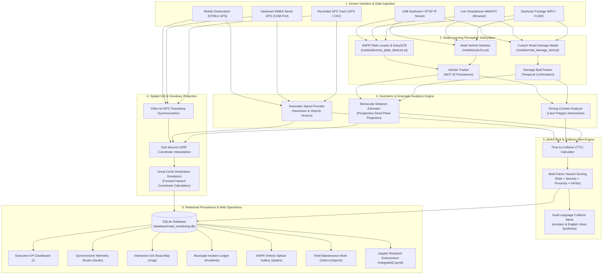

# RoadEye Enterprise: Intelligent Road Surveillance, Pavement Hazard Management & Collision Avoidance Platform

[](https://www.python.org/)
[](https://pytorch.org/)
[](https://github.com/ultralytics/ultralytics)
[](https://opencv.org/)
[](https://flask.palletsprojects.com/)
[](https://www.sqlite.org/)
[](https://leafletjs.com/)
[](LICENSE)

> **Principal Investigator & Lead Developer**: **Haile Sintayehu** ([@haile6](https://github.com/haile6))  
> **Institutional Contact**: `hailesintayehu113@gmail.com`  
> **Repository**: [haile6/intelligent-road-monitoring-system](https://github.com/haile6/intelligent-road-monitoring-system)  
> **Domain**: Deep Learning Perception, Monocular Spatial Kinematics, Automatic Number Plate Recognition (ANPR), and Intelligent Transportation Systems (ITS)

---

## 📌 Executive Summary & Abstract

Traditional roadway asset management relies upon manual, periodic visual surveys that are resource-intensive, safety-hazardous, and structurally reactive. Consequently, pavement defects deteriorate into catastrophic failures, and delayed driver perception leads to severe traffic collisions.

**RoadEye Enterprise** is a unified, end-to-end computer vision and spatial telemetry platform engineered for municipal infrastructure asset preservation and vehicular collision mitigation. Operating over standard monocular dashcam video, real-time smartphone browser feeds (WebRTC), and physical hardware GPS receivers, the platform simultaneously delivers two mission-critical capabilities:

1. **Automated Municipal Road Infrastructure Management**: High-throughput detection, spatial geotagging, severity grading, and dispatch lifecycle management for asphalt road defects (potholes and alligator fatigue cracking).
2. **Real-Time Advanced Driver Assistance System (ADAS)**: Monocular road-plane perspective distance estimation, Multi-Object Tracking (MOT), host vehicle trajectory corridor analysis, dynamic Time-To-Collision (TTC) computation, Automatic Number Plate Recognition (ANPR), and dual-language (Amharic & English) auditory collision warnings.

---

## 🌟 Core System Subsystems

| Subsystem | Technical Implementation | Practical & Operational Impact |
| :--- | :--- | :--- |
| **Pavement Defect Perception** | Custom-trained YOLOv8/11 deep neural network on regional Ethiopian road imagery. | Rapid, robust detection of potholes and alligator fatigue cracks across varying ambient illumination and asphalt conditions. |
| **Multi-Object Tracking (MOT)** | ByteTrack / IoU temporal association with minimum hit confirmation counters. | Eliminates duplicate incident reporting across continuous video frames while computing trajectory vectors. |
| **Vehicle Perception & ANPR** | Two-stage deep pipeline: YOLO11s multi-class vehicle detector + YOLOv8 plate locator + EasyOCR engine. | Tracks surrounding traffic (cars, trucks, buses, motorcycles) and extracts license registration plates into structured optical evidence. |
| **Monocular Distance Estimation** | Road-plane perspective projection geometry utilizing camera elevation ($H$), tilt ($\theta$), and focal length ($f_y$). | Accurately estimates metric distance ($Z$ in meters) without requiring expensive LiDAR or stereo camera sensor suites. |
| **Dynamic Corridor Analysis** | Host vehicle lane polygon projection and geometric intersection. | Distinguishes between lateral non-hazardous roadside defects and obstacles located directly in the driving corridor. |
| **Kinematic Collision Engine** | Continuous Time-To-Collision ($\text{TTC} = d / v_{\text{approach}}$) evaluated against empirical braking curves. | Dynamically categorizes collision threats into four standardized tiers: **Safe**, **Caution**, **Warning**, and **Immediate Danger**. |
| **Dual-Language ADAS Alerts** | Web Audio API sound synthesis and Web Speech API text-to-speech engine. | Delivers immediate, spoken audio warnings in both **Amharic** (*"አስቸኳይ አደጋ!"*) and **English** (*"Danger! Pothole in path!"*). |
| **Forward Geodesic Projection** | Sub-second GPS linear interpolation (LERP) coupled with Great Circle destination geodesics. | Pinpoints the exact geographic coordinates ($\text{Lat}, \text{Lon}$) of detected road hazards in advance of vehicle arrival. |
| **Synchronized Telemetry Studio** | Low-latency split-screen operations dashboard (Video Feed + Synchronized Leaflet GIS Map). | Live vehicle corridor animation, hazard beacon projection, dynamic laser trajectory vector, and instant telemetry readout. |
| **Municipal Web Management Panel** | Full-stack Flask REST architecture, SQLite persistence layer, and responsive interface. | Executive KPI metrics, maintenance work order dispatch, visual ANPR registry, and printable field inspection reports. |

---

## 🛣️ Debre Berhan Road Damage Dataset (Potholes & Alligator Cracks)

To guarantee high model fidelity on authentic regional road conditions, this platform incorporates an original, ground-truth pavement distress dataset collected and annotated specifically for this project:

* **Geographic Origin**: **Debre Berhan City (ደብረ ብርሃን)**, Amhara Region, Ethiopia.
* **Collection Methodology**: **Manual field collection** capturing high-resolution pavement imagery and video feeds across urban asphalt arteries, ring roads, and secondary transit corridors under natural Ethiopian daylight, varying shadows, and authentic road surface distress.
* **Annotation Platform**: Manually annotated, verified, and quality-controlled using **CVAT (Computer Vision Annotation Tool)**.
* **Annotation Format**: Standard Ultralytics YOLOv8 / YOLO11 normalized bounding box format (`<class_id> <x_center> <y_center> <width> <height>`).
* **Distress Class Definitions**:
  - **Class `0` — `alligator_crack`**: Interconnected structural fatigue fissures in asphalt surfacing resembling reptilian scales, indicative of sub-base structural failure.
  - **Class `1` — `pothole`**: Bowl-shaped depressions and structural cavities caused by water penetration and traffic wear, presenting acute vehicular collision hazards.

### Dataset Partitioning & Statistics

| Dataset Partition | Image Count | Label Count | Percentage | Directory Path |
| :--- | :---: | :---: | :---: | :--- |
| **Training Set** | 507 | 507 | 70.0% | [`data/custom_dataset/images/train/`](file:///c:/Users/haile/Downloads/intelligent-road-monitoring-system-main/data/custom_dataset/images/train) |
| **Validation Set** | 109 | 109 | 15.0% | [`data/custom_dataset/images/val/`](file:///c:/Users/haile/Downloads/intelligent-road-monitoring-system-main/data/custom_dataset/images/val) |
| **Test Set** | 109 | 109 | 15.0% | [`data/custom_dataset/images/test/`](file:///c:/Users/haile/Downloads/intelligent-road-monitoring-system-main/data/custom_dataset/images/test) |
| **Total Benchmark** | **725** | **725** | **100.0%** | [`data/custom_dataset/`](file:///c:/Users/haile/Downloads/intelligent-road-monitoring-system-main/data/custom_dataset) |

---

## 🏗️ Architectural Topology



---

## 🔬 Mathematical Formulations

### 1. Monocular Perspective Distance Estimation
Without requiring active sensors (LiDAR/RADAR), metric ground-plane distance $Z$ (meters) is derived from camera mounting height $H$, pitch depression angle $\theta$, vertical field of view $\text{FOV}_v$, and pixel image height $h_{\text{img}}$:

$$\text{Focal Length } (f_y) = \frac{h_{\text{img}}}{2 \cdot \tan\left(\frac{\text{FOV}_v}{2}\right)}$$

$$\text{Horizon Line } (y_{\text{horizon}}) = \frac{h_{\text{img}}}{2} - f_y \cdot \tan(\theta)$$

For any detected bounding box contacting the roadway at pixel row $y_{\text{contact}}$:

$$Z = \frac{H}{\tan\left(\theta + \arctan\left(\frac{y_{\text{contact}} - \frac{h_{\text{img}}}{2}}{f_y}\right)\right)}$$

---

### 2. Kinematic Time-To-Collision (TTC) Dynamic Kinematics

For any obstacle detected within the vehicle's dynamic driving corridor, the Time-To-Collision ($\text{TTC}$) determines the temporal margin before potential vehicular impact:

$$\text{TTC} = \frac{d_{\text{obstacle}}}{v_{\text{approach}}}$$

Where:
* $d_{\text{obstacle}}$: Estimated forward ground-plane metric distance ($m$) derived from perspective projection.
* $v_{\text{approach}}$: Closing velocity ($m/s$). For stationary road hazards (potholes and cracks), $v_{\text{approach}} = v_{\text{host}}$. For dynamic lead vehicles, $v_{\text{approach}} = \max(v_{\text{host}} - v_{\text{lead}}, 0)$.

#### Dynamic Classification Thresholds & Action Matrix:

$$\text{Risk Level} = \begin{cases} 
\textbf{Immediate Danger} & \text{if } \text{TTC} \le 1.8\text{ s} \\ 
\textbf{Warning} & \text{if } 1.8\text{ s} < \text{TTC} \le 3.5\text{ s} \\ 
\textbf{Caution} & \text{if } 3.5\text{ s} < \text{TTC} \le 6.0\text{ s} \\ 
\textbf{Safe / Clear} & \text{if } \text{TTC} > 6.0\text{ s} 
\end{cases}$$

| Risk Tier | TTC Threshold | Visual HUD Banner | Auditory Warning Action | Operational Driver Response |
| :--- | :---: | :---: | :---: | :--- |
| 🔴 **Immediate Danger** | $\le 1.8\text{ s}$ | High-Contrast Red Banner | Spoken Alert (Amharic & English) + Alert Tone | Immediate emergency braking / evasive lane maneuver |
| 🟠 **Warning** | $1.8\text{ s} < \text{TTC} \le 3.5\text{ s}$ | Amber / Orange Warning | Audible Chime Pulse | Prepare deceleration and align vehicle wheels |
| 🟡 **Caution** | $3.5\text{ s} < \text{TTC} \le 6.0\text{ s}$ | Yellow Informational Banner | Visual Indicator Only | Maintain heightened awareness; monitor corridor |
| 🟢 **Safe / Clear** | $> 6.0\text{ s}$ | Green Status Overlay | None (Silent Monitoring) | Normal cruising speed; path unobstructed |

---

### 3. Spatial GIS Forward Geodesic Projection
When an obstacle is detected $d$ meters ahead along compass azimuth $\beta$ from current vehicle coordinates $(\phi_1, \lambda_1)$, its absolute geographic position $(\phi_2, \lambda_2)$ is calculated over the Earth's spherical radius ($R \approx 6,371,000\text{ m}$) using angular distance $\delta = d / R$:

$$\phi_2 = \arcsin\left(\sin(\phi_1)\cos(\delta) + \cos(\phi_1)\sin(\delta)\cos(\beta)\right)$$

$$\lambda_2 = \lambda_1 + \arctan2\left(\sin(\beta)\sin(\delta)\cos(\phi_1),\, \cos(\delta) - \sin(\phi_1)\sin(\phi_2)\right)$$

This forward projection guarantees that road defects are pinpointed at their exact physical location on municipal GIS maps, independent of the inspection vehicle's stopping position.

---

## 📁 Repository Directory Structure

```text
intelligent-road-monitoring-system/
├── config.py                 # Centralized configuration (FOV, camera elevation, thresholds)
├── run_web.py                # Web Management Panel launcher with dynamic port discovery
├── run_integrated.py         # Unified one-pass perception, tracking, GIS, and risk pipeline
├── integrated2.ipynb         # Interactive Jupyter research and model training notebook
│
├── run_phase1.py             # Phase 1: Standalone YOLO Road Damage Detection
├── run_phase2.py             # Phase 2: Damage Multi-Object Tracking & Confirmation
├── run_phase3.py             # Phase 3: Multi-Vehicle Detection & MOT Tracking
├── run_phase4.py             # Phase 4: Dynamic Driving Corridor & Trajectory Analysis
├── run_phase5.py             # Phase 5: Monocular Perspective Distance Estimation
├── run_phase6.py             # Phase 6: Sub-Second GPS Geotagging & Synchronization
├── run_phase6_with_plates.py # Phase 6B: License Plate Detection (ANPR Subsystem)
├── run_phase7.py             # Phase 7: GPS Speed Provider & Plate Association
├── run_phase7_speed.py       # Phase 7B: Alternative Speed Estimation Module
├── run_phase8.py             # Phase 8: Dynamic Time-To-Collision (TTC) Engine
├── run_phase9.py             # Phase 9: Unified Multi-Tier Hazard Classification
│
├── check_distance.py         # Interactive calibration utility for camera elevation & tilt
├── gpx_to_csv.py             # GPS converter converting GPX telemetry traces to synchronized CSV
├── package_project.py        # Automated submission packaging script
│
├── detection/                # Deep Learning Perception Subsystem
│   ├── __init__.py
│   ├── road_damage_detector.py # Custom YOLOv8/11 pavement damage inference wrapper
│   ├── vehicle_detector.py     # Multi-class vehicular inference wrapper
│   └── tracker.py              # IoU & ByteTrack temporal tracking and hit counters
│
├── risk/                     # Spatial Analytics & ADAS Kinematics
│   ├── __init__.py
│   ├── distance_estimator.py   # Perspective ground-plane distance estimation
│   ├── path_analyzer.py        # Host lane polygon intersection
│   ├── ttc_calculator.py       # Dynamic Time-to-Collision evaluation
│   ├── risk_analyzer.py        # Multi-factor hazard classification
│   ├── priority_weight.py      # Municipal repair priority scoring algorithm
│   └── severity_estimator.py   # Pavement surface degradation metric
│
├── gps/                      # Spatial GIS & Telemetry Synchronization
│   ├── __init__.py
│   ├── gps_reader.py           # Synchronized CSV/NMEA telemetry reader
│   ├── gps_sync.py             # Sub-second video-to-GPS interpolation
│   ├── speed_provider.py       # Kinematic speed calculation from geodesic deltas
│   ├── geo.py                  # Haversine distance and Great Circle bearing algorithms
│   ├── real_gps_reader.py      # Serial COM interface for physical NMEA GPS receivers
│   └── folium_map.py           # Standalone Leaflet HTML road inspection generator
│
├── database/                 # Relational Data Persistence Layer
│   ├── __init__.py
│   ├── db_manager.py           # SQLite connection pool, schema migrations, and ORM helpers
│   └── road_monitoring.db     # SQLite database storing incidents, plates, and audit trails
│
├── alerts/                   # Auditory Warning Subsystem
│   ├── __init__.py
│   ├── audio_warning.py        # Synthesized audio tone generator & audio muxer
│   └── voice_clips/            # Spoken English and Amharic collision alert audio
│
├── visualization/            # Overlay Rendering & Head-Up Displays (HUD)
│   ├── __init__.py
│   └── overlay.py              # High-FPS telemetry HUD, collision banners, and lane corridors
│
├── models/                   # Deep Neural Network Weights
│   ├── road_damage_best.pt     # Custom-trained YOLO model (Potholes & Alligator Cracks)
│   ├── yolo11s.pt              # YOLO11s multi-class vehicle detector
│   └── license_plate_detector.pt # YOLOv8 ANPR license plate detection model
│
├── data/                     # Data Repository
│   ├── custom_dataset/         # Debre Berhan CVAT dataset (725 images & labels, dataset.yaml)
│   ├── road_damage_alligator_pothole/ # Original structured benchmark partition
│   ├── gps_track.csv           # Synchronized test drive telemetry track
│   └── *.mp4                   # Highway and urban test videos
│
├── outputs/                  # Export Artifacts, Annotated Videos, and Evidence Crops
├── web/                      # Enterprise Flask Operations Suite (Templates, Static, APIs)
├── requirements.txt          # Python dependency specifications
└── Procfile                  # Production WSGI application specification
```

---

## 💻 Web Operations Platform: Endpoint Architecture

| View / Function | Endpoint | Operational Capability |
| :--- | :--- | :--- |
| **Executive Dashboard** | `/` | Real-time aggregate KPI metrics (Hazard Volumes, Critical Alerts, Monitored Vehicles, Priority Repairs), Chart.js visual breakdowns, and active alert feeds. |
| **Telemetry Studio** | `/studio` | Dual-view synchronized video playback, frame-accurate scrubber, mobile WebRTC camera streaming, and real-time Leaflet GIS corridor map. |
| **Interactive GIS Map** | `/map` | Spatial OpenStreetMap visualization displaying vehicle travel routes with color-coded geographic markers for detected pavement distress. |
| **Incident Ledger** | `/incidents` | Complete municipal work order management: status transitions (`Reported` $\to$ `Scheduled` $\to$ `Repaired`), crew assignments, and priority filters. |
| **ANPR Plate Gallery** | `/plates` | High-resolution visual optical evidence gallery showing vehicle crops, license plate crops, OCR confidence scores, and timestamps. |
| **AI Pipeline Runner** | `/pipeline` | Interactive browser-based runner executing individual pipeline phases or the full integrated system with live Server-Sent Events (SSE) console streaming. |
| **Work Order Reports** | `/reports` | Printable, formatted municipal inspection sheets tailored for field dispatch crews, complete with one-click CSV data export. |
| **Sensor Calibration** | `/calibration` | Interactive calibration interface for camera pitch angle ($\theta$), mounting elevation ($H$), and field of view ($\text{FOV}_v$). |
| **System Diagnostics** | `/health` | Real-time diagnostic monitor tracking neural model readiness, GPU/CUDA acceleration, memory utilization, and database integrity. |
| **Audit Ledger** | `/audit` | Immutable chronological event log auditing user operations, status modifications, and system configuration adjustments. |

---

## 🚀 Installation & Setup Guide

### 1. System Requirements
* **Operating System**: Microsoft Windows 10/11, Ubuntu 20.04+, or macOS
* **Python Runtime**: Version `3.10` or `3.11` (64-bit)
* **Compute Device**: Standard x86_64 CPU; NVIDIA CUDA-compatible GPU recommended for real-time video inference.

### 2. Environment Initialization
```bash
# Clone the repository
git clone https://github.com/haile6/intelligent-road-monitoring-system.git
cd intelligent-road-monitoring-system

# Create and activate Python virtual environment
# Windows (PowerShell):
python -m venv venv
.\venv\Scripts\Activate.ps1

# Linux / macOS:
python3 -m venv venv
source venv/bin/activate

# Upgrade packaging tools and install requirements
pip install --upgrade pip setuptools wheel
pip install -r requirements.txt
```

### 3. Model Weights Verification
Confirm the presence of all neural weights inside the `models/` folder:
* `models/road_damage_best.pt` — Custom road defect neural model (Potholes & Alligator Cracks)
* `models/yolo11s.pt` — Multi-vehicle detection model
* `models/license_plate_detector.pt` — License plate locator model

---

## ⚡ Execution Modalities

### Mode 1: Launch the Web Operations Platform (Recommended)
```bash
python run_web.py
```
* Initializes the SQLite database schema and imports existing incident ledgers.
* Automatically identifies open network ports (default: `8080`) and detects local LAN IP.
* Access locally via **`http://127.0.0.1:8080`** or remotely on smartphones via **`http://<LAN_IP>:8080/studio`**.

### Mode 2: Unified Command-Line (CLI) Pipeline
Execute the complete end-to-end processing pipeline over recorded video or real-time devices:
```bash
# Process default test highway footage
python run_integrated.py

# Process custom video file with real-time HUD rendering
python run_integrated.py --source data/ethiopian_road_driving_test.mp4 --show

# Process live USB dashcam or built-in webcam (Device 0)
python run_integrated.py --source 0 --show

# Stream directly from smartphone IP camera (RTSP / HTTP)
python run_integrated.py --source "http://192.168.1.100:8080/video" --show
```

### Mode 3: Interactive Jupyter Research Environment
For model exploration, training, and algorithmic experimentation:
```bash
jupyter notebook integrated2.ipynb
```
* Conducts dataset inspection over the Debre Berhan benchmark.
* Demonstrates YOLOv8 transfer learning, defect classification, and spatial metric distance estimation.

---

## 🗄️ Relational Database Schema (`road_monitoring.db`)

The SQLite persistence layer maintains structured operational records across multiple normalized tables:

### Table 1: `incidents` (Pavement Defects & Collision Incidents)
| Column Name | Data Type | Description |
| :--- | :--- | :--- |
| `id` | `INTEGER PRIMARY KEY` | Auto-incrementing primary incident identifier |
| `track_id` | `INTEGER` | Persistent temporal tracking identifier across frames |
| `damage_type` | `TEXT` | Classified defect category (`pothole`, `alligator_crack`) |
| `confidence` | `REAL` | Peak neural detection confidence (0.00 – 1.00) |
| `severity` | `TEXT` | Surface degradation classification (`Low`, `Medium`, `Severe`) |
| `max_risk_level` | `TEXT` | Evaluated kinematic risk tier (`SAFE`, `CAUTION`, `WARNING`, `IMMEDIATE_DANGER`) |
| `distance_m` | `REAL` | Perspective distance at initial confirmation ($m$) |
| `ttc_seconds` | `REAL` | Minimum computed Time-To-Collision ($s$) |
| `ever_in_path` | `INTEGER` | Boolean flag (1/0) indicating trajectory corridor intersection |
| `latitude` / `longitude` | `REAL` | Geotagged vehicle coordinates at detection timestamp |
| `damage_latitude` / `damage_longitude` | `REAL` | Projected geographic destination coordinates of the hazard |
| `speed_kmh` | `REAL` | Vehicle velocity at encounter ($km/h$) |
| `status` | `TEXT` | Maintenance workflow lifecycle (`Reported`, `Scheduled`, `Repaired`) |
| `assigned_crew` | `TEXT` | Dispatched municipal road maintenance team |
| `repair_priority` | `TEXT` | Weighted municipal intervention priority (`Low`, `Medium`, `High`, `Critical`) |

### Table 2: `plate_readings` (ANPR Vehicle & Plate Detections)
| Column Name | Data Type | Description |
| :--- | :--- | :--- |
| `id` | `INTEGER PRIMARY KEY` | Unique registration reading identifier |
| `vehicle_id` | `INTEGER` | Multi-Object Tracker identifier of the vehicle |
| `plate_text` | `TEXT` | Cleaned alphanumeric license registration string |
| `ocr_confidence` | `REAL` | Optical character recognition confidence score |
| `frame` / `video_time_s` | `INTEGER` / `REAL` | Frame index and temporal video timestamp |
| `crop_filename` | `TEXT` | Relative path to high-resolution cropped plate image |

---

## 📦 Project Submission Packaging

To compile a clean, production-grade archive compliant with academic and institutional submission standards:
```bash
python package_project.py
```
This utility automatically excludes virtual environments (`venv/`), temporary compilation caches (`__pycache__`), git metadata (`.git/`), and intermediate frame buffers, producing a clean submission ZIP file (`road_monitoring_system_complete.zip`).

---

## 👥 Authorship & Academic Attribution

* **Principal Investigator & Lead Developer**: **Haile Sintayehu**
* **GitHub Profile**: [@haile6](https://github.com/haile6)
* **Institutional Contact**: `hailesintayehu113@gmail.com`
* **Project Repository**: [haile6/intelligent-road-monitoring-system](https://github.com/haile6/intelligent-road-monitoring-system)
* **Primary Research Focus**: Computer Vision for Intelligent Transportation Systems, Road Surface Asset Preservation & Autonomous Driver Assistance Systems.

---

## 📄 License & Terms

This software platform is distributed under the **MIT License**. Permission is granted to utilize, modify, and distribute the source code for academic, research, and municipal transit engineering applications with appropriate attribution.
