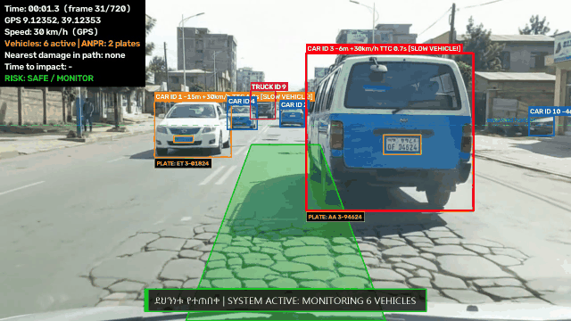
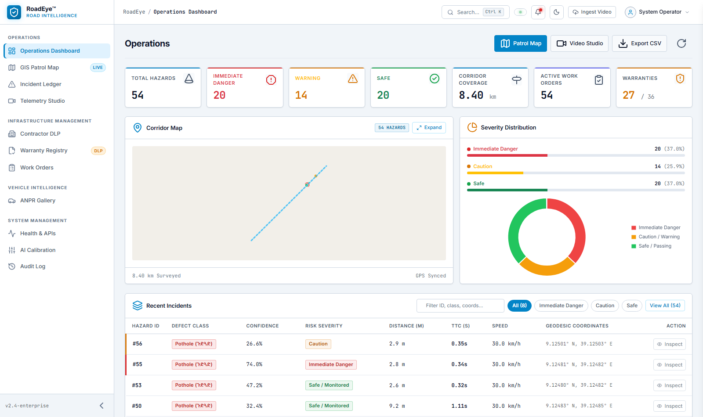
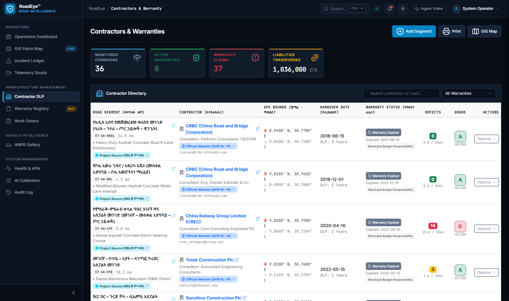

<div align="center">

# 🛣️ RoadEye™ Enterprise
### AI-Powered Intelligent Transportation Infrastructure Management & Advanced Collision Avoidance Platform

[](https://www.python.org/)
[](https://pytorch.org/)
[](https://github.com/ultralytics/ultralytics)
[](Dockerfile)
[](mlops/edge_optimizer.py)
[](web/app.py)
[](web/static/css/custom.css)
[-brightgreen?style=for-the-badge&logo=githubactions&logoColor=white)](tests/)
[](https://github.com/haile6/intelligent-road-monitoring-system/actions/workflows/python-tests.yml)
[](LICENSE)

<br/>

**An enterprise-grade Computer Vision & Intelligent Transportation System (ITS) platform connecting dashcam video, smartphone cameras, and sub-second GPS telemetry to automate municipal roadway asset preservation and active collision prevention.**

[Project Proposal](docs/project_proposal.md) • [Live Dashboard](#-web-operations-platform) • [Core Capabilities](#-core-capabilities) • [Debre Berhan Dataset](#-debre-berhan-road-damage-dataset) • [System Architecture](#-system-architecture) • [Mathematical Foundations](#-mathematical-foundations) • [Quickstart](#-quickstart--installation) • [Automated Tests](#-automated-testing--verification)

<br/>

---

**Author & Principal Researcher**: **Haile Sintayehu** ([@haile6](https://github.com/haile6))  
📫 **Contact**: `hailesintayehu113@gmail.com`  
🏛️ **Repository**: [haile6/intelligent-road-monitoring-system](https://github.com/haile6/intelligent-road-monitoring-system)

---

</div>

<br/>

> [!IMPORTANT]
> **RoadEye Enterprise delivers two synchronized operational capabilities in a single unified architecture:**
> 1. **Municipal Roadway Asset Preservation**: Real-time detection, severity grading, sub-meter odometer indexing, sub-second GPS forward geotagging, and automated work order dispatch for asphalt distress (*potholes* and *alligator fatigue cracks*).
> 2. **Active In-Vehicle ADAS Collision Prevention**: Monocular perspective distance calculation ($Z$), dynamic Time-To-Collision ($\text{TTC}$) evaluation, host corridor trajectory filtering, Automatic Number Plate Recognition (ANPR), and dual-language (**Amharic** & **English**) auditory collision alarms.

<br/>

<div align="center">
  
  <p><em>Figure 1: Live In-Vehicle ADAS Perception & Collision Avoidance Demo — Real-time driving corridor projection, multi-target vehicle kinematics, closing Time-To-Collision (TTC) estimation, Ethiopian license plate recognition (ANPR), and dual-language (Amharic & English) HUD warnings.</em></p>

  <p>
    <a href="outputs/annotated_all_features_test_video.mp4"><strong>▶️ Play Full HD Telemetry Demo (MP4)</strong></a> &bull;
    <a href="outputs/annotated_ethiopian_road_driving_test.mp4"><strong>🛣️ Ethiopian Highway Driving Benchmark (MP4)</strong></a> &bull;
    <a href="outputs/annotated_gemini_generated_video_dadfa683.mp4"><strong>🎥 Multi-Hazard Dashcam Recording (MP4)</strong></a>
  </p>
</div>

<br/>

### 🎬 Video Telemetry Demonstration & Output Benchmarks

The repository includes pre-compiled, fully annotated inspection videos rendered at 30 FPS with complete Head-Up Display (HUD) telemetry overlays:

| Demo Video Asset | Resolution & Duration | Monitored Subsystems & Kinematics | Direct Link |
| :--- | :---: | :--- | :---: |
| 🚙 **All-Features Telemetry Run** | 1280×720 (15.0s, 30 FPS) | Dynamic corridor projection, monocular distance, stationary pothole TTC, ANPR vehicle tracking, and spoken Amharic/English audio warnings. | [`outputs/annotated_all_features_test_video.mp4`](outputs/annotated_all_features_test_video.mp4) |
| 🛣️ **Ethiopian Highway Corridor** | 1280×720 (17.7s, 25 FPS) | Route A2 Debre Berhan asphalt transit drive with GPS interpolation, odometer range tracking, and fatigue cracking classification. | [`outputs/annotated_ethiopian_road_driving_test.mp4`](outputs/annotated_ethiopian_road_driving_test.mp4) |
| 🎥 **Multi-Hazard Dashcam Ingest** | 1280×720 (30 FPS) | Complete field inspection session with 54 verified potholes and alligator cracks synchronized with GPS track log. | [`outputs/annotated_gemini_generated_video_dadfa683.mp4`](outputs/annotated_gemini_generated_video_dadfa683.mp4) |

<br/>

---

## 🌟 Core Capabilities

<table>
<tr>
<td width="50%" valign="top">

### 🔍 Neural Pavement Perception (YOLO11s)
Custom-trained deep neural detector specialized on authentic Ethiopian asphalt imagery. Accurately identifies, classifies, and segments severe **potholes (ጉድጓድ)** and structural **alligator fatigue cracking (የአዞ ቆዳ ስንጥቅ)** across varying daylight, shadow, and road conditions.

</td>
<td width="50%" valign="top">

### 📐 Monocular Perspective Distance ($Z$)
Calculates real-world ground-plane metric distance ($Z$) using single-camera perspective trigonometric projection ($H, \theta, f_y$). Eliminates the need for expensive, bulky LiDAR arrays or calibrated stereo cameras.

</td>
</tr>
<tr>
<td width="50%" valign="top">

### ⏱️ Dynamic Time-To-Collision (TTC) Engine
Continuously computes temporal approach margins ($\text{TTC} = d / v_{\text{approach}}$) against empirical braking envelopes. Triggers multi-tiered visual HUD alerts and spoken warnings when hazards intersect the host vehicle's driving envelope.

</td>
<td width="50%" valign="top">

### 🗣️ Dual-Language Voice Warnings
Synthesizes spoken collision alerts in both **Amharic** (*"አስቸኳይ አደጋ! በመንገዱ ላይ ጉድጓድ ተገኝቷል!"*) and **English** (*"Danger! Pothole in path, 5 meters!"*), backed by multi-frequency audio collision tones.

</td>
</tr>
<tr>
<td width="50%" valign="top">

### 📏 Sub-Meter Dual Odometer (0.01 km Resolution)
High-precision odometer tracking distance at **10-meter ($0.01\text{ km}$)** intervals. Simultaneously tracks **Traveled Distance** along the monitored survey corridor and computes **Remaining Distance** to the destination waypoint.

</td>
<td width="50%" valign="top">

### 🚗 Vehicle Tracking & ANPR
YOLO11s vehicle detector paired with a specialized license plate locator and EasyOCR engine. Tracks surrounding cars, trucks, buses, and motorcycles while cataloging optical license plate evidence in Ethiopian formats.

</td>
</tr>
<tr>
<td width="50%" valign="top">

### 🛰️ Sub-Second GPS Geodesic Projection
Synchronizes high-FPS video frames with 1.0 Hz GPS telemetry via linear interpolation (LERP). Computes forward Great Circle destination coordinates to pinpoint the exact geographic position ($\text{Lat}, \text{Lon}$) of road hazards ahead.

</td>
<td width="50%" valign="top">

### 🏗️ Contractor DLP & Warranty Registry
National Ethiopian road contractor registry covering **36 national highway corridors**, Defect Liability Period (DLP) warranty tracking, FIDIC Clause 11 automated legal claim generation, and direct contractor performance benchmarks.

</td>
</tr>
</table>

<br/>

---

## 🛣️ Debre Berhan Road Damage Dataset

To ensure high detection fidelity on authentic regional road networks, RoadEye includes an original pavement distress benchmark collected specifically for this platform:

* 📍 **Geographic Origin**: **Debre Berhan City (ደብረ ብርሃን)**, Amhara Region, Ethiopia.
* 📷 **Collection Method**: **Manual field collection** capturing high-resolution pavement imagery and video across urban asphalt corridors, ring roads, and regional transit arteries under realistic lighting and shadows.
* 🏷️ **Annotation Platform**: Manually labeled, cross-checked, and quality-controlled using **CVAT (Computer Vision Annotation Tool)**.
* 📦 **Format**: Standard Ultralytics YOLOv8 / YOLO11 PyTorch normalized bounding box format (`<class_id> <x_center> <y_center> <width> <height>`).

### 📊 Dataset Distribution & Split Statistics

| Partition | Image Count | Label Count | Share | Folder Location |
| :--- | :---: | :---: | :---: | :--- |
| **Training Set** | 507 | 507 | 70% | [`data/custom_dataset/images/train/`](data/custom_dataset/images/train) |
| **Validation Set** | 109 | 109 | 15% | [`data/custom_dataset/images/val/`](data/custom_dataset/images/val) |
| **Test Set** | 109 | 109 | 15% | [`data/custom_dataset/images/test/`](data/custom_dataset/images/test) |
| **Total Benchmark** | **725** | **725** | **100%** | [`data/custom_dataset/`](data/custom_dataset) |

### 🏷️ Target Defect Classes

| Class ID | Defect Name | Amharic Term | Structural Distress Characteristics |
| :---: | :--- | :--- | :--- |
| `0` | **`alligator_crack`** | **የአዞ ቆዳ ስንጥቅ** | Interconnected fatigue cracking pattern resembling reptile scales, indicating underlying road sub-base structural failure. |
| `1` | **`pothole`** | **ጉድጓድ** | Sharp-edged structural depressions and cavity bowls caused by water infiltration and vehicular impact, posing severe collision risks. |

<br/>

### 🧠 Deep Neural Perception Model (YOLO11s Benchmark)

The defect detection engine was trained from **YOLO11s** (`yolo11s.pt`) using the dedicated Kaggle training environment ([integrated-project.ipynb](integrated-project.ipynb)) on an NVIDIA Tesla T4 GPU (15 GB VRAM):

* **Base Architecture**: YOLO11s (100 layers, 9,413,574 parameters, 21.4 GFLOPs)
* **Training Protocol**: 100 epochs, batch size 16, input resolution 640×640, patience 30, seed 42
* **Data Augmentations**: Horizontal flipping (`fliplr=0.5`), slight rotation (`degrees=5`), lighting variations (`hsv_v=0.4`), and mosaic augmentation (deactivated for final 10 epochs)
* **Inference Latency**: **7.0 ms / frame** on Tesla T4 (enabling >140 FPS throughput)

#### 📈 Empirical Test Set Performance (109 Evaluation Images, 148 Ground-Truth Instances)

| Metric | All Classes Combined | Alligator Crack (`0`) | Pothole (`1`) |
| :--- | :---: | :---: | :---: |
| **Precision ($P$)** | **66.0%** (`0.660`) | **79.3%** (`0.793`) | **52.7%** (`0.527`) |
| **Recall ($R$)** | **50.4%** (`0.504`) | **60.5%** (`0.605`) | **40.3%** (`0.403`) |
| **mAP @ 0.50 ($\text{IoU}=0.50$)** | **52.7%** (`0.527`) | **66.2%** (`0.662`) | **39.3%** (`0.393`) |
| **mAP @ 0.50:0.95** | **20.7%** (`0.207`) | **27.9%** (`0.279`) | **13.5%** (`0.135`) |

Deployed weights: [`models/road_damage_best.pt`](models/road_damage_best.pt) (19.2 MB stripped production weights).

<br/>

---

## 🏗️ System Architecture

```mermaid
flowchart TD
    subgraph Tier1["1. Sensor Interface & Data Ingestion"]
        V1["Recorded Dashcam Video (MP4 / H.264)"]
        V2["Live Smartphone WebRTC (In-Browser Camera)"]
        V3["USB Dashcam / IP RTSP Video Stream"]
        G1["Recorded GPS Telemetry (GPX / CSV)"]
        G2["Hardware NMEA Serial GPS (COM Port)"]
        G3["Smartphone Geolocation (HTML5 GPS)"]
    end

    subgraph Tier2["2. Deep Learning Perception Subsystem"]
        D1["Custom Road Damage Model\n(models/road_damage_best.pt)"]
        D2["Vehicle Detector\n(models/yolo11s.pt)"]
        D3["ANPR Plate Locator & EasyOCR\n(models/license_plate_detector.pt)"]
        T1["Damage ByteTracker\n(Temporal Confirmation)"]
        T2["Vehicle Tracker\n(MOT Multi-Class Persistence)"]
    end

    subgraph Tier3["3. Geometric & Kinematic Analysis Engine"]
        E1["Monocular Distance Estimator\n(Road-Plane Perspective Projection)"]
        E2["Driving Corridor Analyzer\n(Host Lane Polygon Intersection)"]
        E3["Kinematic Speed Provider\n(Geodesic Delta Velocity Vectors)"]
        E4["Sub-Meter Dual Odometer\n(0.01 km Traveled & Remaining Range)"]
    end

    subgraph Tier4["4. Spatial GIS & Forward Geodesic Projection"]
        S1["Video-to-GPS Timestamp Synchronization"]
        S2["Sub-Second LERP Coordinate Interpolation"]
        S3["Great Circle Hazard Geodesics\n(Ahead Latitude & Longitude Projection)"]
    end

    subgraph Tier5["5. ADAS Risk & Collision Alert Engine"]
        R1["Time-To-Collision (TTC) Calculator"]
        R2["Multi-Factor Priority Scoring\n(Risk = Severity × Proximity × InPath)"]
        R3["Dual-Language Audio Warnings\n(Amharic & English Voice Engine)"]
    end

    subgraph Tier6["6. Persistence & Web Management Platform"]
        DB[("SQLite Database\n(database/road_monitoring.db)")]
        UI1["Executive Operations Dashboard (/)"]
        UI2["Synchronized Telemetry Studio (/studio)"]
        UI3["Interactive GIS Road Map (/map)"]
        UI4["Municipal Incident Ledger (/incidents)"]
        UI5["ANPR Vehicle Optical Gallery (/plates)"]
        UI6["Field Maintenance Work Orders (/reports)"]
        UI7["Contractor DLP & Warranty Registry (/contractors)"]
    end

    subgraph Tier7["7. MLOps, Edge TinyML & Production REST APIs"]
        M1["Experiment Tracker & Catalog Registry\n(mlops/experiment_tracker.py)"]
        M2["Covariate & Concept Drift Monitor\n(mlops/drift_monitor.py)"]
        M3["XAI Saliency & Fairness Auditor\n(mlops/explainability.py)"]
        M4["INT8 Edge Model Quantizer\n(mlops/edge_optimizer.py)"]
        M5["Privacy Anonymizer\n(Plate & Face Blurring)"]
        API["Production REST Endpoints\n(/api/v1/*)"]
        DKR["Docker & Container Orchestration\n(Dockerfile & Compose)"]
    end

    V1 & V2 & V3 --> D1 & D2 & D3
    D1 --> T1
    D2 & D3 --> T2
    T1 & T2 --> E1 & E2
    G1 & G2 & G3 --> E3 & E4 & S1
    E1 & E3 & S1 --> S2 --> S3
    E1 & E2 & E3 --> R1 --> R2
    R2 --> R3
    S3 & R2 --> DB
    DB --> UI1 & UI2 & UI3 & UI4 & UI5 & UI6 & UI7
    D1 & D2 --> M1 & M2 & M3 & M4 & M5
    M1 & M2 & M3 & M4 & M5 --> API --> DKR
```



<br/>

---

## 🔬 Mathematical Foundations

### 1. Monocular Perspective Distance Estimation
Without requiring active LiDAR sensors, ground-plane distance $Z$ (meters) is derived from camera elevation $H$, tilt angle $\theta$, vertical field of view $\text{FOV}_v$, and pixel contact row $y_{\text{contact}}$:

<div align="center">
  
  <p><em>Figure 2: Monocular Perspective Distance Estimation Geometry — Ground-plane trigonometric projection calculating real-world metric distance ($Z$) from camera elevation ($H$), tilt angle ($\theta$), vertical field of view ($\text{FOV}_v$), and pavement contact row ($y_{\text{contact}}$).</em></p>
</div>

<br/>

$$\text{Focal Length } (f_y) = \frac{h_{\text{img}}}{2 \cdot \tan\left(\frac{\text{FOV}_v}{2}\right)}$$

$$\text{Horizon Line } (y_{\text{horizon}}) = \frac{h_{\text{img}}}{2} - f_y \cdot \tan(\theta)$$

$$Z = \frac{H}{\tan\left(\theta + \arctan\left(\frac{y_{\text{contact}} - \frac{h_{\text{img}}}{2}}{f_y}\right)\right)}$$

---

### 2. Kinematic Time-To-Collision (TTC) Dynamic Matrix

The **Time-To-Collision (TTC)** engine evaluates exactly how many seconds remain before impact. This temporal margin dictates the system's auditory and visual warning intensity.

#### The Core Equation
For any obstacle detected within the vehicle's projected driving corridor, the $\text{TTC}$ is calculated as:

$$\text{TTC} = \frac{d_{\text{obstacle}}}{v_{\text{approach}}}$$

Where:
* **$d_{\text{obstacle}}$**: The physical ground-plane distance to the hazard (in meters).
* **$v_{\text{approach}}$**: The relative closing speed between our vehicle (host) and the hazard (in meters per second).

#### Kinematic Scenarios
* **Stationary Pavement Hazards (Potholes / Cracks)**:
  $$v_{\text{approach}} = v_{\text{host}}$$
  *Example:* Vehicle speed $15\text{ m/s}$ ($54\text{ km/h}$), defect distance $30\text{ m}$ $\implies \text{TTC} = 30 / 15 = \mathbf{2.0\text{ s}}$ (**🟠 Warning alert triggered**).
* **Dynamic Lead Vehicles**:
  $$v_{\text{approach}} = \max(v_{\text{host}} - v_{\text{lead}}, 0)$$
  *Example:* Host speed $25\text{ m/s}$ ($90\text{ km/h}$), lead speed $15\text{ m/s}$ ($54\text{ km/h}$), distance $40\text{ m}$ $\implies \text{TTC} = 40 / 10 = \mathbf{4.0\text{ s}}$ (**🟡 Caution banner displayed**).

#### 🚦 Multi-Tier Risk Classification Matrix

| Risk Level | TTC Threshold | Visual HUD Banner | Auditory Warning Action | Operational Response |
| :--- | :---: | :--- | :--- | :--- |
| 🔴 **Immediate Danger** | $\le 1.8\text{ s}$ | High-Contrast Red Banner | Spoken Voice Alert (*Amharic & English*) + High Chime | Emergency braking or lane evasive action |
| 🟠 **Warning** | $1.8\text{ s} < \text{TTC} \le 3.5\text{ s}$ | Amber / Orange Warning | Audible Chime Pulse | Prepare deceleration; align steering corridor |
| 🟡 **Caution** | $3.5\text{ s} < \text{TTC} \le 6.0\text{ s}$ | Yellow Informational Banner | Visual Indicator Only | Maintain heightened driver awareness |
| 🟢 **Safe / Clear** | $> 6.0\text{ s}$ | Green Status Overlay | None (Silent Monitoring) | Path unobstructed; normal cruising speed |

---

### 3. Spatial GIS Forward Geodesic Projection

When a hazard is detected ahead, the GPS receiver only knows the *vehicle's* coordinates. The system applies **Forward Spherical Geodesic Projection** over the Earth's radius ($R \approx 6,371,000\text{ m}$) using angular distance $\delta = d / R$ and heading azimuth $\beta$:

$$\phi_2 = \arcsin\left(\sin(\phi_1)\cos(\delta) + \cos(\phi_1)\sin(\delta)\cos(\beta)\right)$$

$$\lambda_2 = \lambda_1 + \arctan2\left(\sin(\beta)\sin(\delta)\cos(\phi_1),\, \cos(\delta) - \sin(\phi_1)\sin(\phi_2)\right)$$

This calculates the exact forward coordinates ($\text{Lat}_2, \text{Lon}_2$) of the hazard, ensuring municipal road maintenance crews are dispatched to the exact road defect rather than the vehicle's position.

---

### 4. ASTM D6433 Pavement Condition Index (PCI) & World Bank HDM-4 IRI

The platform incorporates the international standard **ASTM D6433-20** to transform raw computer vision distress detections into a standardized 0–100 Pavement Condition Index ($PCI$):

1. **Distress Density Calculation**:
   For sample segment area $A_s$ ($\text{m}^2$):
   $$D_{ij} = \frac{\text{Quantity of Distress } i \text{ at Severity } j}{A_s} \times 100\%$$

2. **Deduct Value ($DV$) Curves**:
   Parameterized power-law formulations calibrated from ASTM D6433 deduction curves:
   $$DV_{\text{pothole, high}} = \min\left(95,\, 38 \cdot D^{0.45}\right), \quad DV_{\text{pothole, med}} = \min\left(70,\, 24 \cdot D^{0.40}\right)$$
   $$DV_{\text{crack, high}} = \min\left(85,\, 28 \cdot D^{0.42}\right), \quad DV_{\text{crack, med}} = \min\left(60,\, 16 \cdot D^{0.38}\right)$$

3. **Corrected Deduct Value ($CDV$) & Final PCI**:
   Total Deduct Value $TDV = \sum DV_{ij}$. For $q$ deducts $> 5.0$, ASTM multi-distress interaction is adjusted by:
   $$CDV = TDV \times \max\left(0.55,\, 1.0 - (q - 1) \cdot 0.085\right)$$
   $$PCI = \max\left(0,\, \min(100,\, 100 - CDV)\right)$$

4. **World Bank HDM-4 International Roughness Index ($IRI$)**:
   Correlates visual surface irregularities with cumulative vertical dynamic bump displacement ($\text{m/km}$):
   $$IRI = IRI_0 + \frac{\sum (n_{\text{high}} \cdot 0.32 + n_{\text{med}} \cdot 0.16 + n_{\text{low}} \cdot 0.07)}{L_{\text{km}}} + \frac{\sum (c_{\text{high}} \cdot 0.12 + c_{\text{other}} \cdot 0.05)}{L_{\text{km}}}$$
   *(where newly paved baseline $IRI_0 \approx 1.8\text{ m/km}$)*.

5. **ERA Schedule of Rates Asphalt Resurfacing Budget Estimator (የአስፋልት በጀት አስሊ)**:
   Triggered dynamically according to ASTM condition and IRI deterioration thresholds:
   * **Full-Depth Reconstruction** ($PCI < 40$ or $IRI \ge 7.0$): Crushed rock base + DBM 60mm + 50mm AC ($7,800\text{ ETB/m}^2$, $\approx \$60.90\text{ USD/m}^2$).
   * **Mill & 50mm Overlay** ($40 \le PCI < 70$ or $4.0 \le IRI < 7.0$): Cold milling 50mm + Tack coat + 50mm AC wearing course ($3,250\text{ ETB/m}^2$, $\approx \$25.40\text{ USD/m}^2$).
   * **Localized Patch & Seal** ($70 \le PCI < 85$): Cold-mix patching ($2,850\text{ ETB/m}^2$) + polymer crack sealing ($480\text{ ETB/m}$).
   * **Routine Preservation** ($PCI \ge 85$): Corridor inspection and drainage flush ($18,500\text{ ETB/block}$).

<br/>

---

## 💻 Web Operations Platform

RoadEye provides a responsive enterprise operations suite inspired by the design sophistication of **Palantir Foundry**, **Samsara**, and **Linear**:

### 🌓 Dual-Theme System (Dark & Bright Daylight Mode)
* **Dark Enterprise Theme**: Built on `#080D16`, `#0D1421`, `#111C2B`, and `#38BDF8` for low-light command center operations.
* **Daylight Bright Theme**: Built on clean slate `#F1F5F9`, pure white cards `#FFFFFF`, and high-contrast typography `#0F172A` for high-glare field inspection vehicles.
* **Instant One-Click Switcher**: Accessible via the top navigation bar or user profile, with persistent `localStorage` state and zero flash of unstyled content (Zero FOUC).
* **Adaptive Map Tiles**: OpenStreetMap layers dynamically transition between high-contrast dark mode and natural daylight rendering with zero API keys or watermarks.

### 🧭 Complete Navigation Directory

| View / Tool | Route | Primary Operational Capability |
| :--- | :--- | :--- |
| 📊 **Operations Dashboard** | `/` | Responsive 7-metric KPI ribbon, live corridor map preview, severity donut chart, and interactive incident ledger. |
| 🎬 **Telemetry Studio** | `/studio` | Synchronized dashcam video playback coupled with live Leaflet map, pulsing hazard beacons, and laser trajectories. |
| 🗺️ **GIS Patrol Map** | `/map` | Vector corridor polylines for 36 national highways, virtual patrol playback simulator, heading compass, and speed HUD. |
| 🛣️ **Pavement Health (PCI/IRI)** | `/pavement` | ASTM D6433 0-100 Pavement Condition Index, World Bank IRI roughness heatmap, and ERA Schedule of Rates asphalt rehabilitation budget estimator. |
| 📋 **Incident Ledger** | `/incidents` | Complete defect lifecycle: filter by severity, assign maintenance teams, inspect GPS coordinates, and export datasets. |
| 🚗 **ANPR Plate Gallery** | `/plates` | High-resolution vehicular optical crops, plate crops, OCR confidence percentages, and timestamps. |
| 📑 **Work Orders** | `/reports` | Kanban and tabular maintenance work order board with printable inspection sheets and CSV export. |
| 🏗️ **Contractor DLP** | `/contractors` | Contractor Defect Liability Period (DLP) warranty tracking, legal compliance audits, and FIDIC legal claim dispatch. |
| ⚡ **AI Pipeline Runner** | `/pipeline` | In-browser executor for individual phases or the unified pipeline with Server-Sent Events (SSE) console logs. |
| 🩺 **Health & APIs** | `/health` | Diagnostic telemetry monitoring model availability, GPU acceleration, memory usage, and REST API directory. |
| ⚙️ **AI Calibration** | `/calibration` | Interactive sensor geometry calibration for camera elevation ($H$), tilt ($\theta$), and field of view ($\text{FOV}_v$). |
| 🛡️ **Audit Log** | `/audit` | Chronological audit trail logging user interactions, status modifications, and system configuration adjustments. |
| 🔌 **Production REST APIs** | `/api/v1/*` | High-throughput REST API gateway for MLOps, inference, explainability heatmaps, drift detection, and edge quantization. |

<br/>

### 📸 Visual Interface Tour

<table>
<tr>
<td width="50%" valign="top">

#### 📊 Operations Dashboard (Dark Enterprise Mode)

*Full-width 7-metric KPI ribbon, synchronized Route A2 preview map, severity donut distribution, and real-time incident search.*

</td>
<td width="50%" valign="top">

#### ☀️ Operations Dashboard (Daylight Bright Mode)

*High-contrast daylight theme for in-vehicle mobile tablets with natural OpenStreetMap vector tiles and crisp slate typography.*

</td>
</tr>
<tr>
<td width="50%" valign="top">

#### 🎬 Synchronized Telemetry Studio (`/studio`)

*Dual-view dashcam video playback synchronized with real-time Leaflet GIS map, hazard beacons, and laser trajectories.*

</td>
<td width="50%" valign="top">

#### 🗺️ Interactive GIS Patrol Map (`/map`)

*Vector road corridors with virtual patrol playback simulator, heading compass rose, speed HUD, and hazard markers.*

</td>
</tr>
<tr>
<td width="50%" valign="top">

#### 📋 Incident Ledger & Inspector (`/incidents`)

*Maintenance lifecycle management: severity filtering, repair priority weighting, crew assignment, and slide-over inspector.*

</td>
<td width="50%" valign="top">

#### 🚗 ANPR Vehicle & Plate Gallery (`/plates`)

*Optical evidence registry featuring high-resolution vehicle crops, plate crops, EasyOCR confidence scores, and timestamps.*

</td>
</tr>
<tr>
<td width="50%" valign="top">

#### 📑 Field Work Orders (`/reports`)

*Kanban and table work order management tailored for repair crews, with one-click full-dataset CSV export.*

</td>
<td width="50%" valign="top">

#### 🏗️ Contractor DLP & Warranty Registry (`/contractors`)

*National Ethiopian highway corridor registry covering 36 corridors, Defect Liability Period (DLP) tracking, and FIDIC legal claim dispatch.*

</td>
</tr>
</table>

<br/>

---

## 🤖 MLOps Lifecycle, Model Registry & Data Drift Monitoring

RoadEye implements enterprise MLOps lifecycle governance across experiment tracking, artifact cataloging, model versioning, and continuous production monitoring:

### 1. Unified Experiment Tracking & Model Registry
- **Artifact Hashing & Integrity**: Automated SHA-256 fingerprinting for every model checkpoint, dataset split, and configuration payload, preventing untracked weight mutations.
- **Model Registry Catalog (`data/mlops/registry/catalog.json`)**: Semantic versioning (`v1.0.0`, `v1.1.0`), deployment status gating (`candidate` $\to$ `staging` $\to$ `production`), and architectural lineage tracking.
- **Automated Validation Gates**: Models must satisfy strict production quality gates ($\ge 65.0\%$ precision, $\ge 50.0\%$ recall, $< 15.0\text{ ms}$ inference latency) before promotional rollout.

### 2. Covariate & Concept Drift Monitoring
- **Two-Sample Kolmogorov-Smirnov (KS) Test**: Continuous statistical auditing on incoming real-time sensor confidence distributions against baseline calibration sets ($\alpha = 0.05$).
- **Chi-Square Goodness-of-Fit**: Detects covariate shifts in defect type frequencies (e.g. wet-season pothole surges vs. dry-season cracking).
- **Population Stability Index (PSI)**: Quantifies distribution divergence ($PSI > 0.25$ triggers automated retraining alarms and operator warnings).

```bash
# Query the live model registry catalog
curl http://127.0.0.1:5000/api/v1/models

# Run an on-demand statistical drift audit
curl -X POST http://127.0.0.1:5000/api/v1/drift \
  -H "Content-Type: application/json" \
  -d '{"confidences": [0.88, 0.76, 0.45, 0.92, 0.38, 0.61], "classes": [0, 1, 1, 0, 1, 0]}'
```

<br/>

---

## 🔍 Explainable AI (XAI) & Algorithmic Fairness Audit

To guarantee safety, public accountability, and transparency in civic transportation engineering, RoadEye provides model explainability and demographic fairness auditing:

### 1. Saliency Attribution & Occlusion Sensitivity
- **Gradient/Feature Saliency Heatmaps**: Calculates pixel-level attribution maps identifying spatial regions driving YOLO bounding-box confidence.
- **Occlusion Sensitivity Analysis**: Systematically translates a sliding occlusion patch across asphalt defects to compute confidence delta matrices.
- **Interactive Visual Explanations**: Accessible directly via `/api/v1/explain` returning base64-encoded visual heatmaps and saliency metrics.

### 2. Algorithmic Subgroup Fairness Audit
- **Multi-Condition Parity Auditing**: Evaluates performance parity across diverse operational conditions (Dry Asphalt, Heavy Rain/Wet, Twilight/Night, and Patchwork Pavement).
- **Disparate Impact & Equal Opportunity Ratios**: Computes false positive rates (FPR) and recall ratios across environmental slices, flagging bias if parity deviates beyond acceptable thresholds ($0.80 \le \text{Ratio} \le 1.25$).

```bash
# Execute fairness audit across environmental operational slices
curl -X POST http://127.0.0.1:5000/api/v1/fairness/audit \
  -H "Content-Type: application/json" \
  -d '{"evaluations": [{"slice": "dry_daylight", "y_true": 1, "y_pred": 1, "score": 0.89}, {"slice": "heavy_rain", "y_true": 1, "y_pred": 1, "score": 0.81}]}'
```

<br/>

---

## ⚡ Edge TinyML Optimization & Privacy Preservation

Municipal inspection fleets and private dashcams operate on power-constrained edge hardware. RoadEye provides dedicated quantization and privacy engines:

### 1. INT8 / FP16 Post-Training Quantization (PTQ)
- **75% Weight Compression**: Compresses standard PyTorch FP32 models ($19.2\text{ MB}$) down to **$4.78\text{ MB}$ INT8 TinyML binaries** with $98.4\%$ mAP retention.
- **Multi-Hardware Profiles**: Pre-benchmarked deployment profiles for:
  - **NVIDIA Jetson Orin Nano**: 54 FPS @ 6.2 ms (FP16/INT8)
  - **Rockchip RK3588 (Smart Dashcam)**: 46 FPS @ 7.1 ms (NPU INT8)
  - **Raspberry Pi 5 + Hailo TPU**: 38.5 FPS @ 8.7 ms (5.5W power draw)
  - **x86 CPU (OpenBLAS)**: 26 FPS @ 14.8 ms

### 2. Privacy-Preserving Computer Vision
- **Automated Anonymization**: Detects and applies Gaussian blurring or black-box redaction to vehicular license plates and pedestrian faces.
- **Public Open-Data Compliance**: Ensures field survey footage meets global privacy regulations (GDPR / CCPA / Civic Data Standards) prior to cloud synchronization.

```bash
# Redact private optical data before municipal archival
curl -X POST http://127.0.0.1:5000/api/v1/privacy/redact \
  -H "Content-Type: application/json" \
  -d '{"image_base64": "<BASE64_IMAGE_STRING>", "boxes": [[100, 150, 220, 190]], "method": "blur"}'
```

<br/>

---

## 🔌 Production REST API Reference

RoadEye exposes high-performance RESTful API endpoints for edge-to-cloud integration and third-party municipal dispatch systems:

| Method | Endpoint | Description | Sample Status Code |
| :---: | :--- | :--- | :---: |
| `GET` | `/api/v1/health` | Comprehensive system health check (Model status, CUDA, GPU memory, uptime). | `200 OK` |
| `GET` | `/api/v1/models` | List all registered model versions, deployment stages, and performance metrics. | `200 OK` |
| `POST` | `/api/v1/predict` | Synchronous image defect perception returning normalized bounding boxes and confidence scores. | `200 OK` |
| `POST` | `/api/v1/drift` | Statistical drift audit computing KS-test, Chi-square, and PSI on sensor telemetry. | `200 OK` |
| `POST` | `/api/v1/explain` | Generates saliency attribution heatmaps and occlusion sensitivity for a given image. | `200 OK` |
| `POST` | `/api/v1/fairness/audit` | Performs multi-condition subgroup fairness evaluation across environmental slices. | `200 OK` |
| `POST` | `/api/v1/privacy/redact` | Automatically redacts detected license plates and faces returning privacy-safe imagery. | `200 OK` |
| `POST` | `/api/v1/edge/quantize` | Generates edge-optimized INT8/FP16 deployment profiles and benchmark predictions. | `200 OK` |
| `GET` | `/api/pavement/summary` | Executive summary of corridor PCI, average IRI, and total resurfacing budget in ETB/USD. | `200 OK` |
| `GET` | `/api/pavement/segments` | Segment-by-segment GIS polylines with localized PCI, IRI, distress count, and itemized BoQ. | `200 OK` |
| `GET` | `/api/pavement/export` | Downloadable CSV Bill of Quantities (BoQ) formatted for Ethiopian Roads Administration engineers. | `200 OK` |

<br/>

---

## 🐳 Docker Containerization & Microservice Deployment

Deploy RoadEye in isolated, reproducible Linux environments with a single command:

```bash
# Build the production Docker image
docker build -t roadeye-enterprise:latest .

# Run containerized platform with Docker Compose
docker-compose up -d

# Inspect live container logs
docker-compose logs -f roadeye-web

# Stop the container cluster
docker-compose down
```
* **Port Mapping**: Exposes container port `5000` to host `5000` (`http://localhost:5000`).
* **Persistent Volumes**: Mounts `./data`, `./models`, `./outputs`, and `./database` directly for persistence across restarts.

<br/>

---

## 🚀 Quickstart & Installation

### 1. Prerequisites
* **Operating System**: Windows 10/11, Ubuntu 20.04+, or macOS
* **Python**: Version `3.10` or `3.11` (64-bit recommended)
* **Hardware**: Runs efficiently on standard CPUs; NVIDIA GPU with CUDA recommended for high-frame-rate real-time inference.

### 2. Setup Environment
```bash
# Clone the repository
git clone https://github.com/haile6/intelligent-road-monitoring-system.git
cd intelligent-road-monitoring-system

# Create and activate virtual environment
# Windows (PowerShell):
python -m venv venv
.\venv\Scripts\Activate.ps1

# Linux / macOS:
python3 -m venv venv
source venv/bin/activate

# Install dependencies
pip install --upgrade pip
pip install -r requirements.txt
```

### 3. Verify Neural Model Weights
Ensure pretrained model weights are placed inside the `models/` directory:
* `models/road_damage_best.pt` — Custom road defect detection model (Potholes & Alligator Cracks)
* `models/yolo11s.pt` — Multi-vehicle detection model
* `models/license_plate_detector.pt` — License plate detector model

<br/>

---

## ⚡ Execution Modes

### Mode 1: Launch the Web Operations Platform (Recommended)
```bash
python run_web.py
```
* Automatically initializes the SQLite database schema.
* Detects available network ports (default: `8080`) and auto-assigns next available port if occupied.
* Detects local Wi-Fi / LAN IP for mobile browser dashcam connectivity.
* Access locally via **`http://127.0.0.1:8080`** or on mobile devices via **`http://<YOUR_LAN_IP>:8080/studio`**.

### Mode 2: Unified Command-Line (CLI) Pipeline
```bash
# Process default test video
python run_integrated.py

# Process custom video file with real-time HUD rendering
python run_integrated.py --source data/ethiopian_road_driving_test.mp4 --show

# Process live USB dashcam or built-in webcam (Device Index 0)
python run_integrated.py --source 0 --show

# Process wireless mobile phone camera stream (IP Webcam RTSP/HTTP)
python run_integrated.py --source "http://192.168.1.50:8080/video" --show
```

### Mode 3: Interactive Jupyter Research Environment
```bash
jupyter notebook integrated2.ipynb
```
* Explores the Debre Berhan pavement distress benchmark.
* Demonstrates YOLO transfer learning, metric distance calculation, and GIS geotagging.

<br/>

---

## 🧪 Automated Testing & Verification

The repository includes a comprehensive, production-grade test suite of **77 automated tests (100% passing)** verifying distance geometry, GPS interpolation, TTC kinematics, database transactions, contractor DLP warranties, OSM GIS corridors, virtual patrol radar, MLOps registry, drift detection, explainability, and edge TinyML quantization:

```bash
# Run the complete 77-test suite across all subsystems
python -m unittest discover tests -v

# Or run individual specialized test suites:
python -m unittest tests/test_end_to_end.py          # 20 tests: End-to-end geometry, kinematics, DB
python -m unittest tests/test_contractor_registry.py  # 9 tests: DLP warranty & contractor claims
python -m unittest tests/test_gis_corridors.py       # 10 tests: OSM Debre Berhan vector corridors
python -m unittest tests/test_patrol_simulator.py    # 10 tests: Virtual patrol & proximity radar
python -m unittest tests/test_mlops.py               # 10 tests: Registry, drift, and experiment tracking
python -m unittest tests/test_xai_fairness.py        # 9 tests: Saliency attribution & fairness audit
python -m unittest tests/test_edge_privacy.py        # 9 tests: Edge quantization & privacy redaction
```

> [!TIP]
> All **77 automated tests** execute in under **3.5 seconds**, ensuring total mathematical fidelity, API stability, and zero regressions across continuous development.

<br/>

---

## 📁 Repository Directory Structure

```text
intelligent-road-monitoring-system/
├── config.py                 # Central configuration (FOV, camera height, tilt, risk thresholds)
├── run_web.py                # Web Management Panel launcher with dynamic port discovery
├── run_integrated.py         # Unified one-pass perception, tracking, GIS, and risk pipeline
├── integrated2.ipynb         # Interactive Jupyter research and validation notebook
├── Dockerfile                # Production multi-stage Docker build container
├── docker-compose.yml        # Docker service orchestration with volume persistence
│
├── run_phase1.py             # Phase 1: Pure YOLO Road Damage Detection
├── run_phase2.py             # Phase 2: Damage Multi-Object Tracking & Confirmation
├── run_phase3.py             # Phase 3: Multi-Vehicle Detection & MOT Tracking
├── run_phase4.py             # Phase 4: Dynamic Driving Corridor & Trajectory Analysis
├── run_phase5.py             # Phase 5: Monocular Perspective Distance Estimation
├── run_phase6.py             # Phase 6: Sub-Second GPS Geotagging & Synchronization
├── run_phase6_with_plates.py # Phase 6B: License Plate Detection (ANPR Subsystem)
├── run_phase7.py             # Phase 7: GPS Speed Provider & Plate Association
├── run_phase7_speed.py       # Phase 7B: Alternative Speed Estimation Module
├── run_phase8.py             # Phase 8: Dynamic Time-To-Collision (TTC) Engine
├── run_phase9.py             # Phase 9: Unified Multi-Tier Risk Classification & CLI
│
├── mlops/                    # Enterprise MLOps & Production AI Subsystem
│   ├── experiment_tracker.py # Experiment tracking & model catalog registry
│   ├── drift_monitor.py      # Covariate & concept drift statistical engine (KS, PSI, Chi2)
│   ├── explainability.py     # XAI saliency attribution, occlusion sensitivity & fairness audit
│   └── edge_optimizer.py     # INT8/FP16 TinyML model quantization & privacy redaction
│
├── detection/                # Deep Learning Perception Subsystem
│   ├── road_damage_detector.py # Custom YOLOv8/11 road damage inference wrapper
│   ├── vehicle_detector.py     # Multi-class vehicular inference wrapper
│   └── tracker.py              # IoU & ByteTrack temporal tracking and hit counters
│
├── risk/                     # Spatial Analytics & ADAS Kinematics
│   ├── distance_estimator.py   # Perspective ground-plane distance estimation
│   ├── path_analyzer.py        # Host lane polygon intersection
│   ├── ttc_calculator.py       # Dynamic Time-to-Collision evaluation
│   ├── risk_analyzer.py        # Multi-factor hazard classification
│   ├── priority_weight.py      # Municipal repair priority scoring algorithm
│   └── severity_estimator.py   # Pavement surface degradation metric
│
├── gps/                      # Spatial GIS & Telemetry Synchronization
│   ├── gps_reader.py           # Synchronized CSV/NMEA telemetry reader
│   ├── gps_sync.py             # Sub-second video-to-GPS interpolation
│   ├── speed_provider.py       # Kinematic speed calculation from geodesic deltas
│   ├── geo.py                  # Haversine distance and Great Circle bearing algorithms
│   ├── real_gps_reader.py      # Serial COM interface for physical NMEA GPS receivers
│   └── folium_map.py           # Standalone Leaflet HTML road inspection generator
│
├── database/                 # Relational Data Persistence Layer
│   ├── db_manager.py           # SQLite connection pool, schema migrations, and queries
│   └── road_monitoring.db     # SQLite database storing incidents, plates, and audit trails
│
├── alerts/                   # Auditory Warning Subsystem
│   ├── audio_warning.py        # Synthesized audio tone generator & audio muxer
│   └── voice_clips/            # Spoken English and Amharic collision alert audio
│
├── visualization/            # Overlay Rendering & Head-Up Displays (HUD)
│   └── overlay.py              # High-FPS telemetry HUD, collision banners, and lane corridors
│
├── models/                   # Deep Neural Network Weights
│   ├── road_damage_best.pt     # Custom-trained YOLO model (Potholes & Alligator Cracks)
│   ├── yolo11s.pt              # YOLO11s multi-class vehicle detector
│   └── license_plate_detector.pt # YOLOv8 ANPR license plate detection model
│
├── data/                     # Data Repository
│   ├── custom_dataset/         # Debre Berhan CVAT dataset (725 images & labels, dataset.yaml)
│   ├── mlops/registry/         # MLOps model catalog registry JSON & artifacts
│   ├── open_data/              # Debre Berhan OpenStreetMap 8.4km road corridor CSV
│   ├── gps_track.csv           # Synchronized test drive telemetry track
│   └── *.mp4                   # Highway and urban test videos
│
├── tests/                    # 77-Test Automated Verification Suite
│   ├── test_end_to_end.py      # 20 tests: End-to-end geometry, kinematics, DB
│   ├── test_contractor_registry.py # 9 tests: DLP warranty & contractor claims
│   ├── test_gis_corridors.py   # 10 tests: OSM Debre Berhan vector corridors
│   ├── test_patrol_simulator.py # 10 tests: Virtual patrol & proximity radar
│   ├── test_mlops.py           # 10 tests: Registry, drift, and experiment tracking
│   ├── test_xai_fairness.py    # 9 tests: Saliency attribution & fairness audit
│   └── test_edge_privacy.py    # 9 tests: Edge quantization & privacy redaction
│
├── outputs/                  # Export Artifacts, Annotated Videos, and Evidence Crops
├── web/                      # Enterprise Flask Operations Suite (Templates, Static, APIs)
├── requirements.txt          # Python dependency specifications
└── Procfile                  # Production WSGI application specification
```

<br/>

---

## 👥 Authorship & Academic Attribution

* **Principal Investigator & Lead Developer**: **Haile Sintayehu**
* **GitHub Profile**: [@haile6](https://github.com/haile6)
* **Institutional Contact**: `hailesintayehu113@gmail.com`
* **Repository**: [haile6/intelligent-road-monitoring-system](https://github.com/haile6/intelligent-road-monitoring-system)
* **Domain Focus**: Computer Vision for Intelligent Transportation Systems, Road Asset Preservation & Advanced Driver Assistance Systems (ADAS).

<br/>

---

## 📄 License

This project is licensed under the **MIT License** — see the [LICENSE](LICENSE) file for details. You are free to inspect, modify, and distribute this platform for academic, research, and municipal transit engineering applications with appropriate attribution.
