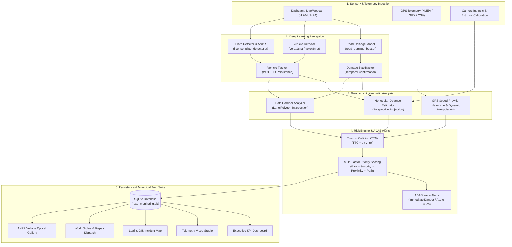

# RoadEye Enterprise: Intelligent Road Monitoring & Collision Avoidance Platform

[](https://www.python.org/)
[](https://pytorch.org/)
[](https://github.com/ultralytics/ultralytics)
[](https://opencv.org/)
[](https://flask.palletsprojects.com/)
[](https://www.sqlite.org/)
[](https://leafletjs.com/)
[]()

> **Author**: Haile Sintayehu ([@haile6](https://github.com/haile6))  
> **Repository**: [haile6/intelligent-road-monitoring-system](https://github.com/haile6/intelligent-road-monitoring-system)  
> **System Architecture**: Multi-Task Vision-Language Telemetry & GIS Infrastructure Platform  

---

## 📌 Executive Summary & Abstract

Modern roadway management relies heavily on manual, hazardous, and infrequent road inspections, leading to delayed maintenance, accelerated pavement degradation, and preventable traffic accidents. 

**RoadEye Enterprise** is a comprehensive, production-ready computer vision and intelligent transportation system (ITS) platform. It transforms standard dashcam or mobile camera video footage, synchronized with GPS telemetry, into actionable roadway health data and real-time Advanced Driver Assistance System (ADAS) warnings.

### Core Capabilities:
1. **Neural Pavement Defect Detection**: High-precision identification of potholes and structural alligator cracks using custom-trained YOLOv8/11 neural networks.
2. **Multi-Object Tracking (MOT)**: Temporal consistency tracking that eliminates duplicate counts across video frames using Intersection-over-Union (IoU) association.
3. **Multi-Vehicle Perception & ANPR**: Simultaneous tracking of passenger cars, commercial trucks, buses, and motorcycles, coupled with Automatic Number Plate Recognition (ANPR).
4. **Monocular Perspective Distance Estimation**: Real-world distance (in meters) calculation using camera geometric projection without requiring expensive LiDAR hardware.
5. **Kinematic Trajectory & Path Corridor Analysis**: Real-time evaluation of whether road hazards or lead vehicles lie directly in the host vehicle's driving path.
6. **Dynamic Time-To-Collision (TTC) & Multi-Tier Risk Engine**: Multi-factor hazard rating (**Safe**, **Caution**, **Warning**, **Immediate Danger**) with automated ADAS voice alerts.
7. **Spatial GIS Synchronization**: Dynamic interpolation of GPS data to geotag every detection with latitude, longitude, bearing, and speed.
8. **Enterprise Municipal Management Web Suite**: Modern, responsive dashboard featuring GIS map corridors, telemetry studio, maintenance dispatch work orders, health diagnostics, and audit logs.

---

## 🏗️ System Architecture

RoadEye is architected in a modular 5-tier pipeline:



---

## 🔬 Mathematical Foundations & Algorithms

### 1. Monocular Perspective Distance Estimation
Without requiring costly LiDAR or stereo cameras, physical distance $Z$ (meters) is computed from 2D pixel coordinates $(u, v)$ on the image plane using the camera mounting geometry:
- Camera Mounting Height: $H$ (meters above ground level)
- Camera Optical Pitch Angle: $\theta$ (radians below horizon)
- Vertical Field of View: $\text{FOV}_v$
- Image Height: $h_{\text{img}}$ pixels

The focal length in pixels is:
$$f_y = \frac{h_{\text{img}}}{2 \cdot \tan\left(\frac{\text{FOV}_v}{2}\right)}$$

The horizon pixel row $y_{\text{horizon}}$ is:
$$y_{\text{horizon}} = \frac{h_{\text{img}}}{2} - f_y \cdot \tan(\theta)$$

For any bounding box bottom contact point $y_{\text{contact}}$:
$$Z = \frac{H}{\tan\left(\theta + \arctan\left(\frac{y_{\text{contact}} - h_{\text{img}}/2}{f_y}\right)\right)}$$

### 2. Time-To-Collision (TTC) Dynamic Kinematics
For any detected obstacle in the vehicle's trajectory corridor:
$$\text{TTC} = \frac{d_{\text{obstacle}}}{v_{\text{approach}}}$$
Where $d_{\text{obstacle}}$ is estimated distance (m) and $v_{\text{approach}}$ is closing velocity (m/s).
- $\text{TTC} \le 1.8\text{s} \implies$ **Immediate Danger** (Red Alert + ADAS Voice Trigger)
- $1.8\text{s} < \text{TTC} \le 3.5\text{s} \implies$ **Warning** (Yellow Alert)
- $3.5\text{s} < \text{TTC} \le 6.0\text{s} \implies$ **Caution** (Blue Alert)
- $\text{TTC} > 6.0\text{s} \implies$ **Safe / Monitoring** (Green)

### 3. Haversine Geodesic Distance & Interpolation
Geographic positioning between sequential GPS fixes is interpolated along the WGS84 ellipsoid:
$$d = 2R \arcsin\left(\sqrt{\sin^2\left(\frac{\Delta \phi}{2}\right) + \cos(\phi_1)\cos(\phi_2)\sin^2\left(\frac{\Delta \lambda}{2}\right)}\right)$$
Where $R \approx 6371000\text{ m}$, $\phi$ is latitude, and $\lambda$ is longitude in radians.

### 4. Spatial GIS Synchronization Explained (The Real-World Highway Case)

To intuitively understand the core contribution of this system, consider a real-world driving scenario on a highway in Ethiopia:

```text
[ Vehicle with Dashcam & GPS ] ======= 15 meters =======> [ Pothole on Highway ]
 (Current GPS fix: Lat A, Lon A)                           (Calculated: Lat B, Lon B)
```

#### The 3-Step Lifecycle:
1. **Step 1: The Camera Detects a Pothole**  
   The custom YOLO model identifies a pothole in the video frame at timestamp `10.5` seconds.
2. **Step 2: The GPS Locates the Vehicle**  
   The GPS receiver logs the vehicle's position, heading, and velocity. However, this GPS position represents the vehicle's antenna, **not the pothole ahead**.
3. **Step 3: GIS Synchronization Projects the Pothole's True Coordinates**  
   The system temporally aligns video time with GPS time, estimates the physical distance ahead ($15\text{ m}$), and uses the vehicle's heading vector to calculate the pothole's exact coordinates.

#### Key Architectural Distinctions:
- **GPS Position**: Where is the vehicle right now?
- **AI Vision Detection**: What object is on the road, and where is it on the 2D image plane?
- **Spatial GIS Synchronization**: Where is that detected hazard geographically on Earth?

#### 4-Step Technical Pipeline:
1. **Time Synchronization**: Matches 30 FPS video frames ($\Delta t = 0.033\text{s}$) with 1 Hz GPS records ($\Delta t = 1.0\text{s}$).
2. **Sub-Second Linear Interpolation (LERP)**:  
   For a detection at $t = 10.5\text{s}$ between known fixes at $t_A = 10.0\text{s}$ and $t_B = 11.0\text{s}$:
   $$f = \frac{10.5 - 10.0}{11.0 - 10.0} = 0.5$$
   $$\text{Latitude}_{\text{vehicle}} = \text{Lat}_A + f \cdot (\text{Lat}_B - \text{Lat}_A)$$
3. **Compass Heading & Azimuth**:  
   Calculates travel direction ($0^\circ = \text{North}, 90^\circ = \text{East}, 180^\circ = \text{South}, 270^\circ = \text{West}$).
4. **Forward Geodesic Projection (`damage_location`)**:  
   Projects a point $15\text{ meters}$ forward along the heading azimuth using the Great Circle destination formula on the WGS84 sphere.

#### Module Responsibilities:
| File | Responsibility |
| :--- | :--- |
| [`gps/gps_sync.py`](file:///c:/Users/haile/Downloads/intelligent-road-monitoring-system-main/gps/gps_sync.py) | Aligns video timestamps to GPS records, interpolates sub-second coordinates, computes vehicle heading, and manages forward hazard projection. |
| [`gps/geo.py`](file:///c:/Users/haile/Downloads/intelligent-road-monitoring-system-main/gps/geo.py) | Mathematical geodesic library providing Haversine distance, forward azimuth bearing, and Great Circle destination point calculations. |

#### Why This is Critical for Modern Transportation:
- **Municipal Road Maintenance**: Repair crews receive exact coordinates (e.g. `9.123456, 39.123456`) instead of hunting for defects along a 50 km road.
- **Interactive GIS Map Corridor (`/map` & `/studio`)**: Renders real-time vehicle movement alongside color-coded defect pins.
- **Multi-Pass Incident Deduplication**: Multiple drive passes on different dates recognize the same physical defect within a 3–5 meter radius rather than recording duplicates.
- **Municipal Work Orders**: Generates verifiable work orders for public works contractors.

> **Formal Presentation Definition:**  
> *"Spatial GIS Synchronization is the process of temporally aligning video frames with GPS data and combining AI-based object detection, vehicle heading, and distance estimation to assign geographic coordinates to road hazards. It enables accurate incident mapping, duplicate detection, risk localization, and location-based road maintenance reporting."*  
> **In one sentence:** *It transforms a pothole detected in a video into a geographically located road incident that municipal authorities can map, investigate, and repair.*

---

## 📁 Repository Directory Structure

```text
intelligent-road-monitoring-system/
├── config.py                 # Centralized configuration (FOV, thresholds, camera tilt)
├── run_web.py                # Main launcher for Web Management Platform & REST APIs
├── run_integrated.py         # One-pass all-in-one unified perception & risk pipeline
│
├── run_phase1.py             # Phase 1: Road Damage Detection (YOLO)
├── run_phase2.py             # Phase 2: Damage Multi-Object Tracking & Confirmation
├── run_phase3.py             # Phase 3: Multi-Vehicle Detection & Tracking
├── run_phase4.py             # Phase 4: Driving Corridor & Trajectory Analysis
├── run_phase5.py             # Phase 5: Monocular Distance Estimation
├── run_phase6.py             # Phase 6: GPS Telemetry Synchronization & Geotagging
├── run_phase6_with_plates.py # Phase 6B: License Plate Detection (ANPR)
├── run_phase7.py             # Phase 7: Kinematic Speed Provider & Plate Association
├── run_phase7_speed.py       # Phase 7B: Alternate Speed Provider Pipeline
├── run_phase8.py             # Phase 8: Dynamic Time-To-Collision (TTC) Engine
├── run_phase9.py             # Phase 9: Unified Multi-Tier Risk Classification
│
├── check_distance.py         # Interactive calibration tool for camera distance validation
├── gpx_to_csv.py             # Telemetry parser converting GPX traces into synchronized CSV
├── package_project.py        # Automated clean packaging script for project submission
│
├── detection/                # Deep Learning Perception Subsystem
│   ├── __init__.py           # Formal package exports
│   ├── road_damage_detector.py # Custom YOLOv8/11 road damage inference wrapper
│   ├── vehicle_detector.py   # Multi-class vehicle inference wrapper
│   └── tracker.py            # IoU-based temporal tracking & confirmation engine
│
├── risk/                     # Spatial Risk & Collision Analytics
│   ├── __init__.py           # Formal package exports
│   ├── distance_estimator.py # Monocular road-plane perspective projection
│   ├── path_analyzer.py      # Driving corridor polygon intersection
│   ├── ttc_calculator.py     # Kinematic Time-To-Collision computing
│   ├── risk_analyzer.py      # Multi-factor hazard classification
│   ├── priority_weight.py    # Infrastructure maintenance priority scoring
│   └── severity_estimator.py # Pavement degradation severity heuristic
│
├── gps/                      # Geodesic & Telemetry Synchronization
│   ├── __init__.py           # Formal package exports
│   ├── gps_reader.py         # CSV & NMEA telemetry reader with caching
│   ├── gps_sync.py           # Sub-second video-to-GPS timestamp interpolation
│   ├── speed_provider.py     # Fallback speed estimation from position deltas
│   ├── geo.py                # Haversine distance & bearing computations
│   └── folium_map.py         # Interactive Leaflet HTML map generator
│
├── database/                 # Relational Data Persistence Layer
│   ├── __init__.py           # Formal package exports
│   ├── db_manager.py         # SQLite connection manager, schema migrations, REST queries
│   └── road_monitoring.db   # Auto-created relational database
│
├── alerts/                   # Auditory ADAS Warning Subsystem
│   ├── __init__.py           # Formal package exports
│   ├── audio_warning.py      # Multi-tone ADAS sound generator & audio muxer
│   └── voice_clips/          # Synthesized spoken audio warnings
│
├── visualization/            # Telemetry Rendering & Video Overlays
│   ├── __init__.py           # Formal package exports
│   └── overlay.py            # High-FPS HUD telemetry, corridor polygons, and banners
│
├── models/                   # Pretrained Deep Learning Weights
│   ├── road_damage_best.pt   # Custom-trained YOLO road damage model (Potholes, Cracks)
│   ├── yolo11s.pt            # YOLO11s multi-vehicle detection model
│   └── license_plate_detector.pt # YOLOv8 ANPR license plate bounding box model
│
├── web/                      # Enterprise Web Management Platform
│   ├── __init__.py           # Formal package exports
│   ├── app.py                # Flask application, REST endpoints, and SSE stream handlers
│   ├── static/               # CSS, JS, audio, PWA manifest
│   └── templates/            # Modern, responsive Jinja2 HTML5 templates
│       ├── base.html         # Master layout with sidebar navigation & telemetry status
│       ├── dashboard.html    # Executive KPI cards & Chart.js breakdown
│       ├── studio.html       # Video telemetry studio with frame scrubber & hazard sync
│       ├── map.html          # Interactive Leaflet GIS road map with hazard markers
│       ├── incidents.html    # Incident ledger with maintenance dispatch workflows
│       ├── plates.html       # ANPR license plate optical evidence gallery
│       ├── pipeline.html     # Browser-based AI pipeline runner with live log streaming
│       ├── reports.html      # Printable municipal work orders & CSV data export
│       ├── calibration.html  # Interactive camera pitch, FOV, and height tuner
│       ├── health.html       # Real-time system hardware, GPU, and model diagnostics
│       ├── audit.html        # Immutable system event & security audit log
│       └── settings.html     # Platform configuration & alert sensitivity preferences
│
├── data/                     # Input Video & GPS Telemetry Data
├── outputs/                  # Generated Master Videos, CSV Reports & Plate Crops
├── requirements.txt          # Python environment dependencies
└── Procfile                  # Production deployment WSGI entry point
```

---

## 💻 Web Management Platform: Page Breakdown

| Page | URL Path | Key Functionality |
| :--- | :--- | :--- |
| **Executive Dashboard** | `/` | Real-time KPI summaries (Total Hazards, Critical Incidents, Monitored Vehicles), Chart.js hazard breakdown, and recent alert feed. |
| **Telemetry Studio** | `/studio` | Dual-view video player synchronized with hazard timeline, frame-accurate scrubber, interactive keyframe jump, and live camera feed. |
| **GIS Road Map** | `/map` | OpenStreetMap/Leaflet visualization displaying the vehicle's GPS track corridor with color-coded pins for potholes and alligator cracks. |
| **Incidents & Repairs** | `/incidents` | Complete municipal maintenance workflow: filter by severity, update status (`Reported` $\to$ `Scheduled` $\to$ `Repaired`), assign crews, and log notes. |
| **ANPR Vehicles Gallery**| `/plates` | Visual optical evidence gallery showing high-resolution vehicle crops, plate crops, confidence ratings, and timestamps. |
| **AI Pipeline Runner** | `/pipeline` | Execute Phase 1 through Phase 9 or the Unified Pipeline directly from the web browser with real-time SSE console output. |
| **Work Orders & Reports**| `/reports` | Printable, formatted municipal work order sheets ready for field repair crews, plus one-click CSV dataset export. |
| **Sensor Calibration** | `/calibration` | Fine-tune camera parameters ($H$, $\theta$, $\text{FOV}_v$), preview ground-plane projections, and save profiles. |
| **System Diagnostics** | `/health` | Live diagnostic badges for YOLO models, GPU/CUDA acceleration, memory utilization, and database integrity. |
| **Audit Ledger** | `/audit` | Chronological record of user interactions, repair status transitions, pipeline runs, and configuration adjustments. |

---

## 🚀 Quickstart & Installation

### 1. Prerequisites
- **Operating System**: Windows 10/11, Ubuntu 20.04+, or macOS
- **Python**: Version `3.10` or higher
- **Hardware**: CPU supported; NVIDIA GPU with CUDA 11.8+ recommended for faster inference.

### 2. Clone and Setup Environment
```bash
# Clone the repository
git clone https://github.com/haile6/intelligent-road-monitoring-system.git
cd intelligent-road-monitoring-system

# Create and activate a virtual environment
# Windows (PowerShell):
python -m venv venv
.\venv\Scripts\Activate.ps1

# Linux / macOS:
python3 -m venv venv
source venv/bin/activate
```

### 3. Install Dependencies
```bash
pip install --upgrade pip
pip install -r requirements.txt
```

### 4. Verify Neural Model Weights
Ensure model weights are present in the `models/` folder:
- `models/road_damage_best.pt` (Custom Road Damage Detector)
- `models/yolo11s.pt` (Vehicle Detector)
- `models/license_plate_detector.pt` (ANPR License Plate Detector)

---

## ⚡ Execution Guide

### Option A: Launch the Web Management Platform (Recommended)
```bash
python run_web.py
```
- Automatically initializes the SQLite database.
- Detects available network ports and LAN IP for mobile streaming.
- Launches Google Chrome directly to the **Telemetry Studio** (`http://127.0.0.1:8080/studio`).

### Option B: Run the Unified All-in-One Pipeline
Process video footage in a single, high-efficiency pass with all detection, tracking, distance, GPS, and risk modules active:
```bash
# Run default video with 2x fast CPU stride acceleration
python run_integrated.py

# Run on a custom video with a specific stride
python run_integrated.py --video data/my_road_trip.mp4 --stride 2

# Run on a live webcam / dashcam feed
python run_integrated.py --webcam 0
```

### Option C: Run Step-by-Step Individual Phases
Each phase can be tested independently for modular verification:
```bash
# Phase 1: Pure YOLO Road Damage Detection
python run_phase1.py

# Phase 2: Damage Multi-Object Tracking & Confirmation
python run_phase2.py

# Phase 3: Multi-Vehicle Detection & Tracking
python run_phase3.py

# Phase 4: Path Corridor & Lane Analysis
python run_phase4.py

# Phase 5: Monocular Distance Estimation
python run_phase5.py

# Phase 6: GPS Geotagging & Route Synchronization
python run_phase6.py

# Phase 7: GPS Speed Provider & Plate Association
python run_phase7.py

# Phase 8: Time-To-Collision (TTC) Dynamic Calculation
python run_phase8.py

# Phase 9: Unified Multi-Tier Risk Classification
python run_phase9.py
```

---

## 🗄️ Relational Database Schema (`road_monitoring.db`)

The SQLite database is structured into 5 normalized tables:

### `damage_records`
| Column | Type | Description |
| :--- | :--- | :--- |
| `id` | INTEGER PRIMARY KEY | Unique record identifier |
| `track_id` | INTEGER | Persistent tracker ID across video frames |
| `class_name` | TEXT | Hazard category (`pothole`, `alligator_crack`) |
| `confidence` | REAL | Peak neural detection confidence (0.00 – 1.00) |
| `severity` | TEXT | Structural severity (`Low`, `Medium`, `High`, `Critical`) |
| `risk_level` | TEXT | Dynamic risk (`Safe`, `Caution`, `Warning`, `Immediate Danger`) |
| `distance_m` | REAL | Estimated distance at point of confirmation (meters) |
| `ttc_seconds` | REAL | Time-To-Collision in seconds |
| `in_path` | INTEGER | Flag (0 or 1) indicating vehicle collision trajectory |
| `latitude` / `longitude` | REAL | Geotagged coordinates |
| `speed_kmh` | REAL | Vehicle velocity at time of encounter |
| `status` | TEXT | Workflow status (`Reported`, `Scheduled`, `Repaired`) |
| `repair_notes` | TEXT | Notes logged by municipal engineers |

---

## 📦 Project Submission Packaging

To generate a clean, production-grade ZIP archive ready for academic or institutional submission:
```bash
python package_project.py
```
This utility automatically:
- Scans all project code, templates, and neural models.
- Strips out `__pycache__`, virtual environments (`venv/`), `.git/`, and redundant temporary video caches.
- Compresses the archive into `road_monitoring_system_complete.zip` with high-efficiency Deflate compression.

---

## 👥 Authors & Academic Attribution

- **Lead Developer**: **Haile Sintayehu**
- **GitHub**: [@haile6](https://github.com/haile6)
- **Email**: `hailesintayehu113@gmail.com`
- **Project**: Intelligent Road Surveillance, Pavement Hazard Management & Collision Avoidance Platform

---

## 📄 License

This project is released under the **MIT License**. You are free to inspect, modify, and distribute this platform for academic, research, and municipal transportation applications.
