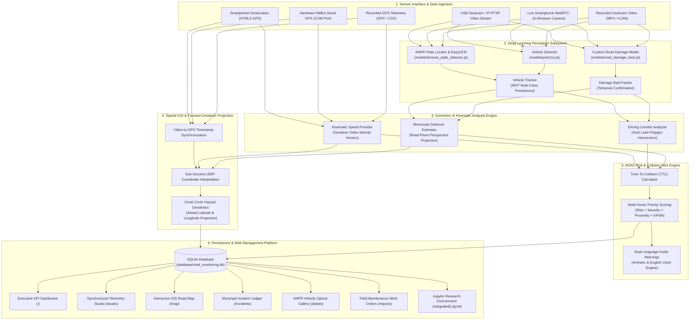

<div align="center">

# 🛣️ RoadEye Enterprise
### Intelligent Road Infrastructure Monitoring & Advanced Collision Avoidance Platform

[](https://www.python.org/)
[](https://pytorch.org/)
[](https://github.com/ultralytics/ultralytics)
[](https://opencv.org/)
[](https://flask.palletsprojects.com/)
[](https://www.sqlite.org/)
[](https://leafletjs.com/)
[](LICENSE)

<br/>

**A production-ready Computer Vision & Intelligent Transportation System (ITS) platform connecting standard dashcam video, smartphone cameras, and GPS telemetry to automate municipal roadway asset preservation and active collision prevention.**

[Live Dashboard](#-web-operations-platform) • [Core Capabilities](#-core-capabilities) • [Debre Berhan Dataset](#-debre-berhan-road-damage-dataset) • [System Architecture](#-system-architecture) • [Quickstart](#-quickstart--installation) • [Automated Tests](#-automated-testing--verification)

<br/>

---

**Author & Principal Researcher**: **Haile Sintayehu** ([@haile6](https://github.com/haile6))  
📫 **Contact**: `hailesintayehu113@gmail.com`  
🏛️ **Repository**: [haile6/intelligent-road-monitoring-system](https://github.com/haile6/intelligent-road-monitoring-system)

---

</div>

<br/>

> [!IMPORTANT]
> **RoadEye Enterprise delivers two synchronized capabilities in a single unified pipeline:**
> 1. **Municipal Asset Preservation**: Automatic detection, severity grading, sub-second GPS geotagging, and work order dispatch for road defects (*potholes* and *alligator fatigue cracks*).
> 2. **Real-Time ADAS Collision Avoidance**: Monocular perspective distance calculation, host vehicle lane corridor analysis, dynamic Time-To-Collision ($\text{TTC}$) evaluation, Automatic Number Plate Recognition (ANPR), and dual-language (**Amharic** & **English**) auditory collision warnings.

<br/>

---

## 🌟 Core Capabilities

<table>
<tr>
<td width="50%" valign="top">

### 🔍 Neural Road Damage Perception
Custom-trained YOLOv8/11 deep models specialized on real-world asphalt imagery. Confidently identifies and differentiates between severe **potholes** and structural **alligator fatigue cracking** under varying daylight, weather, and road conditions.

</td>
<td width="50%" valign="top">

### 📐 Monocular Perspective Distance ($Z$)
Measures real-world ground-plane distance in meters using single-camera geometry ($H, \theta, f_y$). Accurately locates road hazards without requiring expensive, heavy LiDAR or stereo-camera hardware suites.

</td>
</tr>
<tr>
<td width="50%" valign="top">

### ⏱️ Dynamic Time-To-Collision (TTC) Engine
Continuously evaluates approach kinematics ($\text{TTC} = d / v_{\text{approach}}$) against empirical braking envelopes. Automatically triggers visual HUD alerts and spoken warnings when hazards fall within the host vehicle's driving path.

</td>
<td width="50%" valign="top">

### 🗣️ Dual-Language Audio Warnings
Synthesizes spoken collision alerts in both **Amharic** (*"አስቸኳይ አደጋ! በመንገዱ ላይ ጉድጓድ ተገኝቷል!"*) and **English** (*"Danger! Pothole in path, 5 meters!"*), backed by multi-frequency audio beeps.

</td>
</tr>
<tr>
<td width="50%" valign="top">

### 🚗 Vehicle Tracking & ANPR
YOLO11s vehicle detector paired with a specialized license plate locator and EasyOCR engine. Tracks surrounding cars, trucks, buses, and motorcycles while cataloging optical license plate evidence in Ethiopian formats.

</td>
<td width="50%" valign="top">

### 🛰️ Sub-Second GPS Geodesic Projection
Synchronizes high-FPS video frames with 1.0 Hz GPS telemetry via linear interpolation (LERP). Computes forward Great Circle destination coordinates to pinpoint the exact geographic position ($\text{Lat}, \text{Lon}$) of road hazards in advance.

</td>
</tr>
</table>

<br/>

---

## 🛣️ Debre Berhan Road Damage Dataset

To ensure high detection fidelity on authentic regional road networks, RoadEye includes an original pavement distress benchmark collected specifically for this platform:

* 📍 **Geographic Origin**: **Debre Berhan City (ደብረ ብርሃን)**, Amhara Region, Ethiopia.
* 📷 **Collection Method**: **Manual field collection** capturing high-resolution pavement imagery and video across urban asphalt corridors, ring roads, and regional transit arteries under realistic lighting and shadows.
* 🏷️ **Annotation Platform**: Manually labeled, cross-checked, and quality-controlled using **CVAT (Computer Vision Annotation Tool)**.
* 📦 **Format**: Standard Ultralytics YOLOv8 / YOLO11 PyTorch normalized bounding box format (`<class_id> <x_center> <y_center> <width> <height>`).

### 📊 Dataset Distribution & Split Statistics

| Partition | Image Count | Label Count | Share | Folder Location |
| :--- | :---: | :---: | :---: | :--- |
| **Training Set** | 507 | 507 | 70% | [`data/custom_dataset/images/train/`](file:///c:/Users/haile/Downloads/intelligent-road-monitoring-system-main/data/custom_dataset/images/train) |
| **Validation Set** | 109 | 109 | 15% | [`data/custom_dataset/images/val/`](file:///c:/Users/haile/Downloads/intelligent-road-monitoring-system-main/data/custom_dataset/images/val) |
| **Test Set** | 109 | 109 | 15% | [`data/custom_dataset/images/test/`](file:///c:/Users/haile/Downloads/intelligent-road-monitoring-system-main/data/custom_dataset/images/test) |
| **Total Benchmark** | **725** | **725** | **100%** | [`data/custom_dataset/`](file:///c:/Users/haile/Downloads/intelligent-road-monitoring-system-main/data/custom_dataset) |

### 🏷️ Target Defect Classes

| Class ID | Defect Name | Visual Characteristics & Structural Distress |
| :---: | :--- | :--- |
| `0` | **`alligator_crack`** | Interconnected fatigue cracking pattern resembling reptile scales, indicating underlying road sub-base structural failure. |
| `1` | **`pothole`** | Sharp-edged structural depressions and cavity bowls caused by water infiltration and vehicular impact, posing severe collision risks. |

<br/>

---

## 🏗️ System Architecture



<br/>

---

## 🔬 Mathematical Foundations

### 1. Monocular Perspective Distance Estimation
Without requiring active LiDAR sensors, ground-plane distance $Z$ (meters) is derived from camera height $H$, tilt angle $\theta$, vertical field of view $\text{FOV}_v$, and pixel contact row $y_{\text{contact}}$:

$$\text{Focal Length } (f_y) = \frac{h_{\text{img}}}{2 \cdot \tan\left(\frac{\text{FOV}_v}{2}\right)}$$

$$\text{Horizon Line } (y_{\text{horizon}}) = \frac{h_{\text{img}}}{2} - f_y \cdot \tan(\theta)$$

$$Z = \frac{H}{\tan\left(\theta + \arctan\left(\frac{y_{\text{contact}} - \frac{h_{\text{img}}}{2}}{f_y}\right)\right)}$$

---

### 2. Kinematic Time-To-Collision (TTC) Dynamic Matrix
For obstacles within the vehicle's projected driving corridor, $\text{TTC}$ determines the temporal reaction margin:

$$\text{TTC} = \frac{d_{\text{obstacle}}}{v_{\text{approach}}}$$

Where $v_{\text{approach}} = v_{\text{host}}$ for stationary pavement hazards, and $v_{\text{approach}} = \max(v_{\text{host}} - v_{\text{lead}}, 0)$ for dynamic lead vehicles.

| Risk Level | TTC Threshold | Visual HUD Banner | Auditory Warning Action | Operational Response |
| :--- | :---: | :---: | :---: | :--- |
| 🔴 **Immediate Danger** | $\le 1.8\text{ s}$ | High-Contrast Red Banner | Spoken Voice Alert (*Amharic & English*) + Tone | Emergency braking or immediate lane evasive action |
| 🟠 **Warning** | $1.8\text{ s} < \text{TTC} \le 3.5\text{ s}$ | Amber / Orange Warning | Audible Chime Pulse | Prepare deceleration; align steering corridor |
| 🟡 **Caution** | $3.5\text{ s} < \text{TTC} \le 6.0\text{ s}$ | Yellow Informational Banner | Visual Indicator Only | Maintain heightened driver awareness |
| 🟢 **Safe / Clear** | $> 6.0\text{ s}$ | Green Status Overlay | None (Silent Monitoring) | Path unobstructed; normal cruising speed |

---

### 3. Spatial GIS Forward Geodesic Projection
When an obstacle is detected $d$ meters ahead along compass azimuth $\beta$ from current vehicle coordinates $(\phi_1, \lambda_1)$, its geographic position $(\phi_2, \lambda_2)$ is projected over Earth's radius ($R \approx 6,371,000\text{ m}$) using angular distance $\delta = d / R$:

$$\phi_2 = \arcsin\left(\sin(\phi_1)\cos(\delta) + \cos(\phi_1)\sin(\delta)\cos(\beta)\right)$$

$$\lambda_2 = \lambda_1 + \arctan2\left(\sin(\beta)\sin(\delta)\cos(\phi_1),\, \cos(\delta) - \sin(\phi_1)\sin(\phi_2)\right)$$

<br/>

---

## 💻 Web Operations Platform

The platform includes a responsive, full-stack Flask operations suite powered by an SQLite persistence engine:

| View / Tool | Route | Operational Purpose |
| :--- | :--- | :--- |
| 📊 **Executive Dashboard** | `/` | Real-time aggregate KPIs (Total Hazards, Critical Incidents, Monitored Vehicles), Chart.js visual trends, and active alert feeds. |
| 🎬 **Telemetry Studio** | `/studio` | Synchronized split-view: Dashcam video playback (top) coupled with a live Leaflet map (bottom), pulsing hazard markers, and laser trajectory vectors. |
| 🗺️ **GIS Road Map** | `/map` | Fullscreen OpenStreetMap display of vehicle travel routes with color-coded geographic markers for confirmed potholes and cracks. |
| 📋 **Incident Ledger** | `/incidents` | Complete municipal maintenance workflow: filter by severity, transition statuses (`Reported` $\to$ `Scheduled` $\to$ `Repaired`), and assign repair crews. |
| 🚗 **ANPR Plate Gallery** | `/plates` | Optical evidence gallery displaying high-resolution vehicle crops, plate crops, OCR confidence scores, and timestamps. |
| ⚡ **AI Pipeline Runner** | `/pipeline` | In-browser executor for individual phases or the unified pipeline with real-time Server-Sent Events (SSE) console logs. |
| 📑 **Work Order Reports** | `/reports` | Printable, formatted municipal inspection reports formatted for field crews, with one-click CSV dataset export. |
| ⚙️ **Sensor Calibration** | `/calibration` | Interactive calibration tool for camera elevation ($H$), pitch tilt ($\theta$), and field of view ($\text{FOV}_v$). |
| 🩺 **System Diagnostics**| `/health` | Diagnostic monitor tracking YOLO model availability, GPU/CUDA acceleration, memory usage, and database integrity. |
| 🛡️ **Audit Ledger** | `/audit` | Chronological audit trail logging user interactions, status modifications, and system configuration adjustments. |

<br/>

---

## 🚀 Quickstart & Installation

### 1. Prerequisites
* **Operating System**: Windows 10/11, Ubuntu 20.04+, or macOS
* **Python**: Version `3.10` or `3.11` (64-bit recommended)
* **Hardware**: Runs efficiently on standard CPUs; NVIDIA GPU with CUDA recommended for high-frame-rate real-time inference.

### 2. Setup Environment
```bash
# Clone the repository
git clone https://github.com/haile6/intelligent-road-monitoring-system.git
cd intelligent-road-monitoring-system

# Create and activate virtual environment
# Windows (PowerShell):
python -m venv venv
.\venv\Scripts\Activate.ps1

# Linux / macOS:
python3 -m venv venv
source venv/bin/activate

# Install dependencies
pip install --upgrade pip
pip install -r requirements.txt
```

### 3. Verify Neural Model Weights
Ensure pretrained model weights are placed inside the `models/` directory:
* `models/road_damage_best.pt` — Custom road defect detection model (Potholes & Alligator Cracks)
* `models/yolo11s.pt` — Multi-vehicle detection model
* `models/license_plate_detector.pt` — License plate detector model

<br/>

---

## ⚡ Execution Modes

### Mode 1: Launch the Web Operations Platform (Recommended)
```bash
python run_web.py
```
* Automatically initializes the SQLite database schema.
* Detects available network ports (default: `8080`) and auto-assigns next available port if occupied.
* Detects local Wi-Fi / LAN IP for mobile browser dashcam connectivity.
* Access locally via **`http://127.0.0.1:8080`** or on mobile devices via **`http://<YOUR_LAN_IP>:8080/studio`**.

### Mode 2: Unified Command-Line (CLI) Pipeline
```bash
# Process default test video
python run_integrated.py

# Process custom video file with real-time HUD rendering
python run_integrated.py --source data/ethiopian_road_driving_test.mp4 --show

# Process live USB dashcam or built-in webcam (Device Index 0)
python run_integrated.py --source 0 --show

# Process wireless mobile phone camera stream (IP Webcam RTSP/HTTP)
python run_integrated.py --source "http://192.168.1.50:8080/video" --show
```

### Mode 3: Interactive Jupyter Research Environment
```bash
jupyter notebook integrated2.ipynb
```
* Explores the Debre Berhan pavement distress benchmark.
* Demonstrates YOLO transfer learning, metric distance calculation, and GIS geotagging.

<br/>

---

## 🧪 Automated Testing & Verification

The repository includes a comprehensive, automated end-to-end test suite verifying distance geometry, GPS interpolation, TTC kinematics, database transactions, and Web API responses:

```bash
# Run all automated unit and end-to-end tests
python -m unittest tests/test_end_to_end.py -v
```

> [!TIP]
> All 20 core mathematical and system tests run in less than **0.05 seconds**, ensuring regression-free development and reliable production deployments.

<br/>

---

## 📁 Repository Directory Structure

```text
intelligent-road-monitoring-system/
├── config.py                 # Central configuration (FOV, camera height, tilt, risk thresholds)
├── run_web.py                # Web Management Panel launcher with dynamic port discovery
├── run_integrated.py         # Unified one-pass perception, tracking, GIS, and risk pipeline
├── integrated2.ipynb         # Interactive Jupyter research and validation notebook
│
├── run_phase1.py             # Phase 1: Pure YOLO Road Damage Detection
├── run_phase2.py             # Phase 2: Damage Multi-Object Tracking & Confirmation
├── run_phase3.py             # Phase 3: Multi-Vehicle Detection & MOT Tracking
├── run_phase4.py             # Phase 4: Dynamic Driving Corridor & Trajectory Analysis
├── run_phase5.py             # Phase 5: Monocular Perspective Distance Estimation
├── run_phase6.py             # Phase 6: Sub-Second GPS Geotagging & Synchronization
├── run_phase6_with_plates.py # Phase 6B: License Plate Detection (ANPR Subsystem)
├── run_phase7.py             # Phase 7: GPS Speed Provider & Plate Association
├── run_phase7_speed.py       # Phase 7B: Alternative Speed Estimation Module
├── run_phase8.py             # Phase 8: Dynamic Time-To-Collision (TTC) Engine
├── run_phase9.py             # Phase 9: Unified Multi-Tier Risk Classification & CLI
│
├── check_distance.py         # Interactive calibration tool for camera elevation & tilt
├── gpx_to_csv.py             # Telemetry parser converting GPX traces to synchronized CSV
├── package_project.py        # Automated clean project packaging script for submission
│
├── detection/                # Deep Learning Perception Subsystem
│   ├── road_damage_detector.py # Custom YOLOv8/11 road damage inference wrapper
│   ├── vehicle_detector.py     # Multi-class vehicular inference wrapper
│   └── tracker.py              # IoU & ByteTrack temporal tracking and hit counters
│
├── risk/                     # Spatial Analytics & ADAS Kinematics
│   ├── distance_estimator.py   # Perspective ground-plane distance estimation
│   ├── path_analyzer.py        # Host lane polygon intersection
│   ├── ttc_calculator.py       # Dynamic Time-to-Collision evaluation
│   ├── risk_analyzer.py        # Multi-factor hazard classification
│   ├── priority_weight.py      # Municipal repair priority scoring algorithm
│   └── severity_estimator.py   # Pavement surface degradation metric
│
├── gps/                      # Spatial GIS & Telemetry Synchronization
│   ├── gps_reader.py           # Synchronized CSV/NMEA telemetry reader
│   ├── gps_sync.py             # Sub-second video-to-GPS interpolation
│   ├── speed_provider.py       # Kinematic speed calculation from geodesic deltas
│   ├── geo.py                  # Haversine distance and Great Circle bearing algorithms
│   ├── real_gps_reader.py      # Serial COM interface for physical NMEA GPS receivers
│   └── folium_map.py           # Standalone Leaflet HTML road inspection generator
│
├── database/                 # Relational Data Persistence Layer
│   ├── db_manager.py           # SQLite connection pool, schema migrations, and queries
│   └── road_monitoring.db     # SQLite database storing incidents, plates, and audit trails
│
├── alerts/                   # Auditory Warning Subsystem
│   ├── audio_warning.py        # Synthesized audio tone generator & audio muxer
│   └── voice_clips/            # Spoken English and Amharic collision alert audio
│
├── visualization/            # Overlay Rendering & Head-Up Displays (HUD)
│   └── overlay.py              # High-FPS telemetry HUD, collision banners, and lane corridors
│
├── models/                   # Deep Neural Network Weights
│   ├── road_damage_best.pt     # Custom-trained YOLO model (Potholes & Alligator Cracks)
│   ├── yolo11s.pt              # YOLO11s multi-class vehicle detector
│   └── license_plate_detector.pt # YOLOv8 ANPR license plate detection model
│
├── data/                     # Data Repository
│   ├── custom_dataset/         # Debre Berhan CVAT dataset (725 images & labels, dataset.yaml)
│   ├── gps_track.csv           # Synchronized test drive telemetry track
│   └── *.mp4                   # Highway and urban test videos
│
├── tests/                    # Automated Test Suite
│   └── test_end_to_end.py      # 20-test end-to-end validation suite
│
├── outputs/                  # Export Artifacts, Annotated Videos, and Evidence Crops
├── web/                      # Enterprise Flask Operations Suite (Templates, Static, APIs)
├── requirements.txt          # Python dependency specifications
└── Procfile                  # Production WSGI application specification
```

<br/>

---

## 📦 Project Submission Packaging

To compile a clean, production-grade ZIP archive ready for academic or institutional submission:

```bash
python package_project.py
```

This utility automatically excludes virtual environments (`venv/`), temporary compilation caches (`__pycache__`), git metadata (`.git/`), and intermediate frame buffers, producing a clean submission ZIP file (`road_monitoring_system_complete.zip`).

<br/>

---

## 👥 Authorship & Academic Attribution

* **Principal Investigator & Lead Developer**: **Haile Sintayehu**
* **GitHub Profile**: [@haile6](https://github.com/haile6)
* **Institutional Contact**: `hailesintayehu113@gmail.com`
* **Repository**: [haile6/intelligent-road-monitoring-system](https://github.com/haile6/intelligent-road-monitoring-system)
* **Domain Focus**: Computer Vision for Intelligent Transportation Systems, Road Asset Preservation & Advanced Driver Assistance Systems (ADAS).

<br/>

---

## 📄 License

This project is licensed under the **MIT License** — see the [LICENSE](LICENSE) file for details. You are free to inspect, modify, and distribute this platform for academic, research, and municipal transit engineering applications with appropriate attribution.
