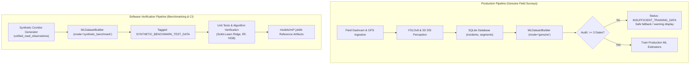

# RoadEye™ Data Quality, Provenance & Integrity Specification

## 1. Scientific Data Integrity Mandate

In civil infrastructure management, relying on fabricated or synthetic data to make structural predictions poses severe financial, operational, and safety risks. RoadEye™ enforces strict data integrity rules across all forecasting layers:

1. **Prohibition of Synthetic Data in Production**:
   Synthetic backward-interpolated data is strictly confined to unit and integration test fixtures (`SYNTHETIC_BENCHMARK_TEST_DATA`). It is never ingested by production models as genuine historical observations.
2. **Transparent Reporting of Data Insufficiency**:
   When longitudinal survey history is absent or incomplete, the system must display explicit status indicators (`INSUFFICIENT_TRAINING_DATA`, `INSUFFICIENT_SEASONAL_DATA`, `INSUFFICIENT_POTHOLE_HISTORY`) rather than inventing artificial degradation curves or arbitrary multipliers.
3. **Decoupled Predictions and Economic Models**:
   Pavement condition degradation (structural engineering) is modeled independently from maintenance budgeting (financial planning). No ROI or monetary claims are produced without formal engineering unit-rate calibration.

---

## 2. Current Database Audit & Longitudinal Field Reality

### 2.1. Audit Methodology (`MLDatasetBuilder.audit_genuine_dataset`)
The database is systematically audited before any model training or longitudinal prediction:
- **Distinct Survey Dates**: Queries the `incidents` and `unified_road_observations` tables for unique calendar dates with verified field inspections.
- **Longitudinal Horizon Alignment**: Evaluates whether sequential inspection pairs exist for 7-day, 30-day, and 60-day forecasting intervals.
- **Segment Overlap**: Verifies that the same physical road segments were revisited on subsequent dates to measure actual distress progression.

### 2.2. Audit Findings for the Debre Berhan Corridor
An inspection of `database/road_monitoring.db` reveals:
- **Genuine Survey Dates Present**: Exactly 2 dates (`2026-10-20` and `2026-11-16`).
- **Seasonal Distribution**: Both surveys took place during **Bega (the dry season)**.
- **Wet-Season (Kiremt/Belg) Repeated Inspections**: **0 observations**.
- **Consecutive Longitudinal Pairs**:
  - 7-day pairs: **0**
  - 30-day pairs: **0** (Interval between 2026-10-20 and 2026-11-16 is 27 days, with differing segment coverages)
  - 60-day pairs: **0**

### 2.3. System Status Classifications

| Subsystem | Audit Status | User-Facing Display | Engineering Reason |
|---|---|---|---|
| **Pavement Deterioration (Genuine Mode)** | `INSUFFICIENT_TRAINING_DATA` | *"Insufficient genuine historical survey dates to train ML model."* | Requires $\ge 3$ repeated panel survey epochs with time-aligned target intervals. |
| **Seasonal Deterioration Ratio** | `INSUFFICIENT_SEASONAL_DATA` | *"Data pending" / "Not available"* | Zero wet-season (Kiremt) inspections available; cannot compute empirical wet-to-dry ratio without fabricating numbers. |
| **Pothole 3D Growth Tracking** | `INSUFFICIENT_POTHOLE_HISTORY` | *"Insufficient repeated defect observations at this GPS location."* | Requires at least 2 distinct temporal visits within 15 meters of the same defect centroid. |

---

## 3. Synthetic Benchmark Test Fixtures vs Genuine Survey Data

To ensure complete transparency, RoadEye™ distinguishes between two data pipelines:



### Strict Benchmark Usage Rules:
- The synthetic dataset is explicitly tagged with `provenance: "SYNTHETIC_BENCHMARK_TEST_DATA"`.
- It is used **only** to verify mathematical convergence, API response serialization, Scikit-Learn wrapper compatibility, and UI rendering.
- All dashboard endpoints clearly display the provenance banner (`data_source: "SYNTHETIC_BENCHMARK_TEST_DATA"` or `"GENUINE_FIELD_DATA"`).

---

## 4. Local Ethiopian Corridor Context (Route A2)

The primary monitoring corridor for RoadEye™ is the **Route A2 trunk highway** connecting Addis Ababa to Dessie via Debre Berhan (Highland elevation: $2,840\,\text{m}$):

### 4.1. Climate Seasons & Rainfall Regimes
- **Kiremt (June – September)**:
  - Heavy monsoonal rains (average monthly precipitation: $280\,\text{mm}$).
  - High risk of moisture stripping, ditch flooding, and base softening.
  - Saturated pavement combined with heavy traffic accelerates asphalt cavitation.
- **Belg (March – May)**:
  - Moderate autumn rains (average monthly precipitation: $95\,\text{mm}$).
  - Intermittent wet/dry cycles inducing micro-crack expansion.
- **Bega (October – February)**:
  - Dry, sunny season (average monthly precipitation: $15\,\text{mm}$).
  - Minimal hydraulic stripping risk; degradation driven primarily by fatigue and axle loads.

### 4.2. Commercial Freight Traffic Composition
- **AADT**: ~8,500 to 10,500 vehicles per day on Route A2.
- **Commercial Heavy Truck Percentage**: ~24% to 28% of total volume.
- **Vehicle Types**: SinoTruck dual- and tri-axle dumpers carrying construction quarry aggregate, heavy multi-axle freight trailers, and cement tankers.
- **Axle Load Impact**: Repetitive dynamic axle loading on water-infiltrated pavement induces rapid pumping of subgrade fines, resulting in structural potholing.

---

## 5. Field Data Collection Roadmap & Protocol

To transition the production ML engine from `INSUFFICIENT_TRAINING_DATA` to fully operational field models, the following survey protocol is established:

```
Month 1           Month 2           Month 3           Month 4
[Survey 1] -----> [Survey 2] -----> [Survey 3] -----> [Survey 4]
  t=0               t=30d             t=60d             t=90d
  (Dry/Bega)        (Dry/Bega)        (Belg/Rain)       (Belg/Rain)
```

1. **Survey Frequency**:
   - Bi-weekly (every 14 days) dashcam passes along Route A2 corridor segments.
   - Immediate post-rainfall passes to capture acute moisture damage events.
2. **Geospatial Precision Standards**:
   - High-precision GPS receivers with $< 3\,\text{m}$ horizontal accuracy.
   - Geospatial snapping to fixed 100-meter corridor stationing markers.
3. **Repeated Defect Clustering**:
   - Geotagged bounding boxes matched using Euclidean distance thresholds ($\Delta d \le 15\,\text{m}$).
   - Calibrated 3D photogrammetric reference targets for camera optical calibration.
4. **Automated Continuous Retraining**:
   - Once $\ge 3$ verified longitudinal survey dates are committed to SQLite, `POST /api/predictions/retrain` automatically executes the genuine model training pipeline.
