# RoadEye™ Machine Learning Pavement Deterioration Architecture

## 1. Executive Summary & Objective

The **RoadEye™ Machine Learning Pavement Deterioration Engine** replaces legacy heuristic rules, hardcoded multipliers (such as the unverified $1.45\times$ or $4.2\times$ seasonal acceleration rates), and synthetic backwards interpolations with a scientifically validated, mechanism-based machine learning pipeline. 

Pavement degradation is a complex non-linear physical process governed by the coupled interaction of:
- **Repetitive dynamic axle loading** (commercial freight traffic, heavy SinoTrucks on Ethiopian trunk corridors).
- **Environmental moisture ingress and pore-pressure stripping** (precipitation during Kiremt/Belg rainy seasons).
- **Existing structural distress states** (micro-fissures, fatigue alligator cracking, potholes).
- **Drainage topology and subgrade susceptibility** (slope gradients, lateral ditch clearances).

Rather than forcing arbitrary multipliers onto pavement condition indices, RoadEye™ deploys genuine Scikit-Learn regression ensembles (`RandomForestRegressor`, `HistGradientBoostingRegressor`, and regularized `Ridge`) trained strictly on time-aligned observations to predict structural deterioration across multiple forecast horizons (**7, 30, and 60 days**).

---

## 2. End-to-End System Pipeline

```mermaid
flowchart TD
    subgraph DataSources["1. Multimodal Data Ingestion"]
        A1["Computer Vision & YOLOv8<br/>(/api/incidents, surface defects)"]
        A2["Monocular 3D Volumetric<br/>(depth, cavity volume liters)"]
        A3["Atmospheric Open-Meteo<br/>(rainfall mm, humidity, temp)"]
        A4["ERA Traffic & Freight Proxies<br/>(AADT, SinoTruck HGV share)"]
        A5["Topographic Drainage Audit<br/>(slope, ditch condition)"]
    end

    subgraph FeatureEngineering["2. Physical Mechanism Feature Engineering"]
        B1["MechanismFeatureExtractor<br/>(13 engineered features)"]
        B2["Moisture Stripping Index<br/>(cumulative rain × baseline PCI)"]
        B3["Dynamic Load Exposure<br/>(AADT × HGV % × axle load factor)"]
        B4["Drainage Vulnerability Score<br/>(slope & ditch deficiency)"]
        B5["Missing Data Auditing<br/>(explicit indicator flags)"]
    end

    subgraph DatasetBuilder["3. ML Dataset Builder & Validation"]
        C1["MLDatasetBuilder<br/>(Time-aligned feature vectors)"]
        C2{"Data Sufficiency Audit<br/>(>=2 distinct dates, >=3 segments)"}
        C3["Genuine Mode: Strict Observation Audit<br/>Returns INSUFFICIENT_TRAINING_DATA if scarce"]
        C4["Chronological Split<br/>Train: 70% | Val: 15% | Test: 15%<br/>(Zero Future Temporal Leakage)"]
    end

    subgraph ModelPortfolio["4. Machine Learning Estimators"]
        D1["Ridge Regressor (Baseline L2)"]
        D2["Random Forest Regressor (Ensemble Trees)"]
        D3["HistGradientBoosting Regressor (Gradient Boosting)"]
        D4["Markov Chain Baseline (Stochastic Transition)"]
    end

    subgraph ModelServing["5. Serving, Storage & Pothole Tracking"]
        E1["Persisted Models (models/ml/*.joblib)"]
        E2["PotholeGrowthPredictor<br/>(Spatial GPS defect clustering)"]
        E3["REST API Endpoints<br/>(/api/predictions/*)"]
    end

    subgraph DecisionLayer["6. Decoupled Cost & Maintenance Layer"]
        F1["MaintenanceCostEstimator<br/>(ERA Unit Rates ETB/m2)"]
        F2["Urgency Categorization<br/>(Critical, High, Medium, Low)"]
    end

    DataSources --> FeatureEngineering
    FeatureEngineering --> DatasetBuilder
    C1 --> C2
    C2 -- "Insufficient Survey Data" --> C3
    C2 -- "Data Valid" --> C4
    C4 --> ModelPortfolio
    ModelPortfolio --> ModelServing
    ModelServing --> DecisionLayer
```

---

## 3. Core Architectural Modules

### 3.1. Mechanism Feature Extraction (`risk/mechanism_features.py`)
Extracts 13 dimensional physical distress and environmental interaction features from raw survey records, avoiding arbitrary heuristic weights:
- **Moisture Exposure**: 30-day cumulative precipitation ($mm$), 14-day rainfall intensity, and rainfall moisture stripping index.
- **Dynamic Load Exposure**: SinoTruck heavy commercial traffic volume proxies derived from Ethiopian Roads Administration (ERA) counts.
- **Fatigue Distress State**: Logarithmic crack density, pothole counts per segment, and base condition indices.
- **Topographic & Drainage Vulnerability**: Gradient slopes and ditch obstruction risks, with explicit indicator flags (`drainage_slope_missing_flag`) when field audits lack sensor data.

### 3.2. Dataset Builder & Temporal Splitting (`risk/ml_dataset_builder.py`)
Enforces strict chronological partitioning to eliminate lookahead bias and temporal data leakage:
$$\text{Train Dates} \le \text{Validation Dates} \le \text{Test Dates}$$
- **Data Provenance Enforcement**: Strictly segregates genuine field inspection records from synthetic benchmark fixtures.
- **Data Sufficiency Gate**: If the database contains fewer than the required longitudinal observation horizons across survey dates, the builder explicitly halts model fitting and emits `INSUFFICIENT_TRAINING_DATA`.

### 3.3. Scikit-Learn Model Portfolio (`risk/ml_deterioration_predictor.py`)
Trains and benchmarks four distinct algorithms on identical feature sets:
1. **Ridge Regression**: L2-regularized linear model providing transparent linear coefficients and stabilizing multicollinear atmospheric features:
   $$\min_{\mathbf{w}} \frac{1}{2n_{\text{samples}}} \|\mathbf{X}\mathbf{w} - \mathbf{y}\|_2^2 + \alpha \|\mathbf{w}\|_2^2$$
2. **Random Forest Regressor**: 100-tree ensemble with bootstrap bagging, capturing non-linear interactions between heavy axle loading and moisture saturation.
3. **HistGradientBoosting Regressor**: Bin-based gradient boosting algorithm (equivalent to LightGBM/XGBoost) handling non-linear splits and high-dimensional defect matrices.
4. **Data-Driven Markov Baseline**: Empirical transition probability matrix $P_{ij}$ across 5 discrete pavement condition states, serving as a classical stochastic benchmark.

### 3.4. Pothole Growth Predictor (`risk/pothole_growth_predictor.py`)
Pothole growth operates as an independent, localized 3D morphological tracking subsystem:
- Uses Euclidean geospatial clustering ($\Delta\text{dist} \le 15\text{ meters}$) to match recurring defects across dashcam inspection runs.
- Tracks 4 geometric dimensions: **length ($cm$), width ($cm$), depth ($cm$), cavity volume ($liters$)**.
- When repeated longitudinal passes for an individual defect are absent, the system explicitly returns `INSUFFICIENT_POTHOLE_HISTORY` rather than synthesizing fictitious growth curves.

### 3.5. Decoupled Maintenance Cost Estimator (`risk/maintenance_cost_estimator.py`)
To prevent data contamination and arbitrary economic assertions:
- Pavement deterioration prediction (ML) and maintenance cost estimation are **strictly decoupled**.
- Predicted future PCI and structural distress classifications are passed to the ERA standard maintenance schedule (`MaintenanceUnitRatesERA`).
- Computes bill-of-quantities cost estimates in Ethiopian Birr (ETB) based on current Ethiopian road authority engineering rates for pothole patching, crack sealing, mill-and-overlay, and deep reconstruction.

---

## 4. API Endpoints Contract

| Endpoint | Method | Description | Primary Response Fields |
|---|---|---|---|
| `/api/predictions/summary` | `GET` | Network-level forecast summary across all road segments | `forecast_horizons_days`, `best_model`, `network_average_current_pci`, `network_average_predicted_pci`, `data_source` |
| `/api/predictions/segments` | `GET` | Segment-by-segment predicted PCI, deterioration delta, and risk levels | `segment_id`, `current_pci`, `predicted_pci_30d`, `delta_pci`, `urgency_level`, `best_model_used` |
| `/api/predictions/segment/<id>` | `GET` | Detailed multi-horizon forecast (7d, 30d, 60d) for a single road segment | `segment_id`, `horizons`, `mechanism_features`, `cost_estimate_etb`, `recommended_action` |
| `/api/predictions/model-performance` | `GET` | Evaluation benchmarks across all models (MAE, RMSE, $R^2$) | `models` (Ridge, Random Forest, HistGradientBoosting, Markov), `best_model`, `metrics`, `test_split_ratio` |
| `/api/predictions/feature-importance` | `GET` | Permutation feature importance ranking from validation dataset | `rankings`, `features`, `top_influencing_mechanism`, `method` |
| `/api/predictions/pothole-growth/<id>` | `GET` | Longitudinal 3D growth forecast for specific defect cluster | `defect_id`, `status` (`INSUFFICIENT_POTHOLE_HISTORY` or historical metrics), `calibrated_sensor` |
| `/api/predictions/retrain` | `POST` | Triggers background model retraining with validation scoring | `status`, `sample_count`, `active_model`, `validation_r2`, `validation_mae` |

---

## 5. Model Persistence & Retraining Safety

All trained estimators, scalers, and hyperparameter configurations are serialized under `models/ml/`:
- `models/ml/rf_pci_30d.joblib` (Primary 30-day Random Forest model)
- `models/ml/ridge_pci_30d.joblib` (Baseline Ridge model)
- `models/ml/hgb_pci_30d.joblib` (HistGradientBoosting model)
- `models/ml/rf_pci_7d.joblib` (7-day near-term model)
- `models/ml/rf_pci_60d.joblib` (60-day strategic planning model)
- `models/ml/model_metadata.json` (Training timestamp, dataset size, validation scores, feature lists)

**Retraining Fail-Safe**:
During retraining via `POST /api/predictions/retrain`:
1. If the database lacks sufficient new genuine observations, the retrain handler preserves existing validated artifacts and warns the operator.
2. Models are evaluated against the held-out validation set before replacing disk artifacts.
3. If an estimator's validation $R^2$ degrades or encounters convergence errors, the existing persisted weights remain active in memory without service disruption.
