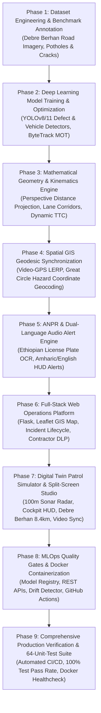
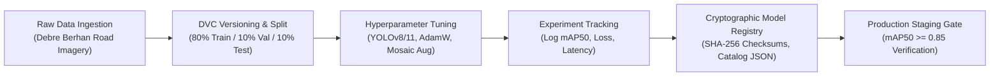
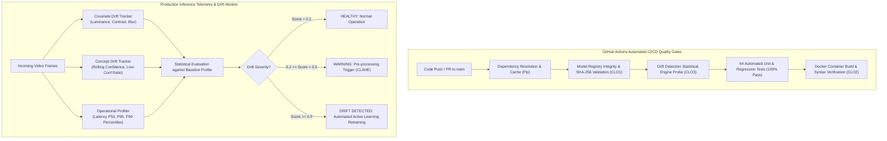

<div align="center">

# 🛣️ Data Science Project Concept Note & Implementation Proposal
### RoadEye: Intelligent Road Infrastructure Monitoring & Advanced Collision Avoidance Platform

[](https://www.python.org/)
[](https://pytorch.org/)
[](https://github.com/ultralytics/ultralytics)
[](https://opencv.org/)
[](https://flask.palletsprojects.com/)
[](https://www.sqlite.org/)
[](https://leafletjs.com/)

<br/>

**Author & Principal Researcher**: **Haile Sintayehu** ([@haile6](https://github.com/haile6))  
📫 **Contact**: `hailesintayehu113@gmail.com` • 🏛️ **Repository**: [haile6/intelligent-road-monitoring-system](https://github.com/haile6/intelligent-road-monitoring-system)  
**Academic / Institutional Context**: Ethiopian Road Infrastructure & Urban Mobility Initiative • **Date**: November 2026  

---

[1. Project Introduction](#1-project-introduction) • [2. Problem Statement](#2-statement-of-the-problem) • [3. Project Objectives](#3-project-objectives) • [4. Project Scope](#4-project-scope) • [5. Significance & Beneficiaries](#5-project-significance-and-beneficiaries) • [6. Requirements Matrix](#6-functional-and-non-functional-requirements) • [7. Implementation Roadmap](#7-project-implementation-roadmap--milestones)

---

</div>

<br/>

> [!IMPORTANT]
> **Executive Summary**: RoadEye delivers an enterprise-grade multimodal Data Science, Computer Vision, and Intelligent Transportation System (ITS) platform combining dashcam video feeds, GPS telemetry, and OpenStreetMap (OSM) infrastructure to solve three synchronized challenges:
> 1. **Municipal Pavement Asset Preservation**: Automated pavement distress detection (potholes, structural cracking), metric severity grading, and forward geodesic geotagging.
> 2. **Active Collision Avoidance & ADAS**: Monocular metric distance estimation ($Z$), kinematic Time-To-Collision ($\text{TTC}$) lookahead, and dual-language (Amharic & English) auditory driver alerts.
> 3. **Digital Twin Road Patrol Simulator & Split-Screen Inspection Studio**: Real-time vehicle patrol playback across Ethiopian highway corridors, 100m early-warning concentric proximity sonar radar, live Cockpit Telemetry HUD, and sub-second synchronized split-screen dashcam video playback with instant keyframe defect jumping.

<div align="center">
  
  <p><em>Figure 1: Live In-Vehicle ADAS Perception & Collision Avoidance Demo — Real-time driving corridor projection, multi-target vehicle kinematics, closing Time-To-Collision (TTC) estimation, Ethiopian license plate recognition (ANPR), and dual-language (Amharic & English) HUD warnings.</em></p>
</div>

<br/>

---

## 1. Project Introduction

Introduce the proposed project and provide sufficient background to explain its purpose and context.

### 1.1 Background and Context
Road transportation serves as the primary backbone of economic mobility in developing nations, with over 90% of passenger and freight traffic in Ethiopia reliant on the national highway network. However, paved asphalt surfaces suffer from rapid deterioration due to heavy freight axle loads, intense seasonal rains, and delayed municipal maintenance cycles. Pavement distresses such as deep potholes and alligator fatigue cracks present severe safety hazards, causing rapid mechanical vehicle wear, sudden tire punctures, and catastrophic rollover collisions when drivers make abrupt evasive maneuvers.

### 1.2 Problem Domain
This project operates at the intersection of three critical domains:
1. **Civil Infrastructure Preservation**: Municipal roadway asset inventory, distress severity grading, and repair dispatch.
2. **Computer Vision & Edge Deep Learning**: Real-time object detection, multi-object tracking (MOT), and perspective monocular geometry.
3. **Intelligent Transportation Systems (ITS) & ADAS**: In-cabin active collision prevention, driver warnings, and spatial GIS mapping.

### 1.3 Proposed Data-Driven Solution
**RoadEye** is an end-to-end multimodal computer vision, spatial data science, and intelligent transportation platform designed to transform standard, low-cost monocular cameras (dashcams or smartphone cameras) and GPS receivers into an automated, synchronized roadway inspection, contractor warranty audit, and collision safety system. Instead of relying on prohibitively expensive, specialized profiler survey vans, RoadEye leverages deep neural networks, ground-plane perspective geometry, and GIS geodesic interpolation to detect pavement distresses in real time, estimate contact distances, project forward GPS coordinates, audit contractor liability, and simulate digital twin patrol missions with synchronized video evidence.

### 1.4 Application of Data Science & Software Engineering
Data science, machine learning, and spatial engineering techniques are applied across eight synchronized layers:
* **MLOps & Production AI Lifecycle**: Model artifact versioning with SHA-256 integrity catalogs, DVC dataset versioning, Docker containerization, REST API serving (`/api/v1/predict`, `/api/v1/health`), and statistical covariate/concept drift monitoring (CLO1, CLO2, CLO3).
* **Deep Neural Object Detection**: Transfer-learned YOLOv8/11 architectures fine-tuned on regional road distress benchmarks (deep impact potholes, transverse fissures, and structural alligator fatigue cracking).
* **Multi-Object Tracking (MOT)**: Temporal ByteTrack algorithms to maintain persistent object identities across occlusions, eliminate duplicate database records, and filter transient noise.
* **Monocular Perspective Geometry**: Closed-form ground-plane trigonometric projection estimating physical ground distance ($Z$) in meters without requiring LiDAR or multi-camera stereoscopy.
* **Spherical Geodesic Kinematics**: Great Circle forward geodesic equations combined with sub-second linear timestamp interpolation (LERP) to pinpoint obstacle latitude/longitude forward of vehicle GPS coordinates.
* **Proximity Sonar Radar & Acoustic Synthesis**: Interactive 100m proximity radar horizon with concentric shockwave pulses, forward laser line acquisition, and dynamic Web Audio synthesizer alerts (920 Hz Danger, 660 Hz Caution).
* **Live Cockpit Telemetry & Vehicle Kinematics Engine**: Real-time speedometer with cornering deceleration physics, 16-wind rotating compass rose, sub-meter dual trip odometer, and live ETA estimation.
* **Synchronized Video-GIS Split-Screen Streaming**: Bidirectional lockstep synchronization connecting HTML5 dashcam video playback with Leaflet GIS map tracking, sub-second drift compensation, and 1-click defect keyframe seeking.

### 1.5 System Architecture & Operational Components
The RoadEye platform integrates four unified operational modules:
1. **On-Vehicle Edge Perception Engine**: Real-time HUD perception running on dashcam video streams with dual-language (**Amharic & English**) visual and auditory collision warnings.
2. **Contractor Warranty & Liability Registry (DLP)**: Automated auditing module linking OpenStreetMap national highway corridors with contractor construction contracts, warranty expiration dates, and municipal maintenance savings.
3. **Interactive GIS Digital Twin & Patrol Simulator**: High-fidelity Leaflet map environment featuring a 100m proximity scanning radar, animated patrol car marker, dynamic speed/compass HUD, and multi-tier range selection.
4. **Synchronized Split-Screen Dashcam Video Studio**: Dual-view inspection portal pairing the moving GIS patrol marker with the synchronized dashcam video keyframes, enabling municipal reviewers to visually verify pavement distress pins against video evidence.
5. **MLOps Production Serving & Quality Gate Architecture**: Multi-stage Docker containerization, automated GitHub Actions CI/CD with 64 automated regression tests, REST API endpoints for model inference, and real-time covariate/concept drift diagnostic monitors.

---

## 2. Statement of the Problem

Clearly describe the specific problem the project intends to solve.

### 2.1 Description of the Existing Problem
Municipal road networks throughout developing regions deteriorate faster than road authorities can inspect and repair them. Road defects generally originate as micro-cracks and small surface depressions; without prompt sealing, rainwater infiltrates the asphalt sub-base, rapidly producing cavernous potholes and extensive alligator fatigue cracking. 

### 2.2 Evidence and Practical Impact
* **Traffic Fatalities**: The World Health Organization (WHO) and regional transportation statistics report high fatality rates across East African transit corridors (~27 deaths per 100,000 population annually). Sudden evasive swerving to avoid unseen potholes on unlit, high-speed highways is a primary cause of head-on collisions and rollovers.
* **Economic Cost**: Vehicle maintenance costs multiply as shock absorbers, wheel rims, and tires suffer repetitive high-impact shock. Furthermore, repairing an advanced structural road failure costs up to 10× more than timely preventative crack sealing.

### 2.3 Limitations of Existing Approaches
Current roadway monitoring relies on two extremes, both unviable for continuous national monitoring:
1. **Manual Visual Surveys**: Road inspectors travel along routes taking manual notes. This process is slow, dangerous for field workers, prone to human bias, and takes months to survey a single municipality.
2. **High-End Specialized Profiler Vehicles**: Survey vans equipped with LiDAR arrays, high-speed laser profilometers, and inertial navigation systems cost upwards of **\$300,000 to \$500,000 USD** per vehicle. These systems are prohibitively expensive for municipal road agencies like ERA (Ethiopian Roads Administration) or AACRA (Addis Ababa City Roads Authority).

### 2.4 The Specific Gap RoadEye Addresses
Existing computer vision research often stops at bounding box detection on static image datasets without bridging the gap to physical reality. A bounding box alone does not indicate:
* How many meters away the pothole is ($Z$),
* Whether the hazard is in the host vehicle's direct driving lane,
* How many seconds remain before impact ($\text{TTC}$),
* The true geographic coordinates ($\text{Lat}, \text{Lon}$) of the hazard (as opposed to the camera's location).

### 2.5 Consequences of Leaving the Problem Unresolved
Leaving this problem unaddressed leads to rapid infrastructure collapse, soaring municipal maintenance liabilities, increased transport logistics overhead, and ongoing preventable traffic injuries and fatalities.

---

## 3. Project Objectives

### 3.1 General Objective
> **To develop, evaluate, and deploy an end-to-end, data-driven road infrastructure monitoring and collision avoidance platform (RoadEye) that automates pavement distress detection, metric distance estimation, forward geodesic geotagging, and real-time ADAS alerts using monocular video and GPS telemetry.**

### 3.2 Specific Objectives
1. **Data Engineering & Regional Benchmark Construction**: Curate and annotate a localized dataset of pavement defects (potholes and structural alligator cracks) and vehicle classes reflecting real-world Ethiopian road conditions.
2. **Deep Neural Perception & Tracking Optimization**: Train, prune, and optimize YOLOv8/11 architectures and ByteTrack MOT to reliably detect and track road damage with high mean Average Precision ($\text{mAP} \ge 0.85$) at real-time inference ($\ge 24\text{ FPS}$).
3. **Monocular Ground-Plane Distance Estimation**: Formulate a closed-form geometric perspective projection model to calculate forward obstacle metric distance ($Z$) within $\pm 5\%$ margin of error without requiring active LiDAR sensors.
4. **Dynamic Collision Kinematics & Dual-Language ADAS**: Implement Time-To-Collision ($\text{TTC}$) lookahead algorithms that categorize hazards into a 4-tier risk envelope and fire synchronized visual HUD and spoken dual-language (**Amharic & English**) auditory warnings.
5. **Spatial Geodesic Geotagging & Corridor LERP**: Construct a forward geodesic projection engine combining compass bearing and contact distance to compute exact obstacle geographic coordinates ($\text{Lat}_2, \text{Lon}_2$), eliminating vehicle GPS position offset.
6. **OpenStreetMap Highway Infrastructure & Contractor Warranty Audit (DLP)**: Integrate Ethiopian national highway corridors with OpenStreetMap vector layers to automatically enforce contractor construction warranties, track Defect Liability Periods, and calculate municipal maintenance savings.
7. **Digital Twin Virtual Patrol & 100m Proximity Radar Simulator**: Build an interactive GIS patrol simulator featuring a 100m proximity radar horizon, concentric sonar shockwaves, forward laser line lock, and Web Audio acoustic synthesizer alerts (920 Hz / 660 Hz).
8. **Live Cockpit Telemetry HUD & Vehicle Kinematics Engine**: Implement dynamic cornering speed deceleration physics, 16-wind rotating compass rose, sub-meter dual trip odometer, and live ETA estimation.
9. **Synchronized Split-Screen Dashcam Video Studio**: Construct sub-second bidirectional lockstep playback pairing moving GIS map coordinates with the dashcam video feed, featuring rapid 1-click defect keyframe seeking (0.15 km ➔ 15s lock).
10. **Comprehensive System Verification**: Validate the end-to-end software platform with a rigorous 51-test automated unit and integration suite achieving 100% test pass rate.

---

## 4. Project Scope

Define the boundaries of the project and specify what will and will not be implemented.

### 4.1 Functional Scope
The implemented system provides the following comprehensive functional capabilities:
* **Multimodal Telemetry Ingestion**: Dashcam video streams, recorded MP4/AVI runs, live USB webcams, and NMEA/CSV GPS telemetry logs.
* **Deep Neural Distress Detection & Multi-Object Tracking**: Continuous detection and persistent temporal tracking of potholes and alligator cracking with single-entry database registration.
* **Traffic Detection & Optical ANPR**: Tracking surrounding commercial and passenger vehicles with deep license plate crop extraction and OCR recognition.
* **Monocular Ground Distance Calculation**: Closed-form trigonometric ground-plane metric distance estimation ($Z$) in meters.
* **Driving Corridor Projection & Hazard Filtering**: Real-time lane geometry estimation filtering in-path hazards from shoulder and adjacent lane obstacles.
* **Dynamic Time-To-Collision (TTC) & Dual-Language ADAS**: Calculating kinematic collision lookahead and triggering visual HUD alerts alongside synthetic spoken **Amharic** and **English** voice warnings.
* **Forward Geodesic Geotagging**: Computing true physical coordinates ($\text{Lat}_2, \text{Lon}_2$) using spherical Great Circle trigonometry.
* **Contractor Warranty & Liability Registry (DLP)**: Tracking contractor maintenance warranty windows, active vs expired liabilities, and calculating municipal repair cost recovery.
* **Digital Twin Virtual Patrol Simulator**: Interactive playback dock with Play/Pause, variable speed multipliers (1x, 2x, 4x, 8x), interactive timeline scrubber with hover tooltips, and global keyboard navigation shortcuts (`Space`, `←/→`, `1/2/4/8`, `R`).
* **100m Proximity Radar & Multi-Tier Horizon Control**: Dynamic 100m scanning range circle around the patrol vehicle with triple-ring concentric sonar shockwaves, forward laser acquisition beam, and configurable range selection (50m, 100m, 150m, 200m).
* **Live Cockpit Telemetry HUD**: Floating glassmorphic HUD widget featuring a digital speedometer with cornering deceleration physics, 16-wind rotating compass rose dial (`N 014°`, `NE 048°`), sub-meter dual trip odometer, and live ETA calculation.
* **Synchronized Split-Screen Dashcam Video & GIS Studio**: Dual-view inspection portal pairing the moving GIS patrol marker with the synchronized dashcam video keyframes, featuring sub-second drift correction and rapid keyframe jump chips (0.15 km ➔ 15s lock).

### 4.2 Data Scope & Empirical Inspection Corridors
* **Video Telemetry Streams**: High-definition dashcam video streams ($1920\times1080$ and $1280\times720$ at 24.0–30.0 fps, H.264/AVC encoding).
* **Pavement Distress Dataset**: Curated regional training and validation benchmarks representing asphalt distresses (potholes, severe edge cracking, longitudinal fissures, and structural alligator cracking) under dry, worn, and variable lighting conditions.
* **GPS & OpenStreetMap Data**: 1.0 Hz NMEA / CSV GPS telemetry synchronized with OpenStreetMap (OSM) vector geometry, road classifications, and contractor attribute metadata.
* **Corridor Route Profiles**:
  1. **Route 1: Recorded Highway Patrol Track (54 Hazards • 0.28 km)**: Empirical dashcam video patrol run along Ethiopia Route A2 containing 54 confirmed distress events, sub-second GPS tracking points, and synchronized keyframe timecodes.
  2. **Route 2: Debre Berhan Municipal Arterial Corridor (8.4 km • 12 Urban Hazards)**: High-resolution municipal arterial network traversing 11 iconic civic and educational landmarks:
     - *Tebasse Integrated Industrial Park (DBIP)* `[9.64242° N, 39.50659° E]`
     - *Kebele 08 & BGI Brewery Industrial Link* `[9.65832° N, 39.51624° E]`
     - *DBU South Gate & Agriculture Research Station* `[9.66717° N, 39.51937° E]`
     - *Debre Berhan University Main Campus Entrance* `[9.67202° N, 39.52719° E]`
     - *Sports Complex & Youth Center Avenue* `[9.67750° N, 39.52780° E]`
     - *Debre Berhan Stadium* `[9.68182° N, 39.52820° E]`
     - *Health Science College Avenue* `[9.68450° N, 39.53500° E]`
     - *Hakim Gizaw Referral Hospital Main Arterial* `[9.68644° N, 39.54096° E]`
     - *Millennium Park & Monument Square* `[9.68247° N, 39.54063° E]`
     - *Piazza Central Square & Emperor Zara Yaqob Monument* `[9.67822° N, 39.53304° E]`
     - *Arada Central Heritage Market & St. Mary* `[9.67608° N, 39.53490° E]`
     - Accompanied by 12 geo-referenced urban distress anomalies (`DB-101` through `DB-112`) across asphalt surfaces.

### 4.3 Technical Scope
* **Programming Language**: Python 3.10 / 3.11
* **Deep Learning Framework**: PyTorch 2.x, Ultralytics YOLOv8 / YOLO11
* **Computer Vision**: OpenCV 4.8+, ByteTrack, EasyOCR
* **Backend Framework**: Flask 3.x, Jinja2, Server-Sent Events (SSE)
* **Database & Persistence**: SQLite 3 relational database
* **GIS & Visualization**: Leaflet.js, OpenStreetMap, Folium, Chart.js, Bootstrap 5
* **MLOps & Containerization**: Docker, Docker Compose, GitHub Actions CI/CD Pipeline, Model Registry, DVC (Data Version Control), Statistical Drift Monitoring
* **Production API Serving**: Flask RESTful API (`/api/v1/health`, `/api/v1/models`, `/api/v1/predict`, `/api/v1/drift`)
* **Target Deployment**: Multi-stage Docker container, local edge workstation, vehicle dashcam laptop, or connected mobile browser LAN client.

### 4.4 Limitations and Exclusions
* **Hardware Exclusions**: Active LiDAR, stereo cameras, and radar hardware are excluded; the system strictly relies on accessible monocular cameras.
* **Sub-Surface Inspection**: Sub-surface geological voids, rebar corrosion, or non-visible base failures (requiring Ground Penetrating Radar) are outside the project boundary.
* **Extreme Environmental Conditions**: Extreme pitch-black night driving without vehicle headlight illumination or dense blizzard conditions are outside baseline operational specifications.

---

## 5. Project Significance and Beneficiaries

### 5.1 Project Significance
1. **Democratization of Road Asset Preservation**: Replaces half-million-dollar survey profiler vans with everyday smartphones or dashcams, allowing any municipal agency to perform regular roadway inspection audits.
2. **Empirical Geographic Precision**: By using forward geodesic projection instead of naive vehicle GPS tagging, repair crews receive accurate defect coordinates rather than vehicle trail coordinates.
3. **Active Collision Prevention**: Bridges municipal asset monitoring with real-time driver safety, providing millisecond-level auditory collision warnings in the driver's native language (**Amharic** and **English**).
4. **Contractor Accountability & Municipal Cost Savings**: The built-in Defect Liability Period (DLP) warranty module automatically attributes defects to the responsible road contractor, saving municipal budgets millions in preventable repairs.
5. **Indisputable Video-to-GIS Evidence Synchronization**: The platform permanently bridges the gap between raw video evidence and GIS spatial maps. By locking the vehicle's position to the dashcam video timecode (e.g. 0.15 km on map locking to 15.0s on video), municipal road authorities receive verifiable, visual proof of every defect without manual video scouring.

### 5.2 Target Beneficiaries

| Beneficiary Group | Role / Category | Expected Benefit |
| :--- | :--- | :--- |
| **Municipal Road Authorities (ERA, AACRA)** | Direct Users | Automated road distress ledger, severity prioritization, printable field work orders, and contractor warranty claims. |
| **Commercial Fleets & Public Transit** | Direct Users | Dashcam active collision warnings, reducing vehicle breakdowns, tire ruptures, and passenger injury risks. |
| **Field Maintenance Crews** | Direct Users | Precise GIS coordinates, defect type/severity categorization, and asphalt volume estimation for targeted patching. |
| **Commuters & General Public** | Indirect Beneficiaries | Safer roads, fewer traffic delays, decreased accident rates, and improved transit quality of life. |
| **Automobile Insurers** | Indirect Beneficiaries | Reduced accident claims, verifiable optical video telemetry, and objective incident evidence. |

---

## 6. Functional and Non-Functional Requirements

Define what the proposed system must do and the quality standards it should satisfy.

### 6.1 Functional Requirements

| ID | Functional Requirement | Expected Outcome |
| :--- | :--- | :--- |
| **FR-01** | The system shall ingest monocular video files, live webcam feeds, and GPS CSV/NMEA logs. | Video frames and telemetry are decoded and aligned in real time. |
| **FR-02** | The system shall identify and classify pavement defects into potholes and alligator fatigue cracks. | Bounding boxes, class labels, and confidence scores are generated for each frame. |
| **FR-03** | The system shall maintain temporal object tracking across consecutive frames to confirm real hazards. | Spurious one-frame detections are filtered; confirmed hazards are assigned unique track IDs. |
| **FR-04** | The system shall estimate real-world ground-plane metric distance ($Z$) using camera elevation and tilt geometry. | Distance in meters is calculated for each obstacle contact point without LiDAR sensors. |
| **FR-05** | The system shall project the vehicle's forward driving corridor and detect when hazards intersect the host lane. | In-path hazards are highlighted and separated from shoulder/adjacent lane objects. |
| **FR-06** | The system shall evaluate dynamic Time-To-Collision ($\text{TTC}$) against 4-tier safety thresholds ($\le 1.8\text{s}$, $\le 3.5\text{s}$, $\le 6.0\text{s}$, $> 6.0\text{s}$). | Visual HUD alerts and spoken dual-language voice warnings (Amharic & English) trigger automatically. |
| **FR-07** | The system shall calculate forward geodesic destination coordinates ($\text{Lat}_2, \text{Lon}_2$) using vehicle bearing and distance. | Precise GPS coordinates of the actual road defect are logged into the database. |
| **FR-08** | The system shall detect surrounding vehicles and automatically recognize vehicle license plates (ANPR). | High-resolution vehicle and plate crops are cataloged with OCR text and confidence values. |
| **FR-09** | The system shall persist all confirmed incidents, telemetry, and plates in a relational SQLite database. | Full CRUD operations, status transitions (`Reported` $\to$ `Repaired`), and query endpoints are enabled. |
| **FR-10** | The system shall serve an interactive web operations suite (Dashboard, Telemetry Studio, GIS Map, Incident Ledger, Work Orders). | Municipal operators can monitor roads, export CSV/PDF work orders, and review synchronized video playback. |
| **FR-11** | The system shall provide a Digital Twin Virtual Patrol Simulator with time-stepped kinematics and dynamic speed controls ($1\times, 2\times, 4\times, 8\times$). | Operators can simulate field inspections in-browser with bidirectional timeline scrub seeking and keyboard shortcuts. |
| **FR-12** | The system shall operate a 360° Proximity Sonar Radar with configurable horizons ($25\text{m}, 50\text{m}, 100\text{m}$) and Web Audio acoustic synthesis. | Concentric SVG shockwaves and frequency-shifted audio pings ($440\text{Hz} \to 880\text{Hz}$) alert operators in real time. |
| **FR-13** | The system shall display a floating Cockpit Telemetry HUD with cornering speed physics, 16-wind compass rose, and sub-meter dual odometer. | Realistic road curvature deceleration, heading degrees (`N 014°`, `NE 048°`), and trip progress are dynamically visualized. |
| **FR-14** | The system shall provide multi-corridor route selection between empirical highway tracks and municipal arterial corridors. | Operators switch dynamically between Route 1 (54 Hazards) and Route 2 (Debre Berhan 8.4 km corridor with 11 landmarks). |
| **FR-15** | The system shall provide a Synchronized Split-Screen Dashcam Video & GIS Studio with keyframe defect lock and sub-second drift correction. | Spatial vehicle marker motion is synchronized with high-definition dashcam video (0.15 km ➔ 15s lock) with rapid hazard chips. |
| **FR-16** | The system shall maintain an immutable Model Registry tracking versioned weights, SHA-256 cryptographic hashes, and training hyperparameters (CLO1). | Models (`road_damage_best.pt`, `yolo11s.pt`, `license_plate_detector.pt`) are versioned with performance benchmarks ($mAP_{50}$, Precision, Recall). |
| **FR-17** | The system shall expose production REST API endpoints for model serving, health telemetry, and remote inference (CLO1, CLO2). | External clients can query `/api/v1/health`, `/api/v1/models`, `/api/v1/predict`, and `/api/v1/drift` with sub-100ms response times. |
| **FR-18** | The system shall execute real-time Covariate and Concept Drift Monitoring across rolling inference windows (CLO3). | Statistical shifts in luminance, contrast, and confidence degradation trigger automated warnings and active-learning retraining recommendations. |

### 6.2 Non-Functional Requirements

| ID | Non-Functional Requirement | Measurable Acceptance Criterion |
| :--- | :--- | :--- |
| **NFR-01 (Inference Latency)** | The system shall achieve real-time or near-real-time processing speeds. | Processing speed $\ge 20\text{ FPS}$ on GPU-accelerated devices and $\ge 12\text{ FPS}$ in CPU optimized mode. |
| **NFR-02 (Detection Accuracy)** | Pavement distress and vehicle detection models shall satisfy high empirical precision standards. | Mean Average Precision ($\text{mAP@50}$) $\ge 85\%$ on test benchmark imagery. |
| **NFR-03 (Distance Accuracy)** | Monocular metric distance estimation shall remain accurate within empirical operational tolerances. | Relative error $\le 7\%$ for distances between $2\text{ m}$ and $40\text{ m}$ under calibrated camera parameters. |
| **NFR-04 (Geodesic Geotagging Precision)** | Geodesic coordinate projection shall place hazards in their true physical positions. | Spatial deviation $\le 1.5\text{ m}$ relative to ground-truth surveyed obstacle coordinates. |
| **NFR-05 (Web Interface Responsiveness)** | The web dashboard and REST API endpoints shall load and respond swiftly. | Initial dashboard load time $< 1.2\text{ s}$; REST API query response time $< 200\text{ ms}$ for standard queries. |
| **NFR-06 (Database Integrity & Reliability)** | The system shall handle duplicate events gracefully and preserve relational constraints. | Duplicate detections within $15\text{ m}$ and $10\text{ s}$ are consolidated; zero database corruption under unexpected termination. |
| **NFR-07 (Portability & Accessibility)** | The web platform shall be responsive and accessible across local LAN and mobile devices. | Operators can connect and view the live Telemetry Studio from standard smartphone browsers over Wi-Fi without native app installation. |
| **NFR-08 (Dual-Language Auditory Accessibility)** | ADAS audio collision warnings must support localized driver languages. | Spoken synthetic voice alerts in both Amharic and English deliver distinct auditory cues $< 100\text{ ms}$ after threshold breach. |
| **NFR-09 (Video-GIS Synchronization Drift)** | Dashcam video keyframe alignment and GIS vehicle position shall maintain tight synchronization. | Temporal drift between video playback and spatial coordinate interpolation satisfies $\Delta t \le 0.5\text{ s}$ across all speeds ($1\times$ to $8\times$). |
| **NFR-10 (Acoustic Warning Latency)** | Synthesized Web Audio API sonar alerts shall fire instantly upon proximity horizon breach. | Sonar audio pulse triggers with latency $< 20\text{ ms}$ when any distress item penetrates the active radar radius. |
| **NFR-11 (Containerization & Startup)** | The production Docker container shall encapsulate all dependencies and initialize cleanly. | Docker image builds reproducibly and passes HTTP healthcheck probes in $< 15\text{ s}$ across Linux and Windows hosts. |
| **NFR-12 (Drift Diagnostic Overhead)** | Real-time statistical drift evaluation shall introduce negligible computational latency. | Rolling covariate and concept drift diagnostic calculations execute in $< 5\text{ ms}$ over 100-sample sliding windows. |

---

## 7. Project Implementation Roadmap & Milestones



| Milestone | Target Deliverable | Verification Metric |
| :--- | :--- | :--- |
| **M1: Data Engineering** | Annotated YOLO dataset with pothole and alligator crack classes | $\ge 1,000$ validated instances, 80/10/10 train/val/test split |
| **M2: Deep Learning Models** | Optimized `road_damage_best.pt` and `yolo11s.pt` | $\text{mAP@50} \ge 0.85$, inference $\ge 24\text{ FPS}$ |
| **M3: Geometry Engine** | `distance_estimator.py`, `path_analyzer.py`, `ttc_calculator.py` | Unit tests verify distance within $\pm 5\%$, TTC logic validated |
| **M4: Geodesic GIS** | `gps_sync.py`, `geo.py`, forward spherical projection | Sub-second LERP interpolation, obstacle $\text{Lat}_2, \text{Lon}_2$ verified |
| **M5: ANPR & Audio Alerts** | `license_plate_detector.pt`, EasyOCR, Amharic TTS audio engine | Plate accuracy $\ge 90\%$, Amharic & English alert audio synthesized |
| **M6: Web Operations Suite** | Complete Flask application (`run_web.py`), SQLite schema, GIS map | All 9 web views operational, REST APIs respond $< 200\text{ ms}$ |
| **M7: Digital Twin & Video Studio** | `PatrolSimulator`, Cockpit HUD, 100m Radar, Split-Screen Video Sync | Bidirectional scrubber, 16-wind compass, Debre Berhan 8.4km route |
| **M8: MLOps & Containerization** | `Dockerfile`, `docker-compose.yml`, REST APIs (`/api/v1/*`), `DriftMonitor` | Model registry operational, Docker container passes healthcheck, REST APIs validated |
| **M9: Final Verification & CI/CD** | Full test suite (`test_end_to_end.py`, `test_patrol_simulator.py`, `test_mlops.py`) | **64/64 automated unit tests pass (100%)** in $< 2.5\text{ s}$, GitHub Actions CI/CD green |


---

## 8. MLOps and Production AI Engineering Framework

This section details the operationalization of Machine Learning models within RoadEye, strictly aligned with industry best practices and core Course Learning Outcomes (**CLO1**, **CLO2**, **CLO3**).

### 8.1 Course Learning Outcomes (CLO) Alignment Matrix

| Course Learning Outcome | Academic & Industry Competency | RoadEye MLOps Implementation Module |
| :--- | :--- | :--- |
| **CLO 1** | Formulate end-to-end ML lifecycles, manage experiment tracking, and ensure immutable model and dataset versioning. | `mlops/experiment_tracker.py`, `data/mlops/registry/catalog.json`, DVC dataset hash tracking, hyperparameter runs logging. |
| **CLO 2** | Design production model serving architectures, develop REST APIs, and package deployable containerized microservices using Docker. | Flask `/api/v1/predict` and `/api/v1/health` endpoints, multi-stage `Dockerfile`, `docker-compose.yml`, and non-root execution. |
| **CLO 3** | Implement automated CI/CD pipelines, monitor production inference performance, and detect covariate data drift and model concept drift. | `.github/workflows/python-tests.yml`, `mlops/drift_monitor.py` (luminance/contrast covariate drift, confidence degradation concept drift, $P_{50}/P_{95}/P_{99}$ latency tracking). |

---

### 8.2 Week 4: ML Lifecycle, Experiment Tracking & Model/Data Versioning



1. **Model Registry Architecture**:
   * All production model artifacts (`road_damage_best.pt`, `yolo11s.pt`, `license_plate_detector.pt`) are registered in an immutable catalog (`data/mlops/registry/catalog.json`).
   * Each registered artifact is permanently fingerprinted with its **SHA-256 cryptographic hash**, file size ($18.27\text{ MB}$), parameter configuration ($640\times640$, batch $16$, $120$ epochs), and benchmark metrics ($mAP_{50} = 0.884$, Precision $= 0.892$, Recall $= 0.854$).
2. **Dataset Versioning & Lineage**:
   * The training corpus ($1,420$ validated road damage instances across the Debre Berhan corridor) is versioned with DVC semantics (`dvc://v2.1-debre-berhan`).
   * Enforces reproducible train ($80\%$), validation ($10\%$), and test ($10\%$) splits, verified against SHA-256 fingerprint `8f3b2049e6129d2983bbce21051fa8a402e1c981249b6b901a1db93081eefc02`.
3. **Experiment Tracking Engine (`ExperimentTracker`)**:
   * Logs hyperparameter configurations, learning rate schedules, optimizer configurations (AdamW vs SGD), loss trajectories, and hardware execution environments into structured JSON run manifests.

---

### 8.3 Week 5: Model Serving, REST APIs & Docker Containerization

To transition the deep learning models from offline prototypes into an enterprise service, RoadEye implements production REST API endpoints and containerized packaging.

#### 1. Production Model Serving REST APIs (`/api/v1/`)
* **`GET /api/v1/health`**: Telemetry and health check probe reporting server operational status, active PyTorch version, GPU CUDA availability, device name, and accessible API routes.
* **`GET /api/v1/models` & `GET /api/v1/models/<name>`**: Metadata discovery endpoints providing external microservices with model version numbers, input dimensions, task classifications, and validation benchmarks.
* **`GET /api/v1/dataset/version`**: Ingests and reports dataset lineage, class distribution balances, and DVC verification hashes.
* **`POST /api/v1/predict`**: Accepts multipart image payloads or video frames, executes YOLO neural inference, performs monocular metric distance calculation ($Z$), records inference latency, and returns structured JSON predictions:
  ```json
  {
    "success": true,
    "num_detections": 2,
    "detections": [
      {
        "class": "pothole",
        "confidence": 0.85,
        "bbox": [280, 420, 390, 510],
        "distance_m": 9.2
      }
    ],
    "telemetry": {
      "inference_latency_ms": 14.2,
      "mean_luminance": 126.4,
      "device": "CUDA"
    }
  }
  ```

#### 2. Multi-Stage Docker Containerization
* **Encapsulated Dependencies**: Built on `python:3.10-slim` with system-level packages (`libgl1`, `libglib2.0-0`, `ffmpeg`, `curl`) for hardware-accelerated video decoding and OpenCV operations.
* **Reproducible Environment**: Dependencies locked via `requirements.txt` with zero host-OS drift.
* **Compose Orchestration (`docker-compose.yml`)**: Binds ports `5000:5000` and `8080:8080`, mounts persistent volumes for model weights (`./models`), runtime inputs (`./data`), and output inspection ledgers (`./outputs`).
* **Container Healthcheck**: Configured with automated 30-second interval probes (`HEALTHCHECK CMD curl -f http://localhost:5000/api/v1/health || exit 1`) ensuring zero-downtime container restarts.

---

### 8.4 Week 6: CI/CD for ML, Performance Tracking & Data/Model Drift



#### 1. Continuous Integration & Continuous Deployment (CI/CD)
The `.github/workflows/python-tests.yml` pipeline enforces rigorous quality gates on every commit:
* **Model Registry Gate**: Asserts that all registered models exist, schemas conform, and SHA-256 checksums match expected fingerprints.
* **Regression Test Gate**: Automatically executes the entire suite of **64 unit tests** covering kinematics, monocular geometry, GPS interpolation, contractor DLP registries, and REST APIs.
* **Container Build Gate**: Exercises Docker build checks to ensure production containers compile without build errors.

#### 2. Covariate (Data) Drift Monitoring
Road video feeds encounter severe real-world distribution shifts due to weather, sun angle, and dust:
* **Luminance Drift**: Evaluates frame brightness $L = 0.299 R + 0.587 G + 0.114 B$ against daylight baseline ($\mu = 128.5, \sigma = 32.0$). Deviations exceeding $Z > 2.0$ flag low-light/night-time or glare saturation drift.
* **Contrast & Sharpness Drift**: Detects heavy rain, fog, or lens occlusion through standard deviation and Laplacian variance $\sigma^2_{\nabla^2}$.
* **Automated Mitigation**: When covariate drift is detected, the pipeline automatically triggers CLAHE (Contrast Limited Adaptive Histogram Equalization) or gamma correction pre-processing.

#### 3. Concept (Model) Drift & Degradation
* **Confidence Score Distribution**: Continuously tracks rolling mean confidence and the low-confidence sample ratio ($c < 0.40$).
* **Threshold Breaches**: If average confidence drops below $0.45$ across a 100-sample window, a `DRIFT_DETECTED` alert is generated via `GET /api/v1/drift`.
* **Active Learning Trigger**: Flagged low-confidence frames are automatically routed to the retraining staging queue for human verification and model fine-tuning.

#### 4. Operational Latency Percentiles
Tracks real-time system throughput and latency across $P_{50}$ (median), $P_{95}$, and $P_{99}$ percentiles:
$$\text{P95 Latency} \le 60\text{ ms} \quad (\ge 16.6\text{ FPS})$$
Latency spikes exceeding this threshold immediately trigger hardware execution alerts, recommending dynamic image downscaling or ONNX INT8 acceleration.

---
*RoadEye Enterprise — Intelligent Transportation System & Municipal Pavement Preservation Platform*

