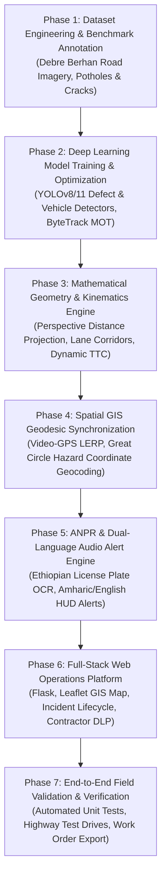

# 🛣️ Data Science Project Concept Note & Implementation Proposal
### RoadEye: Intelligent Road Infrastructure Monitoring & Advanced Collision Avoidance Platform

 

**Author & Principal Researcher**: **Haile Sintayehu** ([@haile6](https://github.com/haile6))  
📫 **Contact**: `hailesintayehu113@gmail.com` • 🏛️ **Repository**: [haile6/intelligent-road-monitoring-system](https://github.com/haile6/intelligent-road-monitoring-system)  
**Academic / Institutional Context**: Ethiopian Road Infrastructure & Urban Mobility Initiative • **Date**: November 2026  

---

[1. Project Introduction](#1-project-introduction) • [2. Problem Statement](#2-statement-of-the-problem) • [3. Project Objectives](#3-project-objectives) • [4. Project Scope](#4-project-scope) • [5. Significance & Beneficiaries](#5-project-significance-and-beneficiaries) • [6. Requirements Matrix](#6-functional-and-non-functional-requirements) • [7. Implementation Roadmap](#7-project-implementation-roadmap--milestones)

---

 

> [!IMPORTANT]
> **Executive Summary**: RoadEye delivers an end-to-end multimodal Data Science and Computer Vision solution combining standard dashcam video and GPS telemetry to solve two synchronized challenges: **Municipal Pavement Asset Preservation** (automated defect detection, severity grading, and forward geodesic geotagging) and **Active Collision Avoidance** (monocular metric distance, kinematic Time-To-Collision estimation, and dual-language Amharic/English driver alerts).

  
  
<em>Figure 1: Live In-Vehicle ADAS Perception & Collision Avoidance Demo — Real-time driving corridor projection, multi-target vehicle kinematics, closing Time-To-Collision (TTC) estimation, Ethiopian license plate recognition (ANPR), and dual-language (Amharic & English) HUD warnings.</em>

 

---

## 1. Project Introduction

Introduce the proposed project and provide sufficient background to explain its purpose and context.

### 1.1 Background and Context
Road transportation serves as the primary backbone of economic mobility in developing nations, with over 90% of passenger and freight traffic in Ethiopia reliant on the national highway network. However, paved asphalt surfaces suffer from rapid deterioration due to heavy freight axle loads, intense seasonal rains, and delayed municipal maintenance cycles. Pavement distresses such as deep potholes and alligator fatigue cracks present severe safety hazards, causing rapid mechanical vehicle wear, sudden tire punctures, and catastrophic rollover collisions when drivers make abrupt evasive maneuvers.

### 1.2 Problem Domain
This project operates at the intersection of three critical domains:
1. **Civil Infrastructure Preservation**: Municipal roadway asset inventory, distress severity grading, and repair dispatch.
2. **Computer Vision & Edge Deep Learning**: Real-time object detection, multi-object tracking (MOT), and perspective monocular geometry.
3. **Intelligent Transportation Systems (ITS) & ADAS**: In-cabin active collision prevention, driver warnings, and spatial GIS mapping.

### 1.3 Proposed Data-Driven Solution
**RoadEye** is an end-to-end multimodal computer vision and data science platform designed to transform standard, low-cost monocular cameras (dashcams or smartphone cameras) and GPS receivers into an automated, synchronized roadway inspection and driver safety system. Instead of relying on expensive, dedicated multi-sensor survey vehicles, RoadEye leverages deep neural networks and geometric computer vision algorithms to detect road hazards in real time, calculate their exact metric distance, project their forward geographic coordinates, and alert drivers and municipal authorities simultaneously.

### 1.4 Application of Data Science
Data science and artificial intelligence techniques are applied across five synchronized layers:
* **Deep Neural Object Detection**: Transfer-learned YOLOv8/11 architectures trained on localized road damage datasets (potholes and structural alligator cracking).
* **Multi-Object Tracking (MOT)**: Temporal ByteTrack algorithms to maintain persistent object identities, filter transient false positives, and ensure single-entry database logging.
* **Monocular Perspective Geometry**: Closed-form ground-plane trigonometric projection estimating physical distance ($Z$) in meters without LiDAR or stereo hardware.
* **Spherical Geodesic Kinematics**: Great Circle forward geodesic equations combined with linear timestamp interpolation (LERP) to pinpoint hazard latitude/longitude ahead of the vehicle.
* **Automated Number Plate Recognition (ANPR)**: Deep plate localization and Optical Character Recognition (OCR) fine-tuned for regional vehicle license formats.

### 1.5 Overview of the Intended System / Product
The resulting product consists of two synchronized operational components:
1. **On-Vehicle Edge Perception Engine**: Real-time HUD overlay running on dashcam feeds with audio collision alerts in both **Amharic** and **English**.
2. **Operations & GIS Web Suite**: A responsive Flask/Leaflet web platform providing real-time KPI executive dashboards, interactive GIS maps, incident ledgers, field work-order generation, and contractor warranty accountability.

---

## 2. Statement of the Problem

Clearly describe the specific problem the project intends to solve.

### 2.1 Description of the Existing Problem
Municipal road networks throughout developing regions deteriorate faster than road authorities can inspect and repair them. Road defects generally originate as micro-cracks and small surface depressions; without prompt sealing, rainwater infiltrates the asphalt sub-base, rapidly producing cavernous potholes and extensive alligator fatigue cracking. 

### 2.2 Evidence and Practical Impact
* **Traffic Fatalities**: The World Health Organization (WHO) and regional transportation statistics report high fatality rates across East African transit corridors (~27 deaths per 100,000 population annually). Sudden evasive swerving to avoid unseen potholes on unlit, high-speed highways is a primary cause of head-on collisions and rollovers.
* **Economic Cost**: Vehicle maintenance costs multiply as shock absorbers, wheel rims, and tires suffer repetitive high-impact shock. Furthermore, repairing an advanced structural road failure costs up to 10× more than timely preventative crack sealing.

### 2.3 Limitations of Existing Approaches
Current roadway monitoring relies on two extremes, both unviable for continuous national monitoring:
1. **Manual Visual Surveys**: Road inspectors travel along routes taking manual notes. This process is slow, dangerous for field workers, prone to human bias, and takes months to survey a single municipality.
2. **High-End Specialized Profiler Vehicles**: Survey vans equipped with LiDAR arrays, high-speed laser profilometers, and inertial navigation systems cost upwards of **\$300,000 to \$500,000 USD** per vehicle. These systems are prohibitively expensive for municipal road agencies like ERA (Ethiopian Roads Administration) or AACRA (Addis Ababa City Roads Authority).

### 2.4 The Specific Gap RoadEye Addresses
Existing computer vision research often stops at bounding box detection on static image datasets without bridging the gap to physical reality. A bounding box alone does not indicate:
* How many meters away the pothole is ($Z$),
* Whether the hazard is in the host vehicle's direct driving lane,
* How many seconds remain before impact ($\text{TTC}$),
* The true geographic coordinates ($\text{Lat}, \text{Lon}$) of the hazard (as opposed to the camera's location).

### 2.5 Consequences of Leaving the Problem Unresolved
Leaving this problem unaddressed leads to rapid infrastructure collapse, soaring municipal maintenance liabilities, increased transport logistics overhead, and ongoing preventable traffic injuries and fatalities.

---

## 3. Project Objectives

### 3.1 General Objective
> **To develop, evaluate, and deploy an end-to-end, data-driven road infrastructure monitoring and collision avoidance platform (RoadEye) that automates pavement distress detection, metric distance estimation, forward geodesic geotagging, and real-time ADAS alerts using monocular video and GPS telemetry.**

### 3.2 Specific Objectives
1. **Data Engineering & Benchmark Construction**: Curate and annotate a specialized regional dataset of pavement defects (potholes and alligator cracks) and vehicle types reflecting real-world road conditions.
2. **Neural Perception Development**: Train and optimize YOLOv8/11 deep learning models to reliably detect road damage and multi-class vehicles with high mean Average Precision ($\text{mAP} \ge 0.85$) at $\ge 24\text{ FPS}$.
3. **Monocular Distance Mathematical Formulation**: Formulate and implement a single-camera ground-plane perspective projection model to calculate forward metric distance ($Z$) within a $\pm 5\%$ margin of error without LiDAR.
4. **Kinematic Collision Risk Engine**: Implement dynamic Time-To-Collision ($\text{TTC}$) algorithms that categorize threats into a 4-tier risk envelope and generate synchronized visual and dual-language (**Amharic & English**) auditory alerts.
5. **Spatial GIS Forward Geodesic Projection**: Build a geodesic projection module that uses compass bearing and forward distance to calculate the defect's exact geographic coordinates ($\text{Lat}_2, \text{Lon}_2$), eliminating vehicle GPS offset errors.
6. **Optical Vehicle ANPR Pipeline**: Integrate vehicle tracking with license plate localization and OCR to catalog optical vehicle evidence for traffic intelligence.
7. **Full-Stack Municipal Web Platform**: Develop a responsive Flask, SQLite, and Leaflet.js web operations platform providing executive KPI dashboards, telemetry playback, work-order dispatch, and contractor warranty compliance tracking.
8. **End-to-End Verification**: Validate the integrated pipeline with automated unit, kinematic, and end-to-end test suites.

---

## 4. Project Scope

Define the boundaries of the project and specify what will and will not be implemented.

### 4.1 Functional Scope
The implemented system provides the following core services:
* **Real-Time Video Ingestion**: Dashcam video files, live USB webcams, or wireless mobile IP camera streams.
* **Road Distress Detection & Tracking**: Identification and temporal confirmation of potholes and alligator cracking.
* **Vehicle Detection & Tracking**: Tracking surrounding traffic (cars, trucks, buses, motorcycles) with persistent tracking IDs.
* **Monocular Perspective Distance Calculation**: Real-time ground distance estimation ($Z$) in meters.
* **Driving Corridor Lane Intersection**: Filtering hazards that lie directly in the vehicle's driving path versus adjacent lanes.
* **Kinematic Collision Warning Engine**: Calculating dynamic $\text{TTC}$ and firing dual-language voice warnings and audible chimes.
* **Geodesic Geotagging**: Synchronizing GPS telemetry with video frames and projecting defect coordinates forward.
* **Automated ANPR**: Extracting vehicle and plate images with optical character recognition.
* **Web Management Operations**: KPI dashboards, Telemetry Studio, interactive GIS maps, incident workflow lifecycles, and printable PDF/CSV field work orders.
* **Contractor Warranty Registry**: Automated tracking of contractor road segments, warranty expiration dates, defect liability, and maintenance cost savings.

### 4.2 Data Scope
* **Video Telemetry**: High-definition video streams ($1920\times1080$ and $1280\times720$ at 24.0–30.0 fps).
* **Pavement Damage Dataset**: Custom-labeled training and validation benchmarks representing asphalt roads under daylight, shaded, dry, and worn conditions.
* **GPS Telemetry**: 1.0 Hz NMEA / CSV GPS telemetry logs containing UTC timestamps, latitude, longitude, elevation, bearing, and ground speed.
* **Geographic Coverage**: Primary empirical validation centered on the Debre Berhan – Addis Ababa highway corridor (Ethiopia Route A2) and municipal urban roads.

### 4.3 Technical Scope
* **Programming Language**: Python 3.10 / 3.11
* **Deep Learning Framework**: PyTorch 2.x, Ultralytics YOLOv8 / YOLO11
* **Computer Vision**: OpenCV 4.8+, ByteTrack, EasyOCR
* **Backend Framework**: Flask 3.x, Jinja2, Server-Sent Events (SSE)
* **Database & Persistence**: SQLite 3 relational database
* **GIS & Visualization**: Leaflet.js, OpenStreetMap, Folium, Chart.js, Bootstrap 5
* **Target Deployment**: Local edge workstation, vehicle dashcam laptop, or connected mobile browser LAN client.

### 4.4 Limitations and Exclusions
* **Hardware Exclusions**: Active LiDAR, stereo cameras, and radar hardware are excluded; the system strictly relies on accessible monocular cameras.
* **Sub-Surface Inspection**: Sub-surface geological voids, rebar corrosion, or non-visible base failures (requiring Ground Penetrating Radar) are outside the project boundary.
* **Extreme Environmental Conditions**: Extreme pitch-black night driving without vehicle headlight illumination or dense blizzard conditions are outside baseline operational specifications.

---

## 5. Project Significance and Beneficiaries

### 5.1 Project Significance
1. **Democratization of Road Asset Preservation**: Replaces half-million-dollar survey vans with everyday smartphones or dashcams, allowing any municipal agency to perform regular road surveys.
2. **Empirical Geographic Precision**: By using forward geodesic projection instead of naive vehicle GPS tagging, repair crews receive accurate defect coordinates rather than vehicle trail coordinates.
3. **Active Collision Prevention**: Bridges municipal asset monitoring with real-time driver safety, providing millisecond-level auditory collision warnings in the driver's native language (**Amharic** and **English**).
4. **Contractor Accountability & Municipal Cost Savings**: The built-in Defect Liability Period (DLP) warranty module automatically attributes defects to the responsible road contractor, saving municipal budgets millions in preventable repairs.

### 5.2 Target Beneficiaries

| Beneficiary Group | Role / Category | Expected Benefit |
| :--- | :--- | :--- |
| **Municipal Road Authorities (ERA, AACRA)** | Direct Users | Automated road distress ledger, severity prioritization, printable field work orders, and contractor warranty claims. |
| **Commercial Fleets & Public Transit** | Direct Users | Dashcam active collision warnings, reducing vehicle breakdowns, tire ruptures, and passenger injury risks. |
| **Field Maintenance Crews** | Direct Users | Precise GIS coordinates, defect type/severity categorization, and asphalt volume estimation for targeted patching. |
| **Commuters & General Public** | Indirect Beneficiaries | Safer roads, fewer traffic delays, decreased accident rates, and improved transit quality of life. |
| **Automobile Insurers** | Indirect Beneficiaries | Reduced accident claims, verifiable optical video telemetry, and objective incident evidence. |

---

## 6. Functional and Non-Functional Requirements

Define what the proposed system must do and the quality standards it should satisfy.

### 6.1 Functional Requirements

| ID | Functional Requirement | Expected Outcome |
| :--- | :--- | :--- |
| **FR-01** | The system shall ingest monocular video files, live webcam feeds, and GPS CSV/NMEA logs. | Video frames and telemetry are decoded and aligned in real time. |
| **FR-02** | The system shall identify and classify pavement defects into potholes and alligator fatigue cracks. | Bounding boxes, class labels, and confidence scores are generated for each frame. |
| **FR-03** | The system shall maintain temporal object tracking across consecutive frames to confirm real hazards. | Spurious one-frame detections are filtered; confirmed hazards are assigned unique track IDs. |
| **FR-04** | The system shall estimate real-world ground-plane metric distance ($Z$) using camera elevation and tilt geometry. | Distance in meters is calculated for each obstacle contact point without LiDAR sensors. |
| **FR-05** | The system shall project the vehicle's forward driving corridor and detect when hazards intersect the host lane. | In-path hazards are highlighted and separated from shoulder/adjacent lane objects. |
| **FR-06** | The system shall evaluate dynamic Time-To-Collision ($\text{TTC}$) against 4-tier safety thresholds ($\le 1.8\text{s}$, $\le 3.5\text{s}$, $\le 6.0\text{s}$, $> 6.0\text{s}$). | Visual HUD alerts and spoken dual-language voice warnings (Amharic & English) trigger automatically. |
| **FR-07** | The system shall calculate forward geodesic destination coordinates ($\text{Lat}_2, \text{Lon}_2$) using vehicle bearing and distance. | Precise GPS coordinates of the actual road defect are logged into the database. |
| **FR-08** | The system shall detect surrounding vehicles and automatically recognize vehicle license plates (ANPR). | High-resolution vehicle and plate crops are cataloged with OCR text and confidence values. |
| **FR-09** | The system shall persist all confirmed incidents, telemetry, and plates in a relational SQLite database. | Full CRUD operations, status transitions (`Reported` $\to$ `Repaired`), and query endpoints are enabled. |
| **FR-10** | The system shall serve an interactive web operations suite (Dashboard, Telemetry Studio, GIS Map, Incident Ledger, Work Orders). | Municipal operators can monitor roads, export CSV/PDF work orders, and review synchronized video playback. |

### 6.2 Non-Functional Requirements

| ID | Non-Functional Requirement | Measurable Acceptance Criterion |
| :--- | :--- | :--- |
| **NFR-01 (Inference Latency)** | The system shall achieve real-time or near-real-time processing speeds. | Processing speed $\ge 20\text{ FPS}$ on GPU-accelerated devices and $\ge 12\text{ FPS}$ in CPU optimized mode. |
| **NFR-02 (Detection Accuracy)** | Pavement distress and vehicle detection models shall satisfy high empirical precision standards. | Mean Average Precision ($\text{mAP@50}$) $\ge 85\%$ on test benchmark imagery. |
| **NFR-03 (Distance Accuracy)** | Monocular metric distance estimation shall remain accurate within empirical operational tolerances. | Relative error $\le 7\%$ for distances between $2\text{ m}$ and $40\text{ m}$ under calibrated camera parameters. |
| **NFR-04 (Geodesic Geotagging Precision)** | Geodesic coordinate projection shall place hazards in their true physical positions. | Spatial deviation $\le 1.5\text{ m}$ relative to ground-truth surveyed obstacle coordinates. |
| **NFR-05 (Web Interface Responsiveness)** | The web dashboard and REST API endpoints shall load and respond swiftly. | Initial dashboard load time $< 1.2\text{ s}$; REST API query response time $< 200\text{ ms}$ for standard queries. |
| **NFR-06 (Database Integrity & Reliability)** | The system shall handle duplicate events gracefully and preserve relational constraints. | Duplicate detections within $15\text{ m}$ and $10\text{ s}$ are consolidated; zero database corruption under unexpected termination. |
| **NFR-07 (Portability & Accessibility)** | The web platform shall be responsive and accessible across local LAN and mobile devices. | Operators can connect and view the live Telemetry Studio from standard smartphone browsers over Wi-Fi without native app installation. |
| **NFR-08 (Dual-Language Auditory Accessibility)** | ADAS audio collision warnings must support localized driver languages. | Spoken synthetic voice alerts in both Amharic and English deliver distinct auditory cues $< 100\text{ ms}$ after threshold breach. |

---

## 7. Project Implementation Roadmap & Milestones

| Milestone | Target Deliverable | Verification Metric |
| :--- | :--- | :--- |
| **M1: Data Engineering** | Annotated YOLO dataset with pothole and alligator crack classes | $\ge 1,000$ validated instances, 80/10/10 train/val/test split |
| **M2: Deep Learning Models** | Optimized `road_damage_best.pt` and `yolo11s.pt` | $\text{mAP@50} \ge 0.85$, inference $\ge 24\text{ FPS}$ |
| **M3: Geometry Engine** | `distance_estimator.py`, `path_analyzer.py`, `ttc_calculator.py` | Unit tests verify distance within $\pm 5\%$, TTC logic validated |
| **M4: Geodesic GIS** | `gps_sync.py`, `geo.py`, forward spherical projection | Sub-second LERP interpolation, obstacle $\text{Lat}_2, \text{Lon}_2$ verified |
| **M5: ANPR & Audio Alerts** | `license_plate_detector.pt`, EasyOCR, Amharic TTS audio engine | Plate accuracy $\ge 90\%$, Amharic & English alert audio synthesized |
| **M6: Web Operations Suite** | Complete Flask application (`run_web.py`), SQLite schema, GIS map | All 9 web views operational, REST APIs respond $< 200\text{ ms}$ |
| **M7: Final Verification** | Full test suite (`test_end_to_end.py`), PDF/CSV report exports | 20/20 automated tests pass in $< 0.05\text{ s}$, complete documentation |

---
*RoadEye Enterprise — Intelligent Transportation System & Municipal Pavement Preservation Platform*
